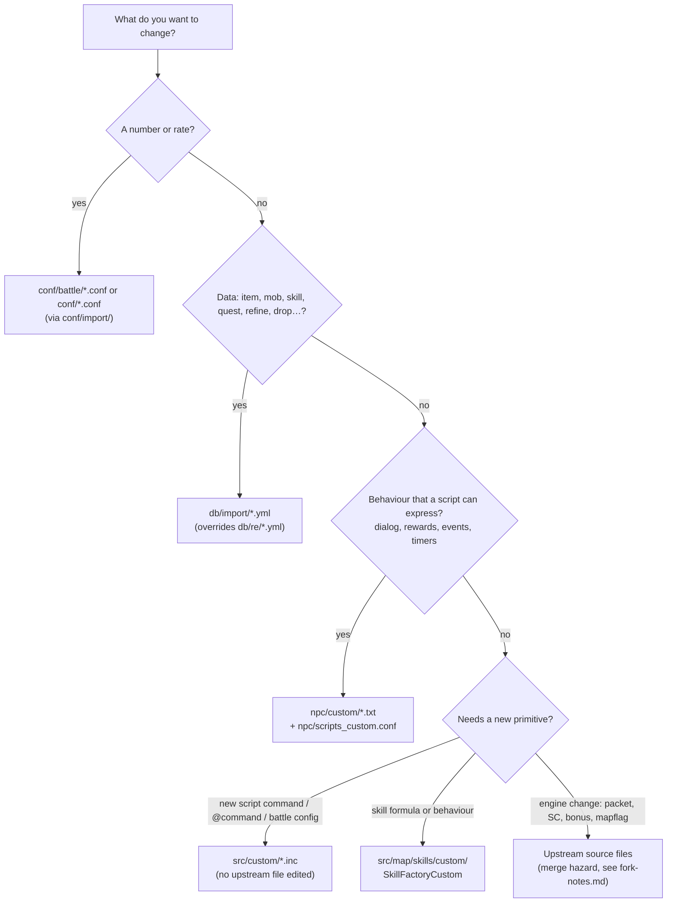

# Customization Guide

> Status: **Phase 6**. ✅ = verified in source · ⚠️ = inferred · ❓ = unknown.
> This guide collects the extension points from every other document. Each section says **where** to put a change, **what** to touch and **which doc** explains the internals. Start with §1 (choosing the layer), because most customisations never need C++.

## 1. Choose the lowest layer that works



| Layer | Rebuild? | Reload without restart? | Merge cost |
|---|---|---|---|
| `conf/import/*` | no | some (`@reloadbattleconf`) | none (gitignored) |
| `db/import/*.yml` | no | `@reloaditemdb`, `@reloadmobdb`, `@reloadskilldb`, `@reloadquestdb`… | none |
| `npc/custom/*.txt` | no | `@reloadscript`, `@loadnpc`/`@unloadnpc` | none |
| `src/custom/*.inc`, `skills/custom/` | **yes** | no | low (files are upstream stubs) |
| Core source | **yes** | no | high |

See [startup-and-initialization.md](startup-and-initialization.md) for what each `@reload*` command reinitialises.

## 2. Configuration overrides (`conf/import/`)

✅ `conf/import/` is generated from `conf/import-tmpl/` at build time (`CMakeLists.txt:516-518`) and is **gitignored** (`.gitignore:70-71`). The templates are: `battle_conf.txt`, `char_conf.txt`, `inter_conf.txt`, `login_conf.txt`, `map_conf.txt`, `log_conf.txt`, `packet_conf.txt`, `script_conf.txt`, `web_conf.txt`, `groups.yml`, `atcommands.yml`, `inter_server.yml`.

Each `*_athena.conf` ends with `import: conf/import/<x>_conf.txt`, and keys read later win. To change a rate without touching upstream files:

```
// conf/import/battle_conf.txt
base_exp_rate: 7000
job_exp_rate: 7000
item_rate_common: 5000
```

⚠️ This fork edits `conf/battle/*.conf` directly instead (see [fork-notes.md §6](fork-notes.md#6-merge-hazards-when-pulling-upstream-into-my-server)). Moving those values into `conf/import/` removes most merge conflicts.

## 3. Database overrides (`db/import/`)

✅ Root entry files (for example `db/item_db.yml`) chain `db/re/…` and then `db/import/…` through `Footer.Imports` ([database-architecture.md §4](database-architecture.md#4-yaml-database-framework)). An entry in `db/import/` with an existing key **merges into** the official one: only the fields you give are overwritten. A new key adds an entry.

| Want to… | File in `db/import/` | Internals |
|---|---|---|
| Add or modify items | `item_db.yml` | [gameplay/item-system.md](gameplay/item-system.md) |
| Item combos | `item_combos.yml` | item-system §5 |
| Cash shop | `item_cash.yml` | [gameplay/economy-systems.md](gameplay/economy-systems.md) |
| Monsters, drops, spawn-only stats | `mob_db.yml`, `mob_skill_db.txt`, `map_drops.yml` | [gameplay/monster-system.md](gameplay/monster-system.md) |
| Skill data (not formulas) | `skill_db.yml` | [gameplay/skill-system.md](gameplay/skill-system.md) |
| Refine chances and downgrade | `refine.yml` | item-system §7 |
| Level penalty | `level_penalty.yml` | monster-system §5 |
| Job stats, exp tables | `job_stats.yml`, `job_exp.yml` | [gameplay/character-system.md](gameplay/character-system.md) |
| Quests, achievements, instances, BG, attendance | `quest_db.yml`, `achievement_db.yml`, `instance_db.yml`, `battleground_db.yml`, `attendance.yml` | [gameplay/content-systems.md](gameplay/content-systems.md) |
| Pets, homunculi, mercenaries, elementals | `pet_db.yml`, `homunculus_db.yml`, `mercenary_db.yml`, `elemental_db.yml` | [gameplay/companions.md](gameplay/companions.md) |
| Castles, guild skills | `castle_db.yml`, `guild_skill_tree.yml` | [gameplay/social-systems.md](gameplay/social-systems.md) |
| Script constants | `const.yml` | [scripting-engine.md](scripting-engine.md) |

Rule of thumb: items, mobs and skills that the **client** must also know (sprites, names, descriptions) need matching client-side data (`itemInfo`, `iteminfo.lub`, `skillinfo`…). The server can't fix a missing client entry.

## 4. NPC scripts

- Put scripts in `npc/custom/` and list them in `npc/scripts_custom.conf` (`npc: npc/custom/my_npc.txt`).
- Use events instead of polling:
  - `OnPCLoginEvent`, `OnPCKillEvent`, `OnNPCKillEvent`, `OnPCDieEvent`
  - `OnClock<hhmm>`, `OnTimer<ms>`
  - `OnInit`, `OnInstanceInit`, `OnAgitStart`
  - The full list is in [gameplay/npc-system.md](gameplay/npc-system.md).
- Persist state in the right scope ([scripting-engine.md §5](scripting-engine.md)):
  - `$var`: server-wide (mapreg, saved).
  - `#var`: account, on char.
  - `##var`: global account, on login.
  - `var`: character.
  - `'var`: instance, **not saved**.
  - `.var`: NPC, not saved.
- Prefer `callfunc`/`function` libraries for shared logic. Duplicated NPCs (`duplicate(...)`) share the same compiled code.

## 5. C++ extension hooks that don't touch upstream files

All of these are empty stubs shipped by upstream. ✅ Include sites:

| Hook file | Included at | Format | Purpose |
|---|---|---|---|
| `src/custom/atcommand.inc` | `atcommand.cpp:11467` | `ACMD_FUNC(name){ … }` | Body of a new `@command` |
| `src/custom/atcommand_def.inc` | `atcommand.cpp:11483` | `ACMD_DEF(name),` | Registration. Permissions go in `conf/groups.yml` `Commands:` |
| `src/custom/script.inc` | `script.cpp:27878` | `BUILDIN_FUNC(name){ …; return SCRIPT_CMD_SUCCESS; }` | Body of a new script command |
| `src/custom/script_def.inc` | `script.cpp:28657` | `BUILDIN_DEF(name,"args"),` | Registration with argument signature (`i` int, `s` string, `v` var, `?` optional, `*` repeat) |
| `src/custom/battle_config_struct.inc` | `battle.hpp:785` | `int32 my_option;` | New `battle_config` member |
| `src/custom/battle_config_init.inc` | `battle.cpp:8912` | `{ "my_option", &battle_config.my_option, default, min, max },` | Name → member binding, read from `conf/battle/*.conf` |
| `src/custom/defines_pre.hpp` | before config headers | `#define …` | Compile switches that must exist before `config/*.hpp` (for example `PACKETVER`) |
| `src/custom/defines_post.hpp` | after config headers | `#undef` / `#define` | Override defaults decided by `config/*.hpp` |

### Worked example: a script command `getonlinecount()`

```cpp
// src/custom/script.inc
BUILDIN_FUNC(getonlinecount)
{
	script_pushint(st, map_getusers());
	return SCRIPT_CMD_SUCCESS;
}

// src/custom/script_def.inc
BUILDIN_DEF(getonlinecount,""),
```

Arguments start at `script_getnum(st, 2)` / `script_getstr(st, 2)` (index 2 is the first argument). Use `script_hasdata(st, n)` for optional arguments and `map_id2sd(st->rid)` for the attached player. See [scripting-engine.md §8](scripting-engine.md#8-adding-a-script-command).

### Worked example: a battle config switch

```cpp
// battle_config_struct.inc
int32 custom_pvp_bonus;
// battle_config_init.inc
{ "custom_pvp_bonus", &battle_config.custom_pvp_bonus, 0, 0, 1000, },
```

Then add `custom_pvp_bonus: 100` to `conf/import/battle_conf.txt` and read `battle_config.custom_pvp_bonus` anywhere in map code.

## 6. Skills: `SkillFactoryCustom`

✅ `SkillFactory` consults the custom factory **first**: `skills/skill_factory.cpp:18` includes `custom/skill_factory_custom.cpp`, and `:37` puts `SkillFactoryCustom` at the head of the factory list. Returning a non-null `SkillImpl` for a `skill_id` replaces the official implementation.

```cpp
// src/map/skills/custom/skill_factory_custom.cpp (the shipped example is behind #if 0)
std::unique_ptr<const SkillImpl> SkillFactoryCustom::create(const e_skill skill_id) const {
	switch( skill_id ){
		case SM_BASH: return std::make_unique<SkillCustomBash>();
		default:      return nullptr;   // fall through to the official factory
	}
}

class SkillCustomBash : public SkillBash {   // inherit and override only what changes
	void calculateSkillRatio(const Damage* wd, const block_list* src, const block_list* target,
	                         uint16 skill_lv, int32& base_skillratio, int32 mflag) const override {
		base_skillratio += 300 * skill_lv;   // official: 30 * skill_lv
	}
};
```

Overridable hooks (cast end, ratio, additional effects, unit behaviour) are listed in [gameplay/skill-system.md §9](gameplay/skill-system.md#9-customisation-guide). Skill **data** (SP cost, cast time, range, requirements) belongs in `db/import/skill_db.yml`, not in C++.

## 7. Core changes (upstream files): checklists

Use these only when §2–§6 can't do the job. Each item lists every place that must change together.

### New status change (SC)

1. Add `SC_MYEFFECT` to `enum sc_type` (`status.hpp:233`), before `SC_MAX`.
2. Export it: `export_constant(SC_MYEFFECT);` in `script_constants.hpp` (near `:985`).
3. Define it in `db/(re/)status.yml`: icon, `CalcFlags` (`SCB_*`), flags, `EndOnStart` and so on.
4. Apply the stat effect in the matching `status_calc_*` function for the flagged `SCB_*`.
5. Add any start, end or tick logic in `status_change_start` / `status_change_end` / `status_change_timer`.
6. If it must be saved across logout, check the `NoSave` flag in `status.yml`.

Pipeline: [gameplay/status-system.md](gameplay/status-system.md).

### New item bonus (`bonus bMyBonus,x;`)

1. Add `SP_MYBONUS` to the `_sp` enum (`map.hpp`).
2. Export it: `export_constant2("bMyBonus",SP_MYBONUS);` in `script_constants.hpp` (beside `bMaxHP`, `:615`).
3. Add a field to `map_session_data` (`bonus` / `indexed_bonus` structs, `pc.hpp`).
4. Add a `case SP_MYBONUS:` in `pc_bonus` (`pc.cpp:3725`), or `pc_bonus2` (`:4498`) for two arguments, honouring `sd->state.lr_flag` (left hand, arrows).
5. Use the field in battle or status code. It's reset on every `status_calc_pc`, because item scripts re-run each time ([gameplay/status-system.md §3](gameplay/status-system.md)).
6. Document it in `doc/item_bonus.txt`.

### New mapflag

1. Add `MF_MYFLAG` to `enum e_mapflag` (`map.hpp:614`), before `MF_MAX` (`:698`).
2. Export it: `export_constant(MF_MYFLAG);` (`script_constants.hpp`, near `:460`). `map_getmapflag_by_name` (`map.cpp:4633`) resolves `"myflag"` → `MF_MYFLAG` through the constant table, so `npc/mapflag/*.txt` and `setmapflag` work without further parsing code ✅.
3. Read it with `map_getmapflag(m, MF_MYFLAG)` or `mapdata->getMapFlag(MF_MYFLAG)`.
4. Flags with arguments need a `case` in `map_setmapflag_sub` (`map.cpp:4730`), like the existing `MF_RESTRICTED` (`:4870`) and `MF_SKILL_DAMAGE` (`:4960`) ✅.

### New packet

See [packet-system.md §7](packet-system.md#7-how-to-add-a-packet): the struct in `packets.hpp`, the id in `clif_packetdb.hpp` gated by `PACKETVER`, and the handler in `clif.cpp`. For server-to-server packets see [inter-server.md §5](inter-server.md#5-adding-an-inter-packet).

### New YAML database

See [database-architecture.md §4 "Adding a new YAML database"](database-architecture.md#adding-a-new-yaml-database): a `TypesafeYamlDatabase<K,V>` subclass with `getDefaultLocation` and `parseBodyNode` (and optionally `loadingFinished`), a global instance, a `.load()` call in the owning module's `do_init_*`, and an entry file under `db/` plus `db/import-tmpl/`.

### New persistent character field

You must change all of the following in step. Missing one causes silent data loss or crashes:

1. Field in `mmo_charstatus` (`common/mmo.hpp`).
2. Column in `sql-files/main.sql` plus an upgrade script in `sql-files/upgrades/`.
3. Load in `char_mmo_char_fromsql` and save in `char_mmo_char_tosql` (diffed against `char_db`; [database-architecture.md §6](database-architecture.md#6-character-persistence)).
4. `mmo_charstatus` is sent whole between char and map, so both servers must be rebuilt.

Prefer **registry variables** (`char_reg_num`) for anything a script can manage. They need no schema change.

## 8. Safety rules for any C++ change

| Rule | Why | Doc |
|---|---|---|
| Never free a `block_list` during `map_foreach*`; use `map_freeblock_lock/unlock` (or `FreeBlockLock`) around code that can kill units | Deferred deletion | [memory-management.md §4](memory-management.md) |
| Never block the main loop (sleep, synchronous HTTP, long SQL) | Every server is a single-threaded reactor | [threading-and-concurrency.md](threading-and-concurrency.md) |
| Move items "add first, delete on success", with an `e_log_pick_type` | Anti-dupe, logging | [gameplay/economy-systems.md §3](gameplay/economy-systems.md) |
| Use `pc_payzeny`/`pc_getzeny`, `status_damage`/`status_heal`, `pc_setpos` | They keep client, logs and side effects consistent | — |
| Re-check pointers after anything that can run a script or kill a unit (`npc_event`, `status_damage`, `skill_attack`) | The object may be gone | [scripting-engine.md](scripting-engine.md) |
| Reset new per-life mob state in `mob_spawn` | `mob_data` is reused on respawn | [gameplay/monster-system.md](gameplay/monster-system.md) |
| Gate client-visible changes by `PACKETVER` | The client must understand the packet | [packet-system.md](packet-system.md) |
| Keep shared structs byte-identical across servers | Inter-server packets `memcpy` packed structs | [inter-server.md](inter-server.md) |

## 9. Quick lookup: "I want to…"

| Goal | Layer | Where |
|---|---|---|
| Change exp/drop rates | conf | `conf/import/battle_conf.txt` (`exp.conf`, `drops.conf` keys) |
| Give a GM command to a group | conf | `conf/import/groups.yml` `Commands:` |
| Add a custom item | db + client | `db/import/item_db.yml` + client item data |
| Make a monster drop something | db | `db/import/mob_db.yml` `Drops`, or `map_drops.yml` for map-wide |
| Change a skill's damage formula | C++ (custom) | `SkillFactoryCustom` |
| Change a skill's SP, cast time or range | db | `db/import/skill_db.yml` |
| Custom warper, healer or event | script | `npc/custom/` |
| Daily login reward | db | `db/import/attendance.yml` |
| Change the WoE schedule | script | `npc/guild/agit_controller.txt` |
| New `@command` | C++ (custom) | `src/custom/atcommand*.inc` |
| New script command | C++ (custom) | `src/custom/script*.inc` |
| Change refine break or downgrade | db | `db/import/refine.yml` |
| New status effect or item bonus | core | §7 checklists |
