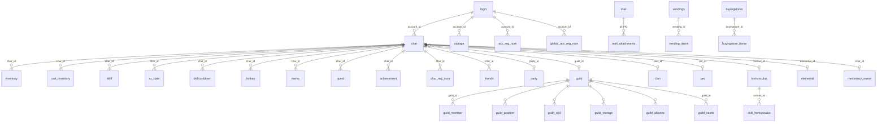
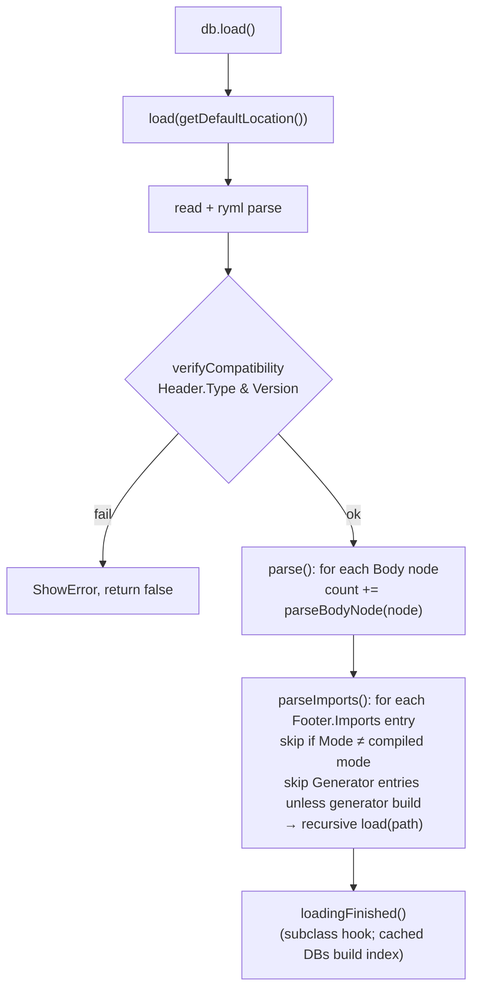
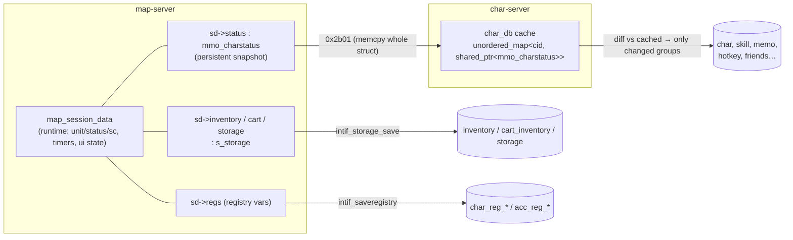

# Database and Data Management

> Status: **Phase 2**. ✅ = verified in source · ⚠️ = inferred · ❓ = unknown.

rAthena has two very different data stores:

| Store | Holds | Loaded by | Mutability |
|---|---|---|---|
| **YAML / TXT files** in `db/`, `conf/`, `npc/` | Static game definitions: items, monsters, skills, jobs, quests, refine tables… | `YamlDatabase` subclasses (plus a few legacy TXT readers) at startup or `@reload*` | Read-only at runtime |
| **MySQL** (`sql-files/main.sql`, `logs.sql`, `web.sql`) | Mutable player and world state: accounts, characters, items, guilds, variables… and logs | `Sql_*` / `SqlStmt` queries | Read/write |

## 1. SQL connection layout

✅ Every server builds its connections from `conf/inter_athena.conf`. Each logical database has its own host/port/user/password/schema keys (`login_server_*`, `ipban_db_*`, `char_server_*`, `map_server_*`, `web_server_*`, `log_db_*`). In this checkout they all point to the schema `ragnarok` on `localhost`.

| Server | Handle(s) | Used for |
|---|---|---|
| login | `accounts` engine → `Sql*` (`account.cpp:126`), ipban, loginlog | `login`, `ipbanlist`, `loginlog`, `global_acc_reg_*` |
| char | `sql_handle` (global in `char.cpp`) | Almost every player table |
| map | `mmysql_handle` (`map.cpp:66`) | `mapreg`, vending/buyingstore persistence, market/barter, sales, roulette, … |
| map | `qsmysql_handle` (`map.cpp:67`) | Script `query_sql` (kept separate so script queries don't clobber result sets) |
| map | `logmysql_handle` (`map.cpp:102`) | `logs.sql` tables (`log.cpp`), only when `log_config.sql_logs` |
| web | per-category handles behind `SQLLock` | `web.sql` tables + reads of login/char tables |

Table names come from configuration, not literals: char uses `schema_config.<name>_db` (34 configurable names, `struct Schema_Config`, `char.hpp:63`), and map/web have equivalents. **Always use the configured table-name variable in new queries.**

`use_sql_db: no` (`inter_athena.conf:176`) means item, mob and mob-skill DBs come from YAML/TXT, not from the `item_db*`/`mob_db*` SQL tables. Those SQL files are generated by `yaml2sql`, mainly for external tools.

## 2. The SQL wrapper (`src/common/sql.*`)

✅ Two APIs:

**Plain queries** (C style, printf-formatted):

```cpp
if( SQL_ERROR == Sql_Query(sql_handle, "SELECT `char_id` FROM `%s` WHERE `account_id`='%d'", schema_config.char_db, aid) ){
    Sql_ShowDebug(sql_handle); return;
}
while( SQL_SUCCESS == Sql_NextRow(sql_handle) ){
    char* data; Sql_GetData(sql_handle, 0, &data, nullptr); ...
}
Sql_FreeResult(sql_handle);
```

- `Sql_Query`/`Sql_QueryV`/`Sql_QueryStr` (`sql.cpp:246+`), `Sql_NextRow`, `Sql_GetData`, `Sql_NumRows`, `Sql_NumRowsAffected`, `Sql_LastInsertId`, `Sql_FreeResult`.
- **Strings must be escaped** with `Sql_EscapeString` / `Sql_EscapeStringLen` before being interpolated. Forgetting this is the main SQL-injection risk in this style.
- `Sql_ShowDebug(h)` logs the failing query together with the source file and line.

**Prepared statements** (`class SqlStmt`, `sql.hpp:243`):

```cpp
SqlStmt stmt{ *sql_handle };
if( SQL_ERROR == stmt.Prepare("SELECT `id`,`nameid` FROM `%s` WHERE `char_id`=?", table)
 || SQL_ERROR == stmt.BindParam(0, SQLDT_INT32, &char_id, 0)
 || SQL_ERROR == stmt.Execute()
 || SQL_ERROR == stmt.BindColumn(0, SQLDT_INT32, &id) ... ){
    SqlStmt_ShowDebug(stmt); ...
}
while( SQL_SUCCESS == stmt.NextRow() ){ ... }
```

Prepared statements are used heavily in char (`char.cpp`, `int_*`), map `log.cpp`, `storage.cpp`, `npc.cpp`, `mapreg.cpp`, and login `account.cpp` (✅ `grep SqlStmt`). They are the recommended style for user-supplied values.

**Keepalive**: `Sql_P_KeepaliveTimer` exists (`sql.cpp:189`), but its registration is commented out (`sql.cpp:217`). ⚠️ Whether reconnection depends on the MySQL client's auto-reconnect has not been checked.

**Transactions are rare** (✅ only `char_clif.cpp:113-120` for character slot moves, `int_mail.cpp:89-153`, `account.cpp:350`/`:575`). Most tables are **MyISAM**, which ignores transactions anyway. Only `bonus_script`, `mail` and `mail_attachments` are InnoDB, and `mail_attachments` carries the schema's **single foreign key** (to `mail.id`). Consistency therefore depends on application logic and save ordering, not on the database.

## 3. Schema overview

✅ `sql-files/main.sql` defines 56 tables. Relationships are **implicit**: they follow id columns, with no FK constraints.



Table groups:

| Group | Tables | Owner |
|---|---|---|
| Accounts | `login`, `ipbanlist`, `global_acc_reg_num/str` (login-wide vars `##`), `acc_reg_num/str` (`#` vars) | login (+char via relay) |
| Character core | `char`, `skill`, `sc_data`, `skillcooldown`, `hotkey`, `memo`, `friends`, `char_reg_num/str`, `bonus_script`, `charlog` | char |
| Items | `inventory`, `cart_inventory`, `storage` (and extra storages from `inter_server.yml`), `guild_storage`, `guild_storage_log` | char. Rows are keyed by an auto-increment `id`, items have a `unique_id` |
| Social | `party`, `guild`, `guild_member`, `guild_position`, `guild_skill`, `guild_alliance`, `guild_expulsion`, `guild_castle`, `clan`, `clan_alliance` | char `int_*` |
| Companions | `pet`, `homunculus`, `skill_homunculus`, `skillcooldown_homunculus`, `mercenary`, `mercenary_owner`, `skillcooldown_mercenary`, `elemental` | char `int_*` |
| Content | `quest`, `achievement`, `party_bookings` | char / web |
| Mail & auction | `mail`, `mail_attachments`, `auction` | char |
| World / shops (map-owned) | `mapreg` (`$` vars), `vendings`, `vending_items`, `buyingstores`, `buyingstore_items`, `market`, `barter`, `sales`, `db_roulette` | **map** (direct SQL) |
| Ops | `interlog` | char |

Schema upgrades live in `sql-files/upgrades/` (dated files). Apply every file dated after your last import. The servers do not migrate the schema themselves; char can only *check* that tables exist (`char_checkdb`).

## 4. YAML database framework

✅ `src/common/database.hpp` / `database.cpp`.

### File format

```yaml
Header:
  Type: SKILL_DB        # must match the class's type string
  Version: 4            # must be ≥ minimumVersion and ≤ version supported by code
Body:
  - Id: 1
    Name: NV_BASIC
    ...
Footer:
  Imports:
    - Path: db/pre-re/skill_db.yml
      Mode: Prerenewal
    - Path: db/re/skill_db.yml
      Mode: Renewal
    - Path: db/import/skill_db.yml
```

### Load algorithm



- `Mode` is compared with the compiled mode: `Renewal`, or `Prerenewal` (`database.cpp:~150-160`). One special case: in a RENEWAL build **without** `RENEWAL_ASPD`, any import whose path contains `job_aspd.yml` is loaded as `Prerenewal` (✅ `database.cpp:200-204`).
- **Later files override earlier ones.** `parseBodyNode` implementations generally `find()` an existing entry by key and update only the fields present in the node. That is what makes `db/import/*.yml` work as partial overrides. ⚠️ Each subclass implements this itself, so it is not guaranteed for every DB.
- `parseBodyNode` returns 1 to count the entry and 0 to skip it. Problems are reported with `invalidWarning(node, fmt, …)`, which prints the file, line and column.
- Typed helpers: `asBool`, `asInt16..asUInt64`, `asFloat`, `asDouble`, `asString`, `asUInt16Rate`/`asUInt32Rate` (rates out of 10000), `nodeExists`, `nodesExist`.
- `reload()` = `clear()` + `load()`.

### Container classes

| Class | Storage | Lookup |
|---|---|---|
| `TypesafeYamlDatabase<K,V>` | `std::unordered_map<K, std::shared_ptr<V>> data` | `find(k)` (map lookup), `exists`, `put`, `erase`, `size`, `begin`/`end`, `random()` (`database.hpp:137`) |
| `TypesafeCachedYamlDatabase<K,V>` | the same, plus `std::vector<std::shared_ptr<V>> cache` | `find(k)` indexes `cache[calculateCacheKey(k)]` when `k < cache.size()`, otherwise falls back to the map |

`TypesafeCachedYamlDatabase::loadingFinished` (`database.hpp:~196-225`) sizes the vector to `max key + 1` and fills it. `calculateCacheKey` can be overridden to compress sparse keys. Note: `find` compares the raw `key` with `cache.size()` but indexes with `calculateCacheKey(key)`. That is only consistent when the transform is monotonic and ≤ key; ⚠️ check this for any DB that overrides it (e.g. `SkillDatabase`). Cached DBs: `ItemDatabase`, `ItemGroupDatabase`, `JobDatabase`, `PlayerStatPointDatabase`, `SkillDatabase`, `StatusDatabase`, `MobDatabase`.

### Adding a new YAML database

```cpp
// foo.hpp
struct s_foo { uint32 id; std::string name; int32 value; };
class FooDatabase : public TypesafeYamlDatabase<uint32, s_foo> {
public:
    FooDatabase() : TypesafeYamlDatabase("FOO_DB", 1) {}
    const std::string getDefaultLocation() override;          // e.g. std::string(db_path) + "/foo_db.yml"
    uint64 parseBodyNode(const ryml::NodeRef& node) override;
};
extern FooDatabase foo_db;

// foo.cpp
uint64 FooDatabase::parseBodyNode(const ryml::NodeRef& node){
    uint32 id;
    if( !this->asUInt32(node, "Id", id) ) return 0;
    std::shared_ptr<s_foo> entry = this->find(id);
    bool exists = entry != nullptr;
    if( !exists ){ entry = std::make_shared<s_foo>(); entry->id = id; }
    if( this->nodeExists(node, "Name") ){ if( !this->asString(node, "Name", entry->name) ) return 0; }
    else if( !exists ) entry->name = "";
    ...
    if( !exists ) this->put(id, entry);
    return 1;
}
```

Then call `foo_db.load()` from your `do_init_*`, `foo_db.clear()` from `do_final_*`, and optionally wire up an `@reload` command. Add `db/foo_db.yml` with a Header/Footer chain, and `db/import-tmpl/foo_db.yml`.

### Legacy TXT loaders

A few DBs are still CSV-style TXT, loaded with `sv_readdb` (✅ `strlib.cpp:887`) (`skill_changematerial_db.txt`, `skill_damage_db.txt`, `status_disabled.txt`, `re/mob_skill_db.txt`, `re/produce_db.txt`, `re/skill_nocast_db.txt`, `re/item_noequip.txt`, `re/job_noenter_map.txt`). These will be catalogued in phase 4.

## 5. Other configuration loaders

| Format | Reader | Examples |
|---|---|---|
| `key: value` `.conf` with `import:` lines | per-server `*_config_read` functions using `sscanf("%[^:]: %[^\r\n]")` ⚠️ pattern | `conf/*_athena.conf`, `conf/battle/*.conf` (`battle_config_read`, `battle.cpp:9158`) |
| libconfig | `src/common/conf.cpp` | `conf/channels.conf` (✅ `config_setting_lookup_*` in `channel.cpp:1335+`) |
| YAML | `YamlDatabase` | `conf/groups.yml`, `conf/atcommands.yml`, `conf/inter_server.yml` |
| NPC script files | `npc_parsesrcfile` | `npc/**/*.txt` (see scripting-engine, phase 3) |

`battle_config` is a big struct (`battle.hpp`). Each `.conf` key maps to a field through a table in `battle.cpp` with min/max bounds. Custom keys go in through `src/custom/battle_config_struct.inc` / `battle_config_init.inc`.

## 6. Character persistence

### Runtime ↔ persistent model



### When is a character saved?

✅ Triggers:

1. **Autosave** — `pc_autosave` (`pc.cpp:13002`) saves **one** player per run, with `chrif_save(sd, CSAVE_INVENTORY|CSAVE_CART)`. It then reschedules itself at `autosave_interval / (users + 1)`, but never sooner than `minsave_interval`. So each player is saved roughly every `autosave_time` seconds however many players are online. Config (`conf/map_athena.conf`): `autosave_time: 300`, `minsave_time: 100` (ms), `save_settings: 4095`.
2. **Event saves**, controlled by the `save_settings` bitmask (`map.hpp:1121-1132`): `CHARSAVE_TRADE` 0x001, `VENDING` 0x002, `STORAGE` 0x004, `PET` 0x008, `MAIL` 0x010, `AUCTION` 0x020, `QUEST` 0x040, `BANK` 0x080, `ATTENDANCE` 0x100. `4095` = `CHARSAVE_ALL`, so every event triggers a save.
3. **Map change / quit** — `map_quit` → `pc_makesavestatus` → `chrif_save(sd, CSAVE_QUIT|CSAVE_INVENTORY|CSAVE_CART)` (`map.cpp:~2303-2304`). Changing map-server uses `CSAVE_CHANGE_MAPSERV` (0x02). `CSAVE_QUITTING` = `QUIT|CHANGE_MAPSERV|AUTOTRADE` (✅ `chrif.hpp:22-26`).
4. **Crash** — `MapServer::handle_crash` tries a final `map_foreachpc(map_abort_sub)` (see startup doc).

### What `chrif_save` sends (`chrif.cpp:277`)

1. `pc_makesavestatus(sd)` copies runtime state (position, HP/SP, options…) into `sd->status`.
2. If quitting: SC data (`chrif_save_scdata`), skill cooldowns, and `chrif_auth_logout` (marks the auth node as logging out).
3. Bonus-script data (`chrif_bsdata_save`).
4. Storage, if `sd->storage.dirty` (`storage_storagesave`). Inventory and cart via `intif_storage_save` when the flags ask for them. Guild storage, if open. Premium storage, if dirty.
5. Registry variables, if `sd->vars_dirty` (`intif_saveregistry`).
6. **`0x2b01`** with the whole `mmo_charstatus` `memcpy`'d in (`chrif.cpp:~315-323`), with a byte flag set when quitting.
7. Pet / homunculus / mercenary / elemental saves when present.

### What char does with it

- `chmapif_parse_reqsavechar` (`char_mapif.cpp`, case `0x2b01` at `:1423`) copies the struct out and calls **`char_mmo_char_tosql(cid, &char_dat)`** (`char.cpp:257`).
- `char_mmo_char_tosql` **diffs against the cached copy** in `char_db` (`char.cpp:83`) and only writes the groups that changed: base/status fields (an `UPDATE char …`), "status2" (appearance/family/fame…), mercenary-related fields, memo (delete + insert), skills (delete + insert), friends, hotkeys, and so on. It prints which groups were saved ("Saved char … : status skills …") ⚠️ when save logging is enabled.
- Items: **`char_memitemdata_to_sql`** (`char.cpp:533`) diffs the in-memory item array against the rows in the table. It `UPDATE`s changed rows matched by `id`, `DELETE`s rows that are gone, and `INSERT`s new items. The same function serves inventory, cart, storage and guild storage (`int_storage.cpp:29-97`).
- On a quit save, char replies **`0x2b21`** (`chrif_save_ack`, `chrif.cpp:418`). The map-server then deletes the auth node and destroys `map_session_data`.

### Consistency notes

- **Crash-loss window**: anything since the player's last save. The autosave interval is about 300 s per player; with `save_settings: 4095`, trades, storage changes and so on also save immediately.
- **Item duplication risk** comes from non-atomic multi-table saves (MyISAM, no transactions). The design leans on careful ordering and on `unique_id`.
- **`mmo_charstatus` layout must match** between map and char. It is checked at auth time (`chrif_authok`, `chrif.cpp:~661`).

## 7. Global and registry variables (summary)

| Prefix | Scope | Stored in | Saved by |
|---|---|---|---|
| `$var` | server-wide | `mapreg` table (map-owned) | `mapreg.cpp`, dirty flag + `script_autosave_mapreg` every 300 s (`MAPREG_AUTOSAVE_INTERVAL`, `mapreg.cpp:28`, `:341`) |
| `var` (no prefix) | character, permanent | `char_reg_num/str` | `intif_saveregistry` → char |
| `#var` | account (this char-server) | `acc_reg_num/str` | intif → char |
| `##var` | account (global, across char-servers) | `global_acc_reg_num/str` | intif → char → login (`0x2728`) |
| `@var`, `.var`, `.@var`, `'var`, `$@var` | temporary | memory only | — |

Details of the script side come in phase 3 (`scripting-engine.md`).

## 8. Caching summary

| Cache | Where | Invalidation |
|---|---|---|
| YAML DB entries (`shared_ptr`) and index vector | every `*Database` instance | `@reload*` → `clear()` + `load()` |
| Raw `item_data*` per inventory slot | `map_session_data::inventory_data[]` (`pc.hpp:492`) | `pc_setinventorydata` (also run by `itemdb_reload`) |
| Last saved character | char `char_db` | Overwritten on every save; used for diffing |
| Online characters / auth nodes | char `online_char_db`, `auth_db`; map `auth_db` (`chrif.cpp`) | Login/logout flows, cleanup timers (`auth_db_cleanup` 30 s, `char_online_data_cleanup` 10 min) |
| Name cache | map `nick_db` | Lookups requested through char ⚠️ |
| Mapreg values | `regs.vars` (i64db) + `mapreg_dirty` | Flushed to SQL every 300 s and on shutdown |
