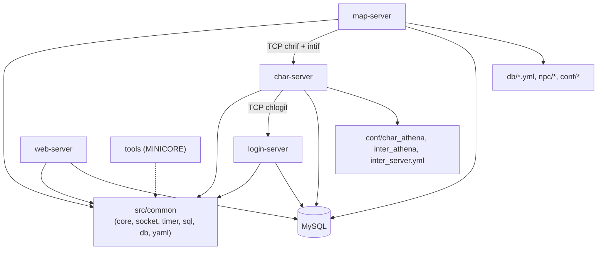
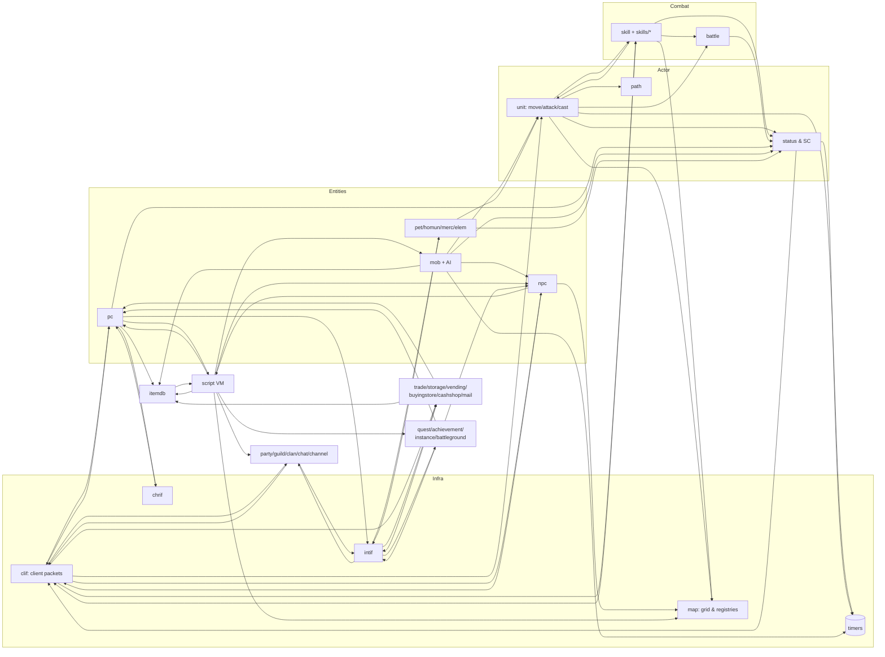

# Initial Dependency Map

> Status: **Discovery pass**. Built from (a) server init order, (b) the `#include "x.hpp"` graph of every `src/map/*.cpp` (generated by grep), and (c) the packet links between servers.
>
> Caveat: direct include counts *understate* coupling because headers include each other (e.g. `pc.hpp` pulls in `status.hpp`, `unit.hpp`, `skill.hpp` transitively ⚠️). Call-level dependency tracing is scheduled per subsystem.

## 1. Process-level dependencies

Startup order for a working cluster: **login → char → map(s)**; web is independent. ✅ Char reconnects to login via the 10 s interval timer `chlogif_check_connect_logserver` (`char_logif.cpp:808`, registered `:847-848`); map reconnects to char via `check_connect_char_server` (`chrif.cpp:1855`, first scheduled `:1507`).

## 2. Map-server module coupling (direct includes)

How many other `src/map/*.cpp` files directly include each header:

| Header | Included by (of 43) | Interpretation |
|---|---|---|
| `pc.hpp` | 38 | Player object is the universal hub |
| `clif.hpp` | 35 | Almost every system sends packets itself |
| `battle.hpp` | 34 | Mostly for `battle_config` (global runtime config struct) |
| `npc.hpp` | 25 | Events/scripts triggered from many systems |
| `map.hpp` | 24 | Block grid, object lookup |
| `intif.hpp` | 24 | Anything persistent/shared goes via char |
| `mob.hpp` | 21 | |
| `itemdb.hpp` | 18 | |
| `chrif.hpp` | 17 | |
| `script.hpp` | 11 | |
| `status.hpp` | 8 (direct) | much higher transitively |
| `unit.hpp` | 4 (direct) | much higher transitively |
| `skill.hpp` | 3 (direct) | much higher transitively |

"God files" — include nearly everything: `clif.cpp`, `pc.cpp`, `script.cpp`, `atcommand.cpp`, `map.cpp`, `skill.cpp`, `unit.cpp`, `status.cpp`. ✅ There are **circular dependencies** at the module level (e.g. `pc ↔ clif`, `pc ↔ status`, `skill ↔ battle ↔ status`, `npc ↔ script`, `pc ↔ party`, `intif ↔ guild/party/storage`); the C-style free-function design relies on headers with forward declarations to make this compile.

## 3. Logical subsystem dependency graph (map-server)

Notes (✅ unless marked):

- **Item scripts run on the script VM**: item `Script`, `EquipScript`, `UnEquipScript` are compiled by `script.cpp` (✅ `parse_script` calls in `itemdb.cpp:1071`, `:1088`, `:1105`) and executed during `status_calc_pc_` (bonuses). Thus `itemdb → script → pc_bonus → status` is a central loop.
- **Skills dispatch through `SkillImpl`** when present, else legacy `switch` in `skill.cpp`/`battle.cpp`.
- **`battle_config`** (struct in `battle.hpp`, values from `conf/battle/*.conf`) is read by most modules — a global runtime config, not a battle-only dependency.
- **SQL from map** is direct (no char round-trip) for `mapreg`, logs, vending/buyingstore persistence, market/barter, and script `query_sql` (`qsmysql_handle`).

## 4. Init-order dependencies

From `MapServer::initialize` (`map.cpp:5419-5450`): `script` is initialized before `itemdb` (item scripts need the compiler), `itemdb` before `skill`/`mob`/`pc` (they reference items), `status` after `pc` and `skill`, and `npc` near the end (NPC scripts reference items, mobs, skills, maps). `npc_event_do_oninit` runs only after everything is loaded. ⚠️ Any new subsystem's `do_init_*` must be placed respecting these data dependencies.

## 5. Cross-server data ownership

| Data | Owner (authoritative writer) | Map-server access |
|---|---|---|
| Accounts, passwords, bans | login (`login` table) | none (via char) |
| Characters, inventory, cart, skills, SC, hotkeys, memos | char (`char_mmo_char_tosql`) | cached in `map_session_data`, saved via `chrif_save` |
| Storage, guild storage | char `int_storage` | intif |
| Party, guild, clan, alliances | char `int_party/int_guild/int_clan` | cached; changes via intif |
| Mail, auctions | char | intif |
| Account/char registry vars | char `inter` (`*_reg_*` tables) | intif (`intif_saveregistry`) |
| Global `$` variables | **map** (`mapreg` table, `mapreg.cpp`) | direct SQL |
| Logs | **map** (`logs.sql` tables) | direct SQL |
| Vending/buying stores (autotrade persistence) | **map** | direct SQL via `mmysql_handle` (✅ e.g. `vending.cpp:63`, `:233`) |
| Web configs, emblems, party booking | web (`web.sql`) | ❓ |

⚠️ Running multiple map-servers: since `mapreg` and some store data are written by map directly, multi-map setups need care — to investigate.
