# Combat System (damage calculation)

> Status: **Phase 4**. ✅ = verified in source · ⚠️ = inferred · ❓ = unknown.
> Main file: `src/map/battle.cpp` (9.2k lines), `src/map/battle.hpp`. Data: `db/<mode>/attr_fix.yml`, `size_fix.yml`, `conf/battle/*.conf`.
> The skill execution pipeline that calls into this is described in [skill-system.md](skill-system.md). SC effects on stats are covered in [status-system.md](status-system.md).

## 1. Purpose

`battle.cpp` does three things:

1. **Damage calculation**: `battle_calc_attack(type, src, target, skill_id, skill_lv, flag)` returns a `Damage` record, with no side effects except a few SC triggers.
2. **Normal (auto) attacks**: `battle_weapon_attack(src, target, tick, flag)` does the calculation, display, and delayed application, plus autospell, double attack and similar triggers.
3. **Targeting rules and global runtime config**: `battle_check_target(src, target, BCT_*)`, plus the `battle_config` struct with its 631 `conf/battle/*.conf` keys (`battle_data[]`, `battle.cpp:8246`).

Renewal and pre-renewal formulas differ substantially. Large parts of the file are inside `#ifdef RENEWAL` (334 `#ifdef RENEWAL` blocks across the map `.cpp` files). This fork builds **Renewal**.

## 2. The `Damage` record

✅ `struct Damage` (`battle.hpp:90`):

| Field | Meaning |
|---|---|
| `statusAtk`, `weaponAtk`, `equipAtk`, `masteryAtk`, `percentAtk` (+ `…2` for the left hand) | **RE only**: the separate ATK components that make up a hit |
| `basedamage` | **Pre-RE only** |
| `damage`, `damage2` | Final right-hand / left-hand damage |
| `type` (`e_damage_type`) | Client display type: normal, critical, multi-hit, endure… |
| `div_` | Number of hits (negative = display as one hit ⚠️) |
| `amotion`, `dmotion` | Attacker animation delay / target flinch time |
| `blewcount` | Knockback cells |
| `flag` (`e_battle_flag`) | `BF_WEAPON`/`BF_MAGIC`/`BF_MISC` \| `BF_SHORT`/`BF_LONG` \| `BF_SKILL`/`BF_NORMAL` |
| `miscflag` | Pass-through flags from the caller |
| `dmg_lv` | `ATK_NONE`, `ATK_MISS`, `ATK_BLOCK`, `ATK_DEF`, `ATK_FLEE`, `ATK_LUCKY` (perfect dodge) |
| `isspdamage` | Show as SP damage (blue numbers) |

Arithmetic helper macros (`battle.cpp:3550-3558`) apply to **both hands** when the attack is left-handed:

| Macro | Effect |
|---|---|
| `ATK_RATE(d, d2, r)` | `d = d * r / 100` |
| `ATK_ADDRATE(d, d2, r)` | `d += d * r / 100` |
| `ATK_ADD(d, d2, v)` | `d += v` |
| `ATK_RATER(d, r)` | `d = d * r / 100`, one hand only |

## 3. Calculation entry point

✅ `battle_calc_attack` (`battle.cpp:6753`) dispatches on the attack type:

| `attack_type` | Function | Used for |
|---|---|---|
| `BF_WEAPON` | `battle_calc_weapon_attack` (`:5387`) | Normal attacks, physical skills |
| `BF_MAGIC` | `battle_calc_magic_attack` (`:5801`) | Magic skills |
| `BF_MISC` | `battle_calc_misc_attack` (`:6290`) | Fixed or special damage (traps, Acid Demonstration-type, …) |

Afterwards, a total of `< 1` becomes a miss (`ATK_MISS`, `dmotion = 0`). Weapon Blocking triggers here (`:6767-6780`).

## 4. Weapon damage pipeline (Renewal)

✅ The order inside `battle_calc_weapon_attack`. Offsets are from `battle.cpp:5387`.

```mermaid
flowchart TD
    A["initialize_weapon_data<br/>(flags, amotion/dmotion, div_, range type)"] --> A2["SkillImpl::modifyDamageData (+23)"]
    A2 --> B["weapon element per hand: battle_get_weapon_element (+26)<br/>→ SkillImpl::modifyElement"]
    B --> C["battle_calc_multi_attack (+47)<br/>double attack, triple attack, multi-hit…"]
    C --> D{"is_attack_critical (+50)?"}
    D --> E{"is_attack_hitting (+64)<br/>HIT vs FLEE, perfect dodge,<br/>SkillImpl::modifyHitRate"}
    E -- miss --> MISS[return with dmg_lv=ATK_FLEE]
    E -- hit --> F["base damage: battle_calc_skill_base_damage (+70/+75)<br/>status ATK + weapon ATK (+ size fix, variance) + equip ATK"]
    F --> G["skill ratio: ATK_RATE(battle_calc_attack_skill_ratio) (+79)<br/>→ SkillImpl::calculateSkillRatio (battle.cpp:4469)"]
    G --> H["constant additions: battle_calc_skill_constant_addition (+82)"]
    H --> I["card/equip modifiers per component: battle_calc_cardfix (+110-131)<br/>race/size/element/class % bonuses (attacker side)"]
    I --> J["SC damage bonuses: battle_attack_sc_bonus (+136)"]
    J --> K["masteries (battle_calc_attack_masteries)"]
    K --> L["DEF: battle_calc_defense_reduction (+239)<br/>then battle_calc_attack_post_defense (+241)"]
    L --> M["element: battle_calc_element_damage (+257)<br/>attr_fix.yml table (battle_attr_fix, :511)"]
    M --> N["critical bonus damage (+260)"]
    N --> O["target-side card reductions: battle_calc_cardfix (defender)"]
    O --> P["battle_apply_div_fix (+~512) / plant special case"]
    P --> Q["left/right hand split: battle_calc_attack_left_right_hands"]
    Q --> R["GvG/BG/PK + defensive SCs: battle_calc_attack_gvg_bg → battle_calc_damage (:1668)"]
    R --> S["final modifiers: battle_calc_weapon_final_atk_modifiers"]
    S --> T["battle_absorb_damage, battle_do_reflect"]
    T --> U[return wd]
```

Key component functions:

| Function | Line | Role |
|---|---|---|
| `battle_calc_base_weapon_attack` | `:2443` | Weapon ATK with variance and over-refine |
| `battle_calc_base_damage` | `:2515` | Pre-RE base |
| `battle_calc_sizefix` | `:2427` | `size_fix.yml` weapon-type × size % (ignored for some weapons/bonuses) |
| `battle_calc_equip_attack` | `:3431` | Equipment ATK |
| `battle_calc_attack_masteries` | `:3781` | Weapon-mastery flat ATK (not multiplied by the skill ratio in RE) |
| `battle_calc_damage_parts` | `:3889` | RE component assembly |
| `battle_calc_skill_base_damage` | `:3963` | |
| `is_attack_critical` / `is_attack_hitting` | `:3017` / `:3228` | Crit chance (LUK, crit bonuses, katar…); HIT vs FLEE, `agi_penalty_*` for multiple attackers |
| `battle_calc_defense_reduction` | `:4720` | Hard DEF (✅ RE: `Damage = Attack * (4000+eDEF)/(4000+eDEF*10) - sDEF`, per the comment and code at `battle.cpp:~4857-4862`; pre-RE subtracts DEF directly), soft DEF (VIT, `vit_penalty_*` for multiple attackers), DEF-ignoring bonuses (`bDefRatioAtk*`, `NK_IGNOREDEFENSE`) |
| `battle_calc_cardfix` | `:769` | One routine for attacker and defender card/equipment %: `addrace`, `addsize`, `addele`, `addclass`, `subrace`, `subele`, `subsize`, … (`left` param 0–3 selects attacker/defender and hand). `battle_calc_cardfix_debuff` (`:725`) |
| `battle_calc_element_damage` | `:3645` | Uses `battle_attr_fix(src, target, dmg, atk_elem, def_ele, def_lv, flag)` (`:511`) with the `attr_fix.yml` matrix (`AttributeDatabase`) |
| `battle_min_damage` | `:3578` | Floors |

Magic (`:5801`) follows the same skeleton: MATK range (min/max), skill ratio (`impl->calculateSkillRatio`, `:5983`), cardfix for magic, MDEF reduction, element, `battle_calc_damage`. Misc damage (`:6290`) skips most of the attacker-side modifiers.

### Defensive layer: `battle_calc_damage`

✅ `battle_calc_damage(src, bl, d, damage, skill_id, skill_lv)` (`battle.cpp:1668`) runs per hand from `battle_calc_attack_gvg_bg` (`:5102`, which calls `battle_calc_damage` at `:5129-5144`). It applies:

- target-side SC reductions and immunities: Safety Wall, Pneuma, Kyrie Eleison, Auto Guard, Parry, Energy Coat, Steel Body, Rejection Sword, Millennium Shield, …
- map restrictions (`battle_calc_gvg_damage` `:2183`, `battle_calc_bg_damage` `:2108`, `battle_calc_pk_damage` `:2220`, `skill_damage` mapflag adjustments)
- damage-cap special cases

## 5. Normal attacks

### 5.1 Auto-attack loop

✅ The client attack request → `unit_attack(src, target_id, continuous)` (`unit.cpp:2902`), which sets `ud->target`. Then `unit_attack_timer` (`:3354`) → `unit_attack_timer_sub` (`:3187`):

1. Re-validate the target: `battle_check_target(src, target, BCT_ENEMY)`, `status_check_skilluse`, not casting, `canact_tick` (`+37-53`).
2. Out of range → walk toward the target (`unit_walktobl`). The client-style range check is `check_distance_client_bl` (`+74`).
3. When ready: `battle_weapon_attack(src, target, tick, 0)`, then reschedule `ud->attacktimer = add_timer(attackabletime = tick + adelay, unit_attack_timer, …)` (`+61`). Monsters branch to `mob_ai_sub_hard_attacktimer` (`+29`).

**ASPD**: `status.amotion`/`adelay` come from `status_calc_bl_main` (`SCB_ASPD`), using `job_aspd.yml` base values and ASPD modifiers. The time between swings is `adelay`.

### 5.2 `battle_weapon_attack`

✅ `battle.cpp:7133`:

1. Block checks: Auto Counter, Blade Stop, Sacrifice, Spell Fist and others. They can return `ATK_BLOCK`/`ATK_MISS` and display a miss (`+13-177`).
2. `wd = battle_calc_attack(BF_WEAPON, src, target, 0, 0, flag)` (`+208`).
3. `clif_damage(src, target, tick, amotion, dmotion, damage, div_, type, damage2, isspdamage)` (`+267`).
4. Counter effects: `skill_counter_additional_effect`, then **`battle_delay_damage(tick, amotion, …)`** (`+303-305`, `battle.cpp:414`). The HP loss is applied after `amotion` through a `delay_damage` entry (from `delay_damage_ers`) and a timer that finally calls `battle_damage` (`:319`) → `status_fix_damage` / `status_damage`.
5. Devotion redirect, Shadow Form / Watery Evasion-type redirects (`+330-360`).
6. **Autospell** (`bAutoSpell` from cards): runs `skill_castend_pos2` / `nodamage_id` / `damage_id` directly and sets `canact_tick` (`+370-390`). Autobonus (`autobonus`/`autobonus2`/`autobonus3` script commands) is triggered from `skill.cpp`'s additional-effect paths through `pc_exeautobonus` (`skill.cpp:1667`, `:1879`, `:1914`).
7. Drain HP/SP (`battle_drain`), reflection (`battle_calc_return_damage`, `:6806`), Duple Light extra hits.

`battle_fix_damage(src, target, damage, div_, skill_id)` (`:494`) applies damage immediately, without the animation delay.

## 6. Targeting rules

✅ `battle_check_target(src, target, flag)` (`battle.cpp:7869`) returns `1` (valid), `0` (not valid), or `-1` (invalid, stop). `flag` is a combination of `BCT_*` (`battle.hpp:62-79`):

| Flag | Value |
|---|---|
| `BCT_NOONE` | `0x000000` |
| `BCT_SELF` | `0x010000` |
| `BCT_ENEMY` | `0x020000` |
| `BCT_PARTY` | `0x040000` |
| `BCT_GUILDALLY` | `0x080000` (allies only, not guildmates) |
| `BCT_NEUTRAL` | `0x100000` |
| `BCT_SAMEGUILD` | `0x200000` |
| `BCT_ALL` | `0x3F0000` |
| `BCT_WOS` | `0x400000` (except self and your master) |
| Derived | `BCT_GUILD`, `BCT_NOGUILD`, `BCT_NOPARTY`, `BCT_NOENEMY`, `BCT_FRIEND` |

The function resolves "who is the real owner" (pets, summons, skill units, homunculi map to their master), then decides enemy/ally from:

- map type (PvP, GvG, battleground; `pk_mode`)
- party, guild, alliance and BG team
- duels
- `MD_*` monster modes (passive, ignore)
- invincibility and hidden states

This one function is what makes the same skill behave differently in towns, PvP, WoE and battlegrounds.

## 7. Configuration (`battle_config`)

✅ `struct Battle_Config` (`battle.hpp`, extendable with `src/custom/battle_config_struct.inc` at `battle.hpp:785`). Values come from `conf/battle_athena.conf` → `conf/battle/*.conf` through `battle_config_read` (`battle.cpp:9158`). The table `battle_data[]` (`:8246`) holds `{ name, &field, default, min, max }` for each key (631 entries). Custom keys go in `src/custom/battle_config_init.inc` (`battle.cpp:8912`). `@reloadbattleconf` re-reads it (startup doc §7).

Combat-relevant files:

| File | Covers |
|---|---|
| `battle/battle.conf` | min/max damage, `agi_penalty_*`, `vit_penalty_*`, `delay_dependon_*`, PvP/GvG damage rates |
| `battle/skill.conf` | |
| `battle/player.conf` | |
| `battle/monster.conf` | |
| `battle/status.conf` | |
| `battle/items.conf` | |
| `battle/drops.conf` / `exp.conf` | **modified in this fork** |

## 8. Dependencies

- **Uses**: status (battle status, SCs), skill (DB properties `nk`, element, `impl` hooks, autospell), pc (bonus tables, equipment, masteries), mob (modes, damage log through `mob_damage`), map (mapflags, cells), party/guild/battleground (targeting), path (range, LoS), clif (`clif_damage`), unit (attack timers, `canact`).
- **Used by**: skill (`skill_attack`), unit (auto-attack), mob/homunculus/mercenary/elemental AI, pet skills, script (`battle_check_target`-style checks in commands ⚠️), status (`battle_config` everywhere).

## 9. Customisation guide

| Goal | Where |
|---|---|
| Global damage tuning (PvP/GvG rates, min damage, penalties) | `conf/battle/battle.conf` (via `conf/import/battle_conf.txt`) |
| Element or size tables | `db/import/attr_fix.yml`, `size_fix.yml` |
| One skill's damage formula | Its `SkillImpl::calculateSkillRatio` (`src/map/skills/...`), or the legacy `battle_calc_attack_skill_ratio` case (`battle.cpp:4407`) for skills not yet migrated |
| A new card/equipment % modifier | New `bonus` type (`pc_bonus*`, item-system) + read it in `battle_calc_cardfix` or the relevant stage |
| A new defensive SC | Reduction in `battle_calc_damage` (`:1668`) + SC definition (status-system) |
| Who can hit whom | `battle_check_target` (`:7869`). High blast radius: affects every skill and attack |
| Custom battle config key | `src/custom/battle_config_struct.inc` + `battle_config_init.inc`, then read `battle_config.my_key` |

Pitfalls:

- Keep **RE/pre-RE parity** in mind. Many functions have two code paths, and a change in one may need its counterpart.
- `battle_calc_*` must stay **side-effect free**. The same calculation is used for previews and for simulations such as reflect and Duple Light. Put side effects in `battle_weapon_attack`, `skill_attack` or `SkillImpl::applyAdditionalEffects`.
- Damage is applied after a delay (`battle_delay_damage`). Code that runs after `battle_weapon_attack` must not assume the target has already lost HP or died.
- Integer overflow: components are `int64`, but many bonus fields are `int32`/`int16`. Clamp when adding large multipliers.
