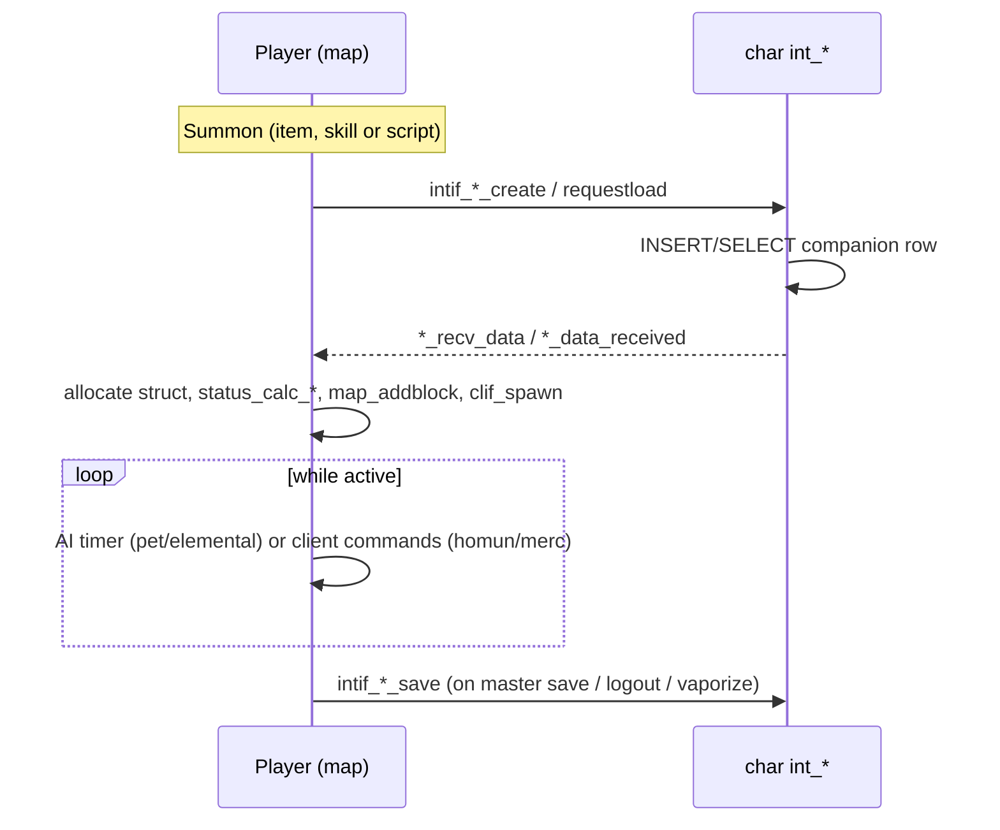

# Companions (pet, homunculus, mercenary, elemental)

> Status: **Phase 5**. ✅ = verified in source · ⚠️ = inferred · ❓ = unknown.
> Main files: `src/map/pet.cpp`, `homunculus.cpp`, `mercenary.cpp`, `elemental.cpp` (+ `.hpp`); client control in `clif.cpp` (`clif_parse_Hom*`). Char side: `src/char/int_pet.cpp`, `int_homun.cpp`, `int_mercenary.cpp`, `int_elemental.cpp`. Data: `db/re/pet_db.yml`, `homunculus_db.yml`, `exp_homun.yml`, `mercenary_db.yml`, `elemental_db.yml`; battle config `conf/battle/pet.conf`, `homunc.conf`.
> Read first: [status-system.md](status-system.md), [map-and-movement.md](map-and-movement.md) (`unit_data`).

## 1. Common shape

All four are `block_list` subclasses owned by a player (`master`). Each has a `unit_data ud` (so it moves and attacks through `unit_*`) and a `masterteleport_timer` (warp back to the master when too far away).

| | Pet | Homunculus | Mercenary | Elemental |
|---|---|---|---|---|
| Struct | `pet_data` (`pet.hpp:184`) | `homun_data` (`homunculus.hpp:87`) | `s_mercenary_data` (`mercenary.hpp:41`) | `s_elemental_data` (`elemental.hpp:76`) |
| `bl.type` | `BL_PET` (0x004) | `BL_HOM` (0x008) | `BL_MER` (0x010) | `BL_ELEM` (0x200) (`map.hpp:296-303`) |
| In `BL_CHAR`? (can be hit) | ❌ no (`map.hpp:309`) | ✅ | ✅ | ✅ |
| Pointer on master | `sd->pd` | `sd->hd` | `sd->md` | `sd->ed` |
| Status | single `status` (no `status_change`) | `base_status` + `battle_status` + `sc` + `regen` | same as homun | same as homun |
| Persistent struct | `s_pet` | `s_homunculus` | `s_mercenary` | `s_elemental` |
| SQL | `pet` | `homunculus`, `skill_homunculus` | `mercenary`, `mercenary_owner` (faith/calls per guild) | `elemental` |
| Link to owner | Egg item: `card[0]=CARD0_PET`, `card[1..2]` = pet id, `card[3]` = name flag + intimacy grade (`pet.cpp:1397-1400`, `:653-655`) | `sd->status.hom_id` | `sd->status.mer_id` | `sd->status.ele_id` |
| Who drives the AI | **Server**: `pet_ai_hard` every 100 ms (`MIN_PETTHINKTIME`, `pet.cpp:41`) | **Client** (`AI.lua`): server executes `clif_parse_HomMoveTo`/`HomAttack`/`HomMoveToMaster` (`clif.cpp:15697-15770`) | **Client** (same packets, `sd->md` branch) | **Server**: `elemental_ai_timer` every 100 ms (`MIN_ELETHINKTIME`, `elemental.hpp:14`, `elemental.cpp:659`) |
| Lifetime | Permanent (until intimacy reaches 0) | Permanent (can be vaporized, killed, or deleted) | `contract_timer` → `merc_contract_end` (`mercenary.cpp:265`) | `summon_timer` (`elemental_get_lifetime`, `:141`) |
| Database class | `PetDatabase` | `HomunculusDatabase` + `HomExpDatabase` | `MercenaryDatabase` (`mercenary.hpp:61`) | `ElementalDatabase` (`elemental.hpp:96`) |

## 2. Pet

- **Capture**:
  1. A taming item (`pet_catch_process_start`, `pet.cpp:1214`) opens the client's target UI.
  2. `pet_catch_process_end` (`:1241`) checks the target mob against `pet_db` (`CaptureRate`, `TameItem`) and rolls.
  3. On success it asks char to create the pet (`intif_create_pet`), and `pet_get_egg` (`:1368`) gives an egg item that encodes the pet id.
  - `pet_catchprocesses` is a per-char `unordered_map` holding the in-progress capture.
  - FIXME in source (`:1267`): a delay-consume taming item isn't deleted here.
- **Hatch**: `pet_select_egg` (`:1185`) reads the pet id from the egg cards → `intif_request_petdata` → `pet_recv_petdata` (`:1130`) → `pet_birth_process` (`:1077`) → `pet_data_init` (`:982`) builds `pet_data`, sets `sd->pd` and starts the hunger timer.
- **Return to egg**: `pet_return_egg` (`:952`) saves the pet, recreates the egg (with the intimacy grade in `card[3]`) and frees the struct.
- **Hunger and intimacy**: the `pet_hungry` timer (`:830`) lowers `hungry` by `Fullness`. If the pet is starving it lowers intimacy by `HungryIntimacyDecrease`. `pet_food` (`:1634`) feeds it and adjusts intimacy by hunger level. `pet_set_intimate` (`:639`) clamps the value, rewrites the egg's intimacy grade in `card[3]` and recalculates the master's bonuses. ✅ **At intimacy 0 the egg item itself is deleted** (`pc_delitem`, `pet.cpp:649-650`), so the pet is gone.
- **AI** (`pet_ai_sub_hard`, `:1753`): follows the master, random-walks, attacks the master's target if the pet has attack skills (`pet_attackskill`, `:708`), and loots items (`pet_ai_sub_hard_lootsearch`, `:1915`) into `pd->loot`, which is returned to the master later (`pet_lootitem_drop`, `:1973`).
- **Bonuses**: `pet_db.yml` `Script` (owner bonus, compiled script) and `SupportScript`. Recovery, heal and skill support timers (`pet_recovery_timer`, `pet_heal_timer`, `pet_skill_support_timer`). Pet autobonuses (`pet_addautobonus`, `:2367`). Support skills need intimacy ≥ `pet_support_min_friendly` (default 900, `battle.cpp:8360`).
- **Evolution**: `pet_evolution_requirements_check` (`:2215`) → `pet_evolution` (`:2247`). Requirements come from `pet_db.yml` `Evolution`.
- **Equipment**: a single accessory (`pet_equipitem`, `:1523`).

## 3. Homunculus

- **Creation**: `hom_create_request` (`homunculus.cpp:1242`) from the Alchemist skill `AM_CALLHOMUN` with an embryo. `hom_call` (`:1114`) either requests the saved homun from char (`intif_homunculus_requestload`) or re-spawns a vaporized one. `hom_recv_data` (`:1175`) → `hom_alloc` (`:1042`) → `hom_init_timers` (`:1098`).
- **States** (`s_homunculus.vaporize`): `HOM_ST_ACTIVE`, `HOM_ST_REST` (vaporized, `hom_vaporize`, `:259`), `HOM_ST_MORPH` (mid-mutation). Death is `hom_dead` (`:234`). Resurrection is `hom_ressurect` (`:1288`). Deletion is `hom_delete` (`:297`, when intimacy hits 0 or by script).
- **Classes** (`homunculus.hpp:103-117`): `HOM_REG`, `HOM_EVO` (evolved, via `hom_evolution`, `:595` → `evo_class`), `HOM_S` (Homunculus S, via `hom_mutate`, `:653`). `hom_class2mapid` (`:158`) maps classes to these ids.
- **Exp**:
  - In **Renewal** the homun gets `base_exp × homunculus_exp_gain%` from every kill its master is credited for (`mob.cpp:3201-3203`).
  - Pre-renewal only credits kills tagged `MDLF_HOMUN` in the damage log.
  - `hom_gainexp` (`:704`) → `hom_levelup` (`:483`) rolls stat growth from `homunculus_db.yml` (min/max per stat).
- **Skills**: the skill tree is per class in `homunculus_db.yml` (`hom_calc_skilltree`, `:361`), with an evolution requirement (`hom_calc_skilltree_sub`, `:319`). `hom_skillup` (`:448`) spends skill points. Skills go through the normal skill pipeline with `BL_HOM` as caster.
- **Hunger and intimacy**: `hom_hungry` timer (`:928`), `hom_food` (`:872`), `hom_increase/decrease_intimacy` (`:755`/`:774`). Grades are mapped in `hom_get_intimacy_grade` (`:1470`).
- **Save**: `hom_save` (`:805`) copies hp/sp → `intif_homunculus_requestsave`. It's called on master save, vaporize and logout.

## 4. Mercenary

- **Hire**: by item script (`mercenary_create`, `mercenary.cpp:56`, from the `mercenary_create` script command with a lifetime). The char-side `mercenary` row holds hp/sp and `life_time`. `mercenary_recv_data` (`:351`) spawns it and arms `contract_timer` (`merc_contract_init`, `:338`).
- **Guild loyalty**: three mercenary guilds (archer, spear, sword; `mercenary_get_guild`, `:98`). `faith` and `calls` per guild are stored in `mercenary_owner` (`int_mercenary.cpp:22-49`).
  - `mercenary_delete(md, reply)` (`:291`) adjusts faith: +1 when the contract ends normally, −1 when the mercenary dies or is fired.
  - `mercenary_killbonus` (`:453`) applies kill-count rewards.
- **AI**: client-side. The server only validates and executes commands.

## 5. Elemental (Sorcerer spirits)

- **Summon**: Sorcerer `SO_SUMMON_*` skills → `elemental_create` (`elemental.cpp:42`) → char → `elemental_data_received` (`:227`). Its lifetime is `summon_timer`. The elemental drains master SP (`last_spdrain_time`).
- **Modes**: passive, defensive, offensive (`elemental_change_mode`, `:416`). The mode changes which skills `elemental_action` (`:302`) uses.
- **AI**: server-side `elemental_ai_sub_timer` (`:541`) searches for targets (`elemental_ai_sub_timer_activesearch`, `:511`). Only elementals whose master is near a client are processed (`elemental_ai_sub_foreachclient`, `:651`).
- **Skill requirements** come from `elemental_skill_get_requirements` (`:479`). `elemental_skillnotok` (`:464`) gates skill use.

## 6. Interactions with other systems

- **Combat**: homun, merc and elemental are full combat units (`BL_CHAR`). `battle_get_master` resolves them to the player for target checks and kill credit. Pets are not targetable.
- **Status**: `status_calc_homunculus_`, `status_calc_mercenary_`, `status_calc_elemental_` (see [status-system.md](status-system.md)). The pet uses a simplified `status_calc_pet_` (`status.cpp:3068`).
- **Warp**: `pc_setpos` moves companions with the master (`unit_remove_map` + re-add on the new map). On a map-server change they're saved first.
- **Logout**: `unit_free` on the player frees every companion (`unit.cpp:3893` onward). A companion's own `unit_free` saves it, or deletes the char row when the mercenary or elemental expired (`intif_mercenary_delete` `:4171`, `intif_elemental_delete` `:4195`).

## 7. Extension points

| Want to… | Where |
|---|---|
| Add a tameable pet | `db/re/pet_db.yml` (+ egg item, taming item, accessory in item DB) |
| Change pet hunger/intimacy rates | `pet_db.yml` per pet; `conf/battle/pet.conf` |
| Add a homunculus class | `homunculus_db.yml` + `homun_mapid` enum + client sprite. Skills via `SkillImpl` like any skill |
| Change homun exp share | `homunculus_exp_gain` in `conf/battle/homunc.conf` |
| Add a mercenary | `mercenary_db.yml` + item script calling `mercenary_create` |
| Change an elemental's behaviour | `elemental_db.yml` (stats, mode skills) + `elemental_action` |
