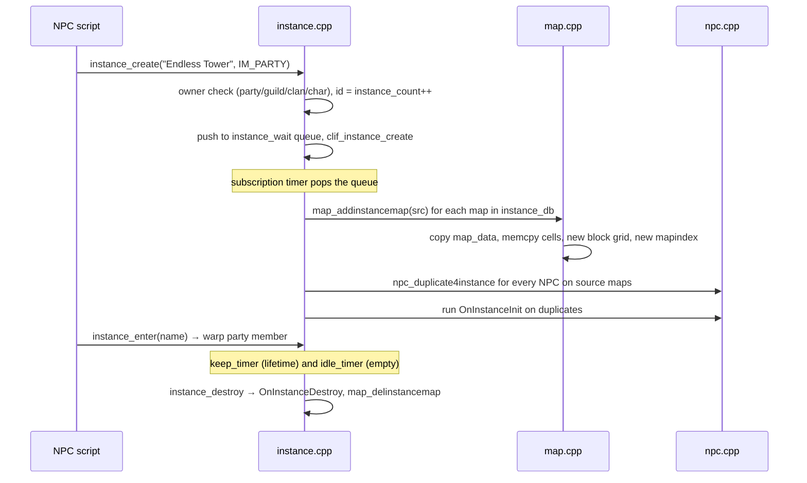

# Content Systems (quests, achievements, instances, battlegrounds, attendance, reputation)

> Status: **Phase 5**. ✅ = verified in source · ⚠️ = inferred · ❓ = unknown.
> Main files: `src/map/quest.cpp`, `achievement.cpp`, `instance.cpp`, `battleground.cpp`, `pc.cpp` (attendance, reputation). Char side: `src/char/int_quest.cpp`, `int_achievement.cpp`. Data: `db/(re/)quest_db.yml`, `achievement_db.yml`, `achievement_level_db.yml`, `instance_db.yml`, `battleground_db.yml`, `attendance.yml`, `reputation.yml`, `reputation_group.yml`.
> Read first: [npc-system.md](npc-system.md), [../scripting-engine.md](../scripting-engine.md). All of these systems are **driven by scripts**; the C++ provides state, persistence and client packets.

## 1. Summary

| System | Runtime state | Persistence | Main trigger |
|---|---|---|---|
| Quest | `sd->quest_log[]` (`s_quest`: id, `time`, `count[]`, `state`), `sd->num_quests`, `sd->avail_quests`, `sd->save_quest` | char `int_quest.cpp` → SQL `quest` | Scripts (`setquest`, `completequest`, `erasequest`, `checkquest`); mob kills |
| Achievement | `sd->achievement_data` (list, level, `save` flag) | char `int_achievement.cpp` → SQL `achievement` | Hard-coded hooks `achievement_update_objective` in 12 files (34 call sites); scripts |
| Instance | `instances` map of `s_instance_data` (`instance.hpp:61`), cloned maps and NPCs | **None**: in memory on one map-server | Scripts (`instance_create`, `instance_enter`) |
| Battleground | `s_battleground_data` (`battleground.hpp:26`), queues `s_battleground_queue` (`:60`) | None (rewards through scripts) | Client BG queue UI or scripts; NPC events |
| Attendance | account registry `#AttendanceDate`, `#AttendanceCounter` (`pc.hpp:64-65`) | Account registry (char) | Client attendance UI |
| Reputation | one registry variable per reputation (`s_reputation.variable`, `pc.hpp:1298`) | Registry | Scripts (`set/get/add_reputation_points`, `script.cpp:28626-28629`) |

Saving: `chrif_save` sends quests when `sd->save_quest` and achievements when `sd->achievement_data.save` (`chrif.cpp:338-341`), together with the companions.

## 2. Quests

- **Definition**: `QuestDatabase` (`quest.cpp:34` → `quest_db.yml`). Each quest has a `TimeLimit` (relative seconds or an exact time of day, parsed by `split_exact_quest_time`, `:449`), `Targets` (objectives: mob id, or a filter by race, size, element, level range and map), and `Drops` (quest-only item drops from the listed mobs).
- **API**:
  - `quest_add` (`:590`) adds a quest, sets its expiry (`quest_time`, `:554`) and marks `save_quest`.
  - `quest_change` (`:636`) swaps one quest for another.
  - `quest_delete` (`:685`) removes it.
  - `quest_update_status` (`:849`) moves it through `Q_INACTIVE` / `Q_ACTIVE` / `Q_COMPLETE`.
  - `quest_check` (`:898`) is the script query (`HAVEQUEST`, `PLAYTIME`, `HUNTING`).
- **Kill objectives** (`quest_update_objective`, `:757`): on mob death, `mob_dead` (`mob.cpp:3575-3578`) credits the killer, or **every party member within `AREA_SIZE`** (`map_foreachinallrange(quest_update_objective_sub, …)`). For each active quest it matches each objective either by exact `mob_id` or by the filters (`:775-790`), increments `count[j]` up to the target, and rolls the quest's item drops.
- **Login**: `quest_pc_login` (`:531`) sends the quest list and objectives to the client.
- **Reload**: `quest_reload_check_sub` (`:940`) removes quests that no longer exist in the DB from online players.

## 3. Achievements

- **Definition**: `AchievementDatabase` (`achievement_db.yml`). Each entry has a group (`e_achievement_group`, `achievement.hpp:21`: `AG_ADD_FRIEND`, `AG_BATTLE`, `AG_GET_ITEM`, `AG_GET_ZENY`, `AG_GOAL_LEVEL`, `AG_JOB_CHANGE`, `AG_PARTY`, `AG_TAMING`…), `Targets` (mob or count), an optional `Condition` (a compiled script expression, `achievement_check_condition`, `:875`), `Dependents`, `Rewards` (item, script, title id) and `Score`. Achievement levels come from `achievement_level_db.yml` (`achievement_level`, `:811`).
- **Update path**: game code calls `achievement_update_objective(sd, group, argc, …)` (`:1090`) at the relevant event, for example party creation (`party.cpp`, in `party_created`), item gain (`pc.cpp`), chat-room creation (`chat.cpp`) and vending (`vending.cpp`). It walks the achievements in that group (`achievement_update_objectives`, `:930`), checks conditions, and completes the achievement (`achievement_update_achievement`, `:607`). Completion runs `achievement_check_groups`, `achievement_check_dependent` and level-ups.
- **Party sharing**: mob-kill achievements are credited to party members in range when `achievement_mob_share > 0` (`mob.cpp:3581-3582`).
- **Rewards**: claimed from the client (`achievement_get_reward`, `:661`). Titles are listed by `achievement_get_titles` (`:736`) and shown as `sd->status.title_id`.

## 4. Instances

✅ Instances are **local to one map-server and not persisted**: `instance.cpp` has no `intif`/`chrif` calls.

- **Modes** (`e_instance_mode`, `instance.hpp:32`): `IM_NONE`, `IM_CHAR`, `IM_PARTY`, `IM_GUILD`, `IM_CLAN`. `instance_create` (`instance.cpp:608`) validates the owner for each mode and stores the instance id on the owner (`party_data::instance_id`, `MapGuild::instance_id`, …).
- **Queue**: new instances go to `instance_wait`. `instance_subscription_timer` (`:338`) creates them one at a time.
- **Map cloning**: `instance_addmap` (`:715`) → `map_addinstancemap` (`map.cpp:2819`) takes a free `map[]` slot ≥ `instance_start` (capped at `MAX_MAP_PER_SERVER`). It names the clone `<id><name>` (`instance_generate_mapname`, `:801`), **copies the cell array** (`memcpy`, `map.cpp:2874`), allocates new block grids, registers a new map index, and copies map flags unless `NoMapFlag`.
- **NPCs**: `instance_addnpc` (`:584`) duplicates every NPC on the source maps (`npc_duplicate4instance`, `npc.cpp:4680`) unless `NoNpc`, then runs `OnInstanceInit` (`npc_instanceinit`).
- **Lifetime**: `keep_limit`/`keep_timer` is the total lifetime (`instance_startkeeptimer`, `:402`). `idle_limit`/`idle_timer` destroys the instance once no players are in it (`instance_startidletimer`/`stopidletimer`, `:453`/`:504`, driven by `instance_addusers`/`delusers`, `:1180`/`:1201`).
- **Destroy**: `instance_destroy` (`:934`) warps players out, removes the NPCs and maps (`map_delinstancemap`, `map.cpp:2943`), and frees the `'` instance variables (`s_instance_data::regs`).
- **Script variables**: the `'var` prefix is stored in `s_instance_data::regs`.

## 5. Battlegrounds

- **Data**:
  - `battleground_db.yml` defines BG types: `required_players`, `max_players`, level range, job restrictions, maps with team spawn points and NPC events, and a `Deserter` timeout.
  - `s_battleground_data` (`battleground.hpp:26`) is a live team: `members`, `cemetery` respawn point, and `logout_event`/`die_event`/`active_event`.
- **Queue system** (`bg_queue_*`, `battleground.cpp:889-1583`):
  1. Players join solo, as a party, as a guild, or multi (`bg_queue_join_solo/party/guild/multi`, `:999-1154`).
  2. Once both sides reach `required_players`, `bg_queue_on_ready` (`:1344`) reserves a free BG map (`bg_queue_reservation`, `:970`) and sends accept prompts.
  3. When everyone accepts (`bg_queue_on_accept_invite`, `:1502`), `bg_queue_start_battleground` (`:1538`) creates teams (`bg_create`, `:659`) and warps them.
  4. Expire, start and requeue timers (`tid_expire`, `tid_start`, `tid_requeue`) handle time-outs and full maps.
- **Team API**: `bg_team_join`/`leave` (`:523`/`:569`), `bg_team_warp` (`:489`), `bg_member_respawn` (`:630`), team chat `bg_send_message` (`:729`), mini-map dots (`bg_send_xy_timer_sub`, `:748`).
- **Map flags**: `MF_BATTLEGROUND` makes `battle_check_target` treat other teams as enemies (`bg_team_get_id`). `bg_mapflag_check` (`:1452`) validates that BG maps are flagged correctly.
- **Game rules** (scoring, flags, rewards, badges) all live in `npc/battleground/` scripts. The C++ fires the configured events.

## 6. Attendance (daily check-in)

✅ `attendance.yml` (`AttendanceDatabase`, `pc.hpp:1286`) defines periods (start and end dates) with day → item rewards.

- `pc_attendance_enabled` (`pc.cpp:15576`) needs `feature.attendance` and an active period.
- `pc_attendance_counter` (`:15590`) reads `#AttendanceCounter` and resets it when the period changes.
- `pc_attendance_claim_reward` (`:15612`):
  1. Needs `PC_PERM_ATTENDANCE` and refuses if already claimed today (`#AttendanceDate == today`).
  2. Increments the counter and stores the date.
  3. Optionally saves immediately (`CHARSAVE_ATTENDANCE`).
  4. **Delivers the reward by RoDEX mail** (`mail_message` built in `:15650-15660`), not straight into the inventory.

## 7. Reputation

✅ `reputation.yml` (`ReputationDatabase`, `pc.hpp:1309`) defines each reputation with an id, name, backing **variable name**, and min/max. `reputation_group.yml` groups them into client tabs. Points are plain registry values set by scripts (`set_reputation_points`, `add_reputation_points`, `get_reputation_points`; UI through `reputationui`). The client is told via `clif_reputation_type`/`list`/`open` (`clif.cpp:24243-24287`). `pc_reputation_generate` (`pc.cpp:452`) only exists in the `MAP_GENERATOR` tool build, where it writes client-side content data.

## 8. Extension points

| Want to… | Where |
|---|---|
| Add a quest | `db/import/quest_db.yml` + NPC script using `setquest`/`completequest` |
| Add an achievement on a new event | `achievement_db.yml` entry in an existing group; for a new kind of event, add an `AG_*` value and an `achievement_update_objective` call at the event site |
| Add an instance | `db/import/instance_db.yml` (maps, enter point, limits) + NPC scripts with `OnInstanceInit` |
| Add a battleground | `battleground_db.yml` + maps with `battleground` mapflag + scripts for the game logic |
| Change daily rewards | `db/import/attendance.yml` (and the client-side attendance data) |
| Add a reputation | `reputation.yml` + `reputation_group.yml` + client content data (`pc_reputation_generate` helps) |

## 9. Hazards

- Instances use `map[]` slots; heavy instance use is bounded by `MAX_MAP_PER_SERVER` minus the static maps. `map_addinstancemap` fails with an error when the array is full.
- Instances (and their `'` variables) disappear on map-server restart. Long-lived content must keep its state in character or account variables.
- Quest kill credit for a party only reaches members **within `AREA_SIZE` of the dead monster**, not the whole map.
