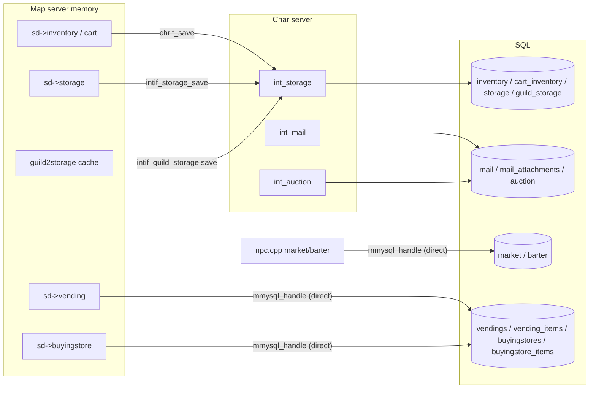

# Economy Systems (zeny, trade, storage, vending, buying store, search store, mail, auction, NPC shops)

> Status: **Phase 5**. ✅ = verified in source · ⚠️ = inferred · ❓ = unknown.
> Main files: `src/map/trade.cpp`, `storage.cpp`, `vending.cpp`, `buyingstore.cpp`, `searchstore.cpp`, `mail.cpp`, `npc.cpp` (shops, market, barter), `cashshop.cpp`, `pc.cpp` (zeny/cash). Char side: `src/char/int_storage.cpp`, `int_mail.cpp`, `int_auction.cpp`. Config: `conf/battle/feature.conf`, `conf/battle/misc.conf` (mail), `conf/battle/items.conf` (vending), `conf/inter_server.yml` (extra storages).
> Read first: [item-system.md](item-system.md) (item instances, containers, trade restrictions).

## 1. Currencies

| Currency | Storage | API | Notes |
|---|---|---|---|
| Zeny | `sd->status.zeny` (char row) | `pc_payzeny` (`pc.cpp:5795`), `pc_getzeny` (`:5829`) | Capped at `MAX_ZENY = INT_MAX` (`mmo.hpp:82`). Every call takes an `e_log_pick_type` and a partner `char_id`, logged to `zenylog` when enabled |
| Cash points | account registry `#CASHPOINTS` (`pc.hpp:51`) | `pc_paycash` (`:5866`), `pc_getcash` (`:5911`) | Saved as `##`/`#` account vars by char (`acc_reg_num`) |
| Kafra points | `#KAFRAPOINTS` (`pc.hpp:52`) | Same functions (`points` argument) | ✅ The caller chooses how many Kafra points to use; `pc_paycash` charges `price − points` in cash (`pc.cpp:5871-5875`) |
| Item currencies | inventory | NPC `itemshop`, `pointshop` (any variable), `barter` | See §8 |

**Rule for new code:** never write `sd->status.zeny` directly. Go through `pc_payzeny`/`pc_getzeny` so the client update (`clif_updatestatus(SP_ZENY)`), the cap and the logging all happen.

## 2. Where economic state lives

✅ **The map-server writes several tables directly** through its own `mmysql_handle`: `vendings`/`vending_items` (`vending.cpp:63,233,396`), `buyingstores`/`buyingstore_items` (`buyingstore.cpp:234,454,491`), `market` (`npc.cpp:4798`), `barter` (`npc.cpp:864,3360`). This answers roadmap item 12. With several map-servers, these rows are keyed by vender/buyer id or NPC name, so map-servers don't collide as long as NPC names are unique per cluster ⚠️.

## 3. Player trade

✅ `trade.cpp`. State is kept on both `map_session_data`s: `trade_partner{id, lv}`, `state.trading`, `state.deal_locked` (0 → 1 "OK pressed" → 2 "Trade pressed"), and `deal.item[10]{index, amount}` + `deal.zeny`.

| Step | Function | Checks |
|---|---|---|
| Request | `trade_traderequest` (`trade.cpp:31`) | `MF_NOTRADE`, distance, partner not busy (chat, vending, storage open), group permission `pc_can_give_items` |
| Accept | `trade_tradeack` (`:108`) | Re-checks both sides |
| Add item | `trade_tradeadditem` (`:351`) | `itemdb_cantrade` (trade restriction flags plus group-level override), bound items (`isBoundTrading`), weight on partner |
| Add zeny | `trade_tradeaddzeny` (`:471`) | `amount <= sd->status.zeny` |
| Lock | `trade_tradeok` (`:498`) | Sets `deal_locked = 1` |
| Commit | `trade_tradecommit` (`:586`) | Both sides must reach `deal_locked == 2` |
| Cancel | `trade_tradecancel` (`:520`) | Restores the client view and clears state |

**Commit anti-dupe** (`trade.cpp:586-685`) ✅:

1. Runs `impossible_trade_check` (`:181`) for each side, which rebuilds the offered amounts against the real inventory.
2. Runs `trade_check` (`:247`) to simulate both inventories receiving the goods (slot and weight).
3. Moves each item with `pc_additem(target)` first, then `pc_delitem(source)` **only if the add succeeded**. If the add fails, the item stays with its owner (`clif_additem` restores the view).
4. Moves zeny with `pc_payzeny` + `pc_getzeny`.
5. If `save_settings & CHARSAVE_TRADE`, saves both players immediately (`chrif_save(..., CSAVE_INVENTORY|CSAVE_CART)`) so a crash can't roll back one side only.

## 4. Storage

All containers share `s_storage` (see [item-system.md §2](item-system.md#2-containers)).

### Account storage (and premium storages)

- **Loaded at login**: `pc_reg_received` asks char for storage, cart and inventory (`intif_storage_request(TABLE_STORAGE|TABLE_CART|TABLE_INVENTORY, …)`, `pc.cpp:2434-2436`). Char answers with `mapif_parse_StorageLoad` (`int_storage.cpp:450`) → `mapif_storage_data_loaded`. Storage is in memory before the player ever opens it.
- **Open**: `storage_storageopen` (`storage.cpp:133`) only sets `state.storage_flag = 1`, sorts and sends the list. It needs `pc_can_give_items`.
- **Save**: `storage_storagesave` (`:461`) → `intif_storage_save` → `mapif_parse_StorageSave` (`int_storage.cpp:490`) → `storage_tosql`, using the generic `char_memitemdata_to_sql` diff.
- **Premium / extra storages** (`storage_premiumStorage_*`, `storage.cpp:1118-1199`) are defined in `conf/inter_server.yml` (`InterServerDatabase`, `inter.cpp:891`) with their own table names. They're loaded on demand (`storage_premiumStorage_load` → `intif_storage_request(TABLE_STORAGE, num, mode)`).

### Guild storage

✅ `storage_guild_storageopen` (`storage.cpp:556`):

- Needs a guild, and with `OFFICIAL_GUILD_STORAGE` (defined in `config/packets.hpp:67`) the `GD_GUILD_STORAGE` skill. Capacity is `100 + 100 × level` (200–600).
- Needs a position with `GUILD_PERM_STORAGE` (PACKETVER ≥ 20140205).
- **One user at a time**: refuses when `gstor->status` (in use) or `gstor->lock` is set (`:600-604`). Different map-servers can't share it at once either, because char serves the data on request (`mapif_parse_LoadGuildStorage`, `int_storage.cpp:191`) ⚠️ the lock on the char side is implicit in the request/save round trip.
- Every add and get is logged to `guild_storage_log` (`storage_guild_log`, `:615`). The client's log view reads it back (`storage_guild_log_read`, `:709`).
- When closed, it's saved (`storage_guild_storagesave`, `:1025`) → char `mapif_parse_SaveGuildStorage` (`int_storage.cpp:201`) → ack `storage_guild_storagesaved` (`:1046`).
- **Guild-bound items** are returned to guild storage when a member leaves (`guild_retrieveitembound`, `guild.cpp:1321` → char `mapif_parse_itembound_retrieve`, `int_storage.cpp:278`).

## 5. Vending (player shops)

✅ `vending.cpp`.

- **Open** (`vending_openvending`, `:298`):
  - Requires `MC_VENDING` and a cart.
  - Item count must be ≥ 1, ≤ `MAX_VENDING`, and ≤ 2 + skill level.
  - Each cart item must be identified, not broken, not rental, tradeable (`itemdb_cantrade`) and not bound (unless permitted). Price is capped at `vending_max_value`.
  - Inserts into `vendings` and `vending_items`, and gives the shop a unique id (`vending_getuid`, `:49`).
- **Browse**: `vending_vendinglistreq` (`:80`).
- **Buy** (`vending_purchasereq`, `:123`):
  - Validates the shop uid, amounts, the buyer's zeny and weight, and the vender's zeny cap.
  - Tax is `vending_calc_tax` (`:106`): `vending_tax` in 1/100 % applied above `vending_tax_min`.
  - Moves zeny (`pc_payzeny` buyer / `pc_getzeny` vender), then `pc_additem` to the buyer and `pc_cart_delitem` from the vender.
  - Updates or deletes the `vending_items` row, and saves both players when `CHARSAVE_VENDING`.
  - Closes the shop when it's empty and the vender is an autotrader.
- **Close**: `vending_closevending` (`:58`) deletes the SQL rows.

### Autotrade persistence

✅ With `feature.autotrade: on` (`conf/battle/feature.conf:43`), a vender who uses `@autotrade` disconnects the client but keeps the session (`state.autotrade`). On map-server **startup**:

1. `do_init_vending_autotrade` (`vending.cpp:595`) reads `vendings WHERE autotrade = 1` plus their items into `vending_autotrader_db`, then **deletes all rows** (`:697`). They're re-inserted when each shop reopens.
2. For each autotrader it calls `chrif_authreq(sd, true)` (`:647`). The character is loaded like a normal login, without a client.
3. Once loaded, `pc_autotrade_timer` fires after `feature.autotrade_open_delay` (5 s, `intif.cpp:3515`) → `vending_reopen` (`pc.cpp:14860`, `vending.cpp:519`), which rebuilds the shop from the saved rows.

Buying stores follow the same pattern (`do_init_buyingstore_autotrade`, `buyingstore.cpp:660`; `buyingstore_reopen`, `:598`).

## 6. Buying store and search store

- **Buying store** (`buyingstore.cpp`), a reverse shop opened with a `ALL_BUYING_STORE` item or skill:
  - `buyingstore_setup` (`:69`) → `buyingstore_create` (`:116`): lists items and prices plus a zeny limit. Only items with `flag.buyingstore` qualify. Stored in `buyingstores`/`buyingstore_items`.
  - Sellers call `buyingstore_trade` (`:325`), which moves items, updates the limit and amounts in SQL (`:454-491`), and closes the store when the limit is exhausted.
- **Search store** (`searchstore.cpp`), the "universal catalog" items:
  - `searchstore_open` (`:88`) sets the remaining `uses` and the `effect` (open the shop remotely or just show the location).
  - `searchstore_query` (`:115`) iterates vending or buying stores on the map (`vending_searchall` / `buyingstore_searchall`) with paging (`searchstore_next`, `:239`).
  - `searchstore_click` (`:284`) opens the found shop if the effect allows it (`searchstore_queryremote`, `:349`).

## 7. Mail (RoDEX) and auction

### RoDEX

✅ The flow is map `mail.cpp` → `intif_Mail_*` → char `int_mail.cpp` → SQL `mail` + `mail_attachments`.

| Step | Map | Char |
|---|---|---|
| Write | `mail_setitem` (`mail.cpp:162`), `mail_setattachment` (`:283`) stage items and zeny in `sd->mail` | — |
| Send | `mail_send` (`:462`): `mail_daily_count` via `SC_DAILYSENDMAILCNT` (`conf/battle/misc.conf:147`), `mail_attachment_price` fee, `mail_delay` flood control. Removes the attachments from the inventory **before** sending | `mapif_parse_Mail_send` (`int_mail.cpp:599`) → `mail_savemessage` (`:82`) → `mapif_Mail_new` to the receiver's map |
| Failure | `mail_deliveryfail` (`:414`) gives the staged items back | — |
| Receiver check | — | `mapif_parse_Mail_receiver_check` (`:702`) |
| Read / attachments | `mail_openmail`, `mail_getattachment` (`:332`) | `mapif_parse_Mail_getattach` (`:435`) deletes the attachment rows and sends the items |
| Expiry | — | `mail_return_timer` and `mail_delete_timer` run **every minute** (`char.cpp:3243-3248`) → `mail_timer_sub` (`int_mail.cpp:247`). Unread normal mail older than `mail_return_days` (default 14) is returned to its sender. Returned mail older than `mail_delete_days` is deleted |

`mail_sendmail` (`int_mail.cpp:660`) is the char-internal API used to send system mail (auction results, for example).

### Auction

✅ `int_auction.cpp` keeps auctions in the `auction` table with an end timer. It's **disabled** by default (`feature.auction: off`, `conf/battle/feature.conf:26`), and `battle.cpp:9021-9030` force-disables it on this PACKETVER (the clients removed the UI in 2014-11). It's kept only for older clients.

## 8. NPC shops

| Type (script keyword) | Code | Notes |
|---|---|---|
| `shop` | `npc_buylist` (`npc.cpp:2796`), `npc_selllist` (`:3031`) | Discount (`MC_DISCOUNT`) and overcharge (`MC_OVERCHARGE`) apply. `OnBuyItem`/`OnSellItem` for `trader` variants |
| `cashshop` / `itemshop` / `pointshop` | `npc_cashshop_buylist` (`:2516`), `npc_cashshop_buy` (`:2676`), payment `npc_cashshop_process_payment` (`:2427`) | Currency is cash points, an item, or any script variable |
| `marketshop` | `npc_market_*` (`:4795-4921`) | Limited stock persisted in SQL `market` (`name`, `nameid`, `price`, `amount`, `flag`). Restocked by script (`npcshopupdate`) |
| Barter (`barter` NPCs from `db/barters.yml` / `npc/barters.yml`) | `BarterDatabase` (`npc.cpp:394`), `npc_barter_purchase` (`:3140`) | Trades items for items. Optional stock persisted in SQL `barter` (`:847-868`, `:3360`) |
| In-game cash shop (client button) | `cashshop.cpp` (`db/item_cash.yml`) | See [item-system.md](item-system.md). This fork defines `ENABLE_CASHSHOP_PREVIEW_PATCH` |

## 9. Extension points and hazards

| Want to… | Where |
|---|---|
| Change vending tax or price cap | `conf/battle/items.conf`: `vending_max_value: 1000000000` (`:13`), `vending_tax: 500` (5 %, `:24`), applied only to sales of at least `vending_tax_min: 100000000` (`:29`) ✅ |
| Add an extra storage | `conf/inter_server.yml` + SQL table + `openstorage2` script command |
| Add a currency shop | `itemshop`/`pointshop` NPC; or `barter` YAML |
| Persist trades immediately | `save_settings` in `conf/map_athena.conf` (`CHARSAVE_TRADE`, `CHARSAVE_VENDING`, `CHARSAVE_STORAGE`…) |
| Add an item move path | Always use `pc_additem` + `pc_delitem` with an `e_log_pick_type`. Check `itemdb_cantrade`/`itemdb_canstore`/`itemdb_canmail` and `pc_can_give_items` |

Hazards:

- Move items "add first, delete on success" like `trade_tradecommit`. Deleting first can lose items when the target is full.
- Direct-SQL tables (vending, buying store, market, barter) are written **synchronously** on the map main thread. A slow MySQL stalls every player on that map-server ⚠️.
- The guild storage `lock`/`status` flags are per map-server. Opening the same guild's storage from two map-servers relies on char's request/save ordering ⚠️.
