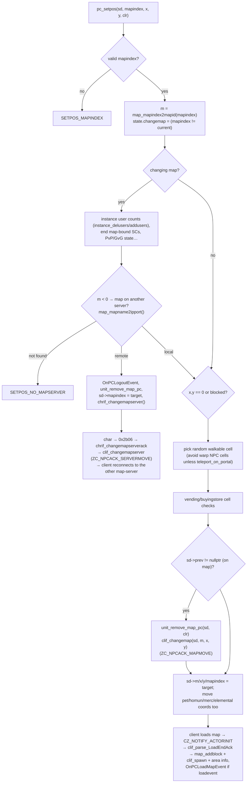

# Maps and Movement

> Status: **Phase 3**. ✅ = verified in source · ⚠️ = inferred · ❓ = unknown.
> Prerequisites: the object model in [../server-architecture.md §8](../server-architecture.md#8-core-in-memory-object-model-map-server) and deferred deletion in [../memory-management.md §4](../memory-management.md#4-deferred-object-destruction).

## 1. Purpose

This subsystem answers four questions for every object on the map-server:

1. **Where can things stand?** Map geometry: cells, walls, water, cliffs.
2. **Who is near whom?** The block grid and area queries.
3. **How do units move?** Pathfinding, per-step walk timers, and broadcasting movement.
4. **How do they change maps?** Warping, possibly to another map-server.

Main files: `src/map/map.cpp/.hpp` (maps, cells, grid, area iteration), `src/map/path.cpp/.hpp` (A*, line-of-sight, distance), `src/map/unit.cpp/.hpp` (the movement state machine), `src/map/pc.cpp` (`pc_setpos`), `src/map/clif.cpp` (move/appear/disappear packets), `src/map/navi.cpp` (offline navigation data).

## 2. Map data

### 2.1 Which maps a server hosts

- `conf/maps_athena.conf` (imported by `map_athena.conf`) lists `map: <name>` lines. Each one calls `map_addmap(name)` (`map.cpp:3719`) during `map_config_read`.
- `db/map_index.txt` assigns every map name a global **map index** (`mapindex_init`, `src/common/mapindex.cpp`). The map index is what's stored in SQL and sent between servers. The **map id** (`int16 m`) is the local position in this server's `map[]` array.
  - Conversions: `map_mapname2mapid` (`map.cpp:3130`), `map_mapindex2mapid` (`:3142`), `mapindex_name2id`, `map_mapid2mapname`.

### 2.2 Loading geometry

✅ `map_readallmaps` (`map.cpp:3911`):

- With `enable_grf` (`map_athena.conf`), each map's `.gat` is read from the client GRF (`map_readgat`, `:3855`). Otherwise, and by default, geometry comes from the **map cache** files `db/import/map_cache.dat`, `db/<re|pre-re>/map_cache.dat` and `db/map_cache.dat`, searched in that order. These are generated by the `mapcache` tool.
- `map_readfromcache` (`:3672`) zlib-decodes the map's cell bytes and converts each `.gat` type with `map_gat2cell` (`:~3283`):

  | gat | walkable | shootable | water | Meaning |
  |---|---|---|---|---|
  | 0, 2, 4, 6 | ✔ | ✔ | | ground |
  | 1 | | | | wall |
  | 3 | ✔ | ✔ | ✔ | walkable water |
  | 5 | | ✔ | | cliff/gap (can be shot across) |

- A map that isn't in `map_index.txt`, or whose data can't be found, is removed (`map_delmapid`).
- The block grid is allocated (`bxs = ceil(xs/8)`, `bys = ceil(ys/8)`) as two arrays of list heads, `block` and `block_mob` (`map.cpp:~3995-3999`). Then `map_flags_init()` runs.

### 2.3 `map_data` and cells

✅ `struct map_data` (`map.hpp:819`):

| Field | Meaning |
|---|---|
| `name`, `index`, `m` | name, global map index, local id |
| `cell` | `mapcell[xs*ys]`, or `nullptr` if the map is hosted on another server |
| `block`, `block_mob`, `bxs`, `bys` | spatial grid (§3) |
| `xs`, `ys` | size in cells |
| `users`, `users_pvp` | players currently on the map |
| `npc[MAX_NPC_PER_MAP=512]`, `npc_num`, `npc_num_area`, `npc_num_warp` | NPCs placed here |
| `moblist[MAX_MOB_LIST_PER_MAP=128]`, `mob_delete_timer` | spawn definitions for dynamic mobs |
| `save` | `nosave` respawn point |
| `drop_list`, `zone`, `skill_damage`, `skill_duration`, `damage_adjust` | mapflag-driven rules |
| `instance_id`, `instance_src_map` | instance map copies |
| `flags` (private `std::vector<int32>`) | mapflag values, accessed with `getMapFlag`/`setMapFlag` |

`struct mapcell` (`map.hpp:788`) is a bitfield:

- terrain bits: `walkable`, `shootable`, `water`
- dynamic bits: `npc` (inside an NPC's OnTouch area), `basilica`, `landprotector`, `novending`, `nochat`, `maelstrom`, `icewall`, `nobuyingstore`
- optional `cell_bl` count (`CELL_NOSTACK`)

Accessors (✅ `map.cpp:3315-3402`):

- `map_getcell(m, x, y, cell_chk)` / `map_getcellp(mapdata, …)` answer **queries**:
  - `CELL_CHKWALL`, `CHKWATER`, `CHKCLIFF`
  - `CHKPASS` / `CHKNOPASS` (walkable)
  - `CHKREACH` / `CHKNOREACH` (✅ plain `walkable`; `CHKPASS` is the same, except that with `CELL_NOSTACK` it also refuses cells holding `custom_cell_stack_limit` or more units, `map.cpp:~3360-3366`)
  - `CHKSTACK`, `CHKNPC`, `CHKBASILICA`, `CHKLANDPROTECTOR`, `CHKNOVENDING`, `CHKNOCHAT`, `CHKMAELSTROM`, `CHKICEWALL`, `CHKNOBUYINGSTORE`
- `map_setcell(m, x, y, cell_t, flag)` sets dynamic bits. Used by NPC areas (`npc_setcells`), skills (Ice Wall, Land Protector, Basilica), `setcell` and `setwall` script commands (`map_iwall_set`, `:3475`), and vending restrictions.

### 2.4 Map flags

- `enum e_mapflag` (`map.hpp`) has 87 `MF_*` entries.
- They are set from NPC files with `<map><TAB>mapflag<TAB><flag><TAB><value>` (`npc_parse_mapflag`, `npc.cpp:5420`, which resolves names with `map_getmapflag_by_name`, `map.cpp:4633`). The official sets live in `npc/mapflag/*.txt` (`town.txt`, `nosave.txt`, `pvp.txt`, `gvg.txt`, `noteleport.txt`, `nowarp.txt`, `restricted.txt`, `skill_damage.txt`, …). Scripts can also change them at runtime with `setmapflag` / `removemapflag`.
- Read with `map_getmapflag(m, MF_X)` / `map_getmapflag_sub` (`map.cpp:4680`); write with `map_setmapflag_sub` (`:4730`). Some flags carry arguments (`u_mapflag_args`: zone ids, skill damage, nosave point…).
- `map_data_copyall` (`:3819`) copies flags from source maps to their instance copies.

### 2.5 Maps on other map-servers

✅ `map_db` (uidb, map index → `map_data_other_server`). On connecting, each map-server sends its map list to char (`chrif_sendmap`, `chrif.cpp:367`, packet `0x2afa`). Char broadcasts every server's list to all the others (`chrif_recvmap`, `chrif.cpp:382`, packet `0x2b04` → `map_setipport`, `map.cpp:3580`). `map_mapname2ipport(index, &ip, &port)` (`:3158`) returns 0 only for **remote** maps (entries with `cell == nullptr`). That is how `pc_setpos` decides to hand the player off (§6).

## 3. The block grid and area queries

✅ `#define BLOCK_SIZE 8` (`map.cpp:120`): the map is divided into 8×8-cell blocks. Each block heads an intrusive doubly linked list through `block_list::next/prev`. Monsters live in a separate list (`block_mob`), so player-only or mob-only scans skip the other kind.

| Function | Purpose |
|---|---|
| `map_addblock(bl)` (`map.cpp:407`) | Link `bl` into the list for block `(x/8, y/8)`. Errors if it is already linked or out of bounds |
| `map_delblock(bl)` (`:464`) | Unlink it and set `prev = nullptr`. **A `prev == nullptr` object is "not on a map"**, which the foreach loops use to skip removed objects |
| `map_moveblock(bl, x1, y1, tick)` (`:518`) | Change position. Re-links only when the 8×8 block changes. Also moves attached ground effects (`skill_unit_move`, dance and other unit groups) and ✅ for any `BL_CHAR`, **every** `map_moveblock` call (whether or not the block changes) ends position-bound statuses: `SC_CLOSECONFINE(2)`, `SC_TINDER_BREAKER(2)`, `SC_TATAMIGAESHI`, `SC_MAGICROD`, `SC_SU_STOOP`, and conditionally `SC_PROPERTYWALK` (`map.cpp:534-550`). Re-linking into the block lists happens only when the 8×8 block changes (`moveblock` flag) |
| `map_foreachinrange(func, center, range, type, …)` (`:793`) | Objects of `type` mask within `range` of `center`. Respects `skill_wall_check` (line of sight) |
| `map_foreachinallrange` (`:803`) | The same, without the line-of-sight filter |
| `map_foreachinarea` / `map_foreachinallarea` / `map_foreachinshootarea` (`:932` / `:913` / `:923`) | Rectangle versions |
| `map_foreachinmovearea(func, center, range, dx, dy, type, …)` (`:1077`) | **Only the strip that enters or leaves view** when `center` moves by `(dx, dy)`. Drives visibility updates (§5) |
| `map_foreachincell` (`:1206`), `map_foreachinpath` (`:1253`, for line-shaped skills), `map_foreachinmap` (`:1601`), `map_foreachpc`, `map_foreachmob`, … | Other shapes |
| `map_count_oncell` (`:641`), `map_search_freecell` (`:1798`), `map_nearby_freecell` | Cell occupancy helpers |

All `foreach*` calls gather matches into the shared `bl_list[]` first, then run `func` under a `FreeBlockLock`, so callbacks may kill or remove objects safely ([memory-management.md §4](../memory-management.md#4-deferred-object-destruction)). The type mask is a `bl_type` bitmask (`BL_PC|BL_MOB`, `BL_CHAR`, `BL_ALL`).

**Range metric**: `check_distance` / `distance` (`path.cpp:436-485`). By default the server uses **square (Chebyshev)** distance, `max(|dx|, |dy|)`. With `CIRCULAR_AREA` it uses a circle, with a 1-cell grace on diagonals. `check_distance_client` emulates the client's own rule for range checks on client requests.

**View range**: `AREA_SIZE` = `battle_config.area_size` (`map.hpp`), set by `conf/battle/client.conf:39 area_size: 14`. Objects within 14 cells, square, can see each other.

## 4. Movement

### 4.1 Unit state

✅ `struct unit_data` (`unit.hpp:22`). It is embedded in every mobile object and fetched with `unit_bl2ud(bl)`:

| Field | Meaning |
|---|---|
| `walkpath` (`walkpath_data { path_len, path_pos, path[MAX_WALKPATH] }`) | The planned route, one **direction** (0–7) per step |
| `to_x`, `to_y` | Destination |
| `walktimer` | Timer for the next step (`unit_walktoxy_timer`) |
| `target`, `target_to`, `chaserange` | Attack/chase target, walking toward a unit |
| `attacktimer`, `skilltimer`, `steptimer`, `stepskill_*` | Auto-attack, casting, "act when reaching the next cell" |
| `canmove_tick`, `canact_tick` | Earliest time the unit may move or act again (walk delay, cast delay…) |
| `skillunits`, `skilltimerskill[]`, `skillunittick[]` | Ground effects owned by the unit, delayed skill hits |
| `state.*` | `change_walk_target`, `walk_easy`, `force_walk`, `blockedmove`, … |
| `walk_done_event` | NPC event to run when the walk finishes (`npcwalkto`, `unitwalk … ,"NPC::OnX"`) |

### 4.2 Pathfinding

✅ `src/map/path.cpp`:

- **`MAX_WALKPATH = 32`** (`path.hpp:14`). A path has at most 32 steps, and the A* search space is a **32×32 window** indexed by `calc_index(x,y) = (x + y*32) & 1023` (`path.cpp:51`). Long walks are done in pieces: the client clicks within its view, and the server re-paths when the target changes.
- `path_search(wpd, m, x0, y0, x1, y1, flag, cell_chk)` (`path.cpp:269`):
  - `flag & 1` = "easy" walk: a straight diagonal-then-straight line that fails at the first blocked cell.
  - Otherwise **A\***: costs `MOVE_COST = 10` straight and `MOVE_DIAGONAL_COST = 14` diagonal (`path.hpp:11-12`), Manhattan heuristic ×10 (`path.cpp:55`), and a binary-heap open set (`g_open_set`, `BHEAP` macros, `db.hpp:1391`).
  - ✅ Diagonal moves are only allowed when both orthogonal neighbours are passable as well (no corner cutting): `allowed_dirs` / `chk_dir(PATH_DIR_NORTH|PATH_DIR_EAST)` checks (`path.cpp:~385-400`).
  - `flag & 2` delegates to `path_search_long`.
  - It fails if the destination cell matches `cell_chk` (usually `CELL_CHKNOPASS`).
- `path_search_long(spd, m, x0, y0, x1, y1, cell)` (`:132`): a **straight-line (Bresenham-style) trace** used for line of sight and projectiles (`CELL_CHKWALL`), and as an extra check that long paths are reachable.
- `path_blownpos(m, x0, y0, dx, dy, count)` (`:80`): where a **knockback** ends up (stops at walls).
- `navi.cpp` + `MAP_GENERATOR`: offline generation of navigation data for the client's /navigation UI (`navi_create_lists`). Not used at runtime.

### 4.3 Walking: request to completion

```mermaid
sequenceDiagram
    participant C as Client
    participant clif as clif_parse_WalkToXY
    participant U as unit.cpp
    participant P as path_search
    participant T as timer heap
    participant M as map.cpp
    participant V as clif_insight/outsight

    C->>clif: CZ_REQUEST_MOVE (x,y)
    clif->>clif: checks: dead, blocking SC/opt, progress bar, sitting…
    clif->>U: unit_walktoxy(sd, x, y, 4)
    U->>P: path_search(… CELL_CHKNOPASS) — reachable?
    U->>U: store to_x/to_y; if already walking → state.change_walk_target
    U->>U: unit_walktoxy_sub: path_search → ud->walkpath (trim for chaserange)
    U->>U: unit_walktoxy_nextcell(send=true)
    U->>T: add_timer(now + speed(×1.4 diag), unit_walktoxy_timer)
    U->>C: clif_move (AREA) + clif_walkok (self)
    loop each step (timer fires)
        T->>U: unit_walktoxy_timer
        U->>U: next cell blocked? → unit_walktoxy_sub (re-path)
        U->>V: map_foreachinmovearea(clif_outsight, …, dx, dy)
        U->>M: map_moveblock(bl, x+dx, y+dy)
        U->>V: map_foreachinmovearea(clif_insight, …, -dx, -dy)
        U->>U: PC: npc_touchnext_areanpc / npc_touch_area_allnpc (CELL_CHKNPC),<br/>pc_cell_basilica; MOB: npc_touch_areanpc2 (OnTouchNPC)
        U->>U: change_walk_target? → re-path; else path_pos++
        U->>T: unit_walktoxy_nextcell → schedule next step (or stop)
    end
    U->>U: arrival: walk_done_event, chase → attack / stepaction skill
```

✅ Anchors:

| Step | Code |
|---|---|
| Client handler | `clif_parse_WalkToXY` (`clif.cpp:11377`): reads `x,y` with `RFIFOPOS` from the packet DB offsets, calls `pc_delinvincibletimer`, then `unit_walktoxy(sd, x, y, 4)` (`:~11425`) |
| Request | `unit_walktoxy(bl, x, y, flag)` (`unit.cpp:841`). Flags: `&1` easy walk, `&2` ignore `canmove` checks, `&4` if movement is briefly blocked (`canmove_tick` < 2 s away) queue the walk with `unit_delay_walktoxy_timer` instead of failing, `&8` pick a nearby free cell. Paths longer than 14 cells are also checked with `path_search_long`. If already walking, it only sets `state.change_walk_target`, and the next step re-paths |
| Plan | `unit_walktoxy_sub` (`unit.cpp:254`): `path_search` → `ud->walkpath`. When chasing, the last `chaserange` cells are trimmed |
| Schedule | `unit_walktoxy_nextcell` (`unit.cpp:180`): one step lasts `status_get_speed(bl)` ms (×14/10 on diagonals). Sends `clif_move` (area) and `clif_walkok` (PC). For monsters it may first try a mob skill (`mobskill_use`) or update the chase. Ends with `clif_walkok` when `path_pos >= path_len` |
| Step | `unit_walktoxy_timer` (`unit.cpp:542`): validates the next cell (`CELL_CHKNOPASS`, Ice Wall rules for mobs `mob_icewall_walk_block`), outsight → `map_moveblock` → insight, OnTouch handling, `walk_done_event`, then re-paths or advances |

**Speed**: `status_get_speed(bl)` is the milliseconds per cell, computed by the status system (base `DEFAULT_WALK_SPEED`, plus SC and equipment modifiers). See status-system (phase 4).

**Server-authoritative**: the client predicts movement after `clif_move`, but the server keeps its own position and sends `clif_fixpos` when they disagree (blocked path, re-path failure, `unit_stop_walking(bl, USW_FIXPOS)`).

### 4.4 Other movement primitives

| Function | Use |
|---|---|
| `unit_walktobl(bl, target, range, flag)` (`unit.cpp:950`) | Walk toward a unit (chase). `target_to` re-paths as the target moves (`unit_update_chase`) |
| `unit_movepos(bl, x, y, easy, checkpath)` (`unit.cpp:1172`) | **Instant** move with a visible slide (dash and backslide skills, knockback): `unit_stop_walking(USW_FIXPOS)`, path check, outsight → `map_moveblock` → insight |
| `skill_blown` → `path_blownpos` | Knockback |
| `unit_stop_walking(bl, type, canmove_delay)` (`unit.hpp:137`) | Cancel `walktimer`. `USW_FIXPOS` sends the position to clients, `USW_FORCE_STOP` and others |
| `unit_set_walkdelay(bl, tick, delay, type, skill_id)` (`unit.cpp:2003`) | Freeze movement after damage or a skill (sets `canmove_tick`) |
| `unit_can_move(bl)` (`unit.cpp:1799`) | Central check: SC immobilisation, sitting, vending, chat, `PCBLOCK_MOVE`, `blockedmove`… |
| `unit_warp(bl, m, x, y, clrtype)` (`unit.cpp:1427`) | Teleport a **non-player** unit (mobs, NPCs, companions). Random or nearest free cell when the target is invalid. Players use `pc_setpos` |

## 5. Visibility (insight/outsight)

Clients only know about objects the server has told them about. ✅ `clif.cpp`:

- **Moving**: before `map_moveblock`, `map_foreachinmovearea(clif_outsight, bl, AREA_SIZE, dx, dy, …)` visits units in the strip that is about to leave view. Afterwards, `clif_insight` visits the strip that just came into view (`unit.cpp` walk timer and `unit_movepos`). For a player mover, every object type is scanned (`BL_ALL`); for other movers, only players (`BL_PC`).
- `clif_outsight(bl, ap)` (`clif.cpp:5602`): tells the observer to remove the object: `clif_clearunit_single(id, CLR_OUTSIGHT)`, vending/buying-store boards, floor items (`clif_clearflooritem`), skill units (`clif_clearchar_skillunit`). This happens in both directions (the mover loses sight of others, and others lose sight of the mover).
- `clif_insight(bl, ap)` (`clif.cpp:5660`): the opposite. `clif_getareachar_unit` / spawn packets for the newly visible object, and vice versa.
- **Entering a map** (`clif_parse_LoadEndAck`, `clif.cpp:10746+`): `map_addblock(sd)` (`:10813`), `clif_spawn(sd)` (others see you), then `map_foreachinallarea(clif_getareachar, …, ±AREA_SIZE, BL_ALL, sd)` (you see everything around you), then the pet/homunculus/mercenary/elemental are added and spawned.
- **Leaving a map**: `unit_remove_map_(bl, clrtype)` (`unit.cpp:3580`) / `unit_remove_map_pc` (`:3864`) → `clif_clearunit_area(bl, clrtype)` (`CLR_OUTSIGHT`, `CLR_DEAD`, `CLR_RESPAWN`, `CLR_TELEPORT`, `CLR_TRICKDEAD` choose the client-side effect) → `map_delblock`.
- Invisible units are filtered inside these callbacks: ✅ `clif_outsight` skips `JT_INVISIBLE` (`vd->look[LOOK_BASE]`). ⚠️ Handling of other hiding options (cloaking, GM hide) has not been traced.

## 6. Warping and map changes

✅ `pc_setpos(sd, mapindex, x, y, clrtype)` (`pc.cpp:6930`). Return values: `SETPOS_OK`, `SETPOS_MAPINDEX` (invalid, or not allowed out of an instance), `SETPOS_NO_MAPSERVER`, `SETPOS_AUTOTRADE`.



Points to note:

- **The player is off the map** (`prev == nullptr`) between `clif_changemap` and the client's `LoadEndAck`. Packet handlers reject most actions in this window (`clif_parse` lets only `LoadEndAck` through while `sd->prev == nullptr`).
- **Cross-server change**: `chrif_changemapserver` (`chrif.cpp:423`) → char → `chrif_changemapserverack` (`:455`, `0x2b06`) → `clif_changemapserver` (`clif.cpp:~2167`, packet `0x0092`/`0x0ac7`). The client then performs the **map-server half of the login handshake** with the other server (`WantToConnection`), reusing the char-server auth node ([networking.md §6](../networking.md#6-full-client-connection-lifecycle)). The old server saves with `CSAVE_CHANGE_MAPSERV`.
- `pc_setpos` is the **single entry point** used by warp NPCs (OnTouch), `warp` and related script commands, `@warp`/`@go`/`@jump`, Fly Wing and Butterfly Wing, death respawn (`pc_respawn` → save point), Teleport, Warp Portal, instance entry and exit, and jail.
- Restrictions are enforced by the **callers**, before `pc_setpos`, through mapflags: `noteleport`, `nowarp`, `nowarpto`, `noreturn`, `nomemo`, `nosave`, plus `pc_has_permission` for GMs. `pc_setpos` itself only refuses invalid or remote-unknown maps and leaving an instance when that isn't allowed.

## 7. Dynamic monsters (map activity)

✅ With `battle_config.dynamic_mobs` (`conf/battle/monster.conf`), spawn lines are stored per map (`moblist[]`, `npc.cpp:5392`). They are spawned when the **first player** loads the map (`map_spawnmobs`, called from `clif_parse_LoadEndAck`, `clif.cpp:10804` → `map.cpp:3004`). When the last player leaves, a `map_removemobs_timer` is scheduled after `mob_remove_delay` (`map_removemobs`, `unit.cpp:3717` → `map.cpp:3084-3095`), so empty maps cost no AI time. ✅ `map_removemobs_sub` (`map.cpp:~3026-3050`) leaves a monster in place if it has no respawn data and isn't a slave, if its spawn isn't a dynamic one, if it is waiting to respawn, if it is damaged while `mob_remove_damaged` is off, or if it is an **MVP**.

## 8. Instances (map copies)

`map_addinstancemap(src_m, instance_id, no_mapflag)` (`map.cpp:2819`) clones a source map's geometry and flags into a new map id named by `instance_generate_mapname` (✅ `"%0*u#%0*u"` = zero-padded source map id, `#`, zero-padded instance id; `instance.cpp:~812`), and `map_delinstancemap` (`:2943`) frees it. NPCs on the source map are duplicated by `npc_instanceinit` ([npc-system.md §6](npc-system.md#6-duplicates-and-instances)). Lifecycle and timers: content-systems (phase 5).

## 9. Dependencies

| Depends on | For |
|---|---|
| common/mapindex, grfio, map cache | geometry and names |
| status | movement speed, immobilising SCs, options affecting visibility |
| clif | move, fixpos, spawn, clearunit, changemap packets |
| npc | OnTouch areas (`CELL_NPC`), warp NPCs, `walk_done_event` |
| skill | ground units that move with their owner, cell-altering skills, knockback |
| chrif | cross-server map changes |
| mob | AI drives `unit_walktoxy` / `unit_walktobl`; dynamic spawns |
| battle_config | `area_size`, `skill_wall_check`, `dynamic_mobs`, `mob_icewall_walk_block`, `teleport_on_portal`, … |

Almost everything depends on this subsystem: combat range checks, skill AoE (`map_foreachin*`), AI target search, party/guild area packets (`clif_send` `*_AREA`), item drops (`map_addflooritem`, `map.cpp:2007`; `map_search_freecell`).

## 10. Customisation guide

| Goal | How |
|---|---|
| Add a new map | Add the name to `db/map_index.txt` (or `db/import/map_index.txt`), rebuild the map cache with `mapcache` (from the client GRF), list it in `conf/maps_athena.conf` (or `conf/import/map_conf.txt`), add mapflags in `npc/mapflag/` or a custom NPC file. No code changes needed |
| Change map rules | Mapflags via NPC files, or `setmapflag` at runtime |
| Block or unblock cells | `setcell` / `setwall` / `delwall` script commands (`map_setcell`, `map_iwall_set`) |
| Change view range | `area_size` in `conf/battle/client.conf`. A larger range means more packets per move, and the client must agree on what it can display |
| Change walking rules | `unit_can_move` (`unit.cpp:1799`) for who can move, and `unit_walktoxy_timer` for per-step effects. Keep the outsight → `map_moveblock` → insight order, or clients desync |
| Run code when a player steps on cells | Prefer an NPC with `OnTouch_` and an area (`xs`,`ys`) over C++. For C++, hook the per-cell section of `unit_walktoxy_timer` next to `npc_touch_area_allnpc`, and set a dynamic cell bit so the check stays cheap |
| Custom teleport logic | Wrap `pc_setpos` and check mapflags/permissions first, the same way the existing callers do |

Coupling and side effects:

- **Never change `bl->x/y/m` directly** for an object that is on a map. Use `map_moveblock`, `unit_movepos`, `unit_warp` or `pc_setpos`, or the block lists will point at the wrong block.
- After anything that can warp or remove the unit (OnTouch events, `npc_touch_*`, `map_moveblock` side effects), **check `bl->prev` or the return value** before continuing. `unit_walktoxy_timer` does this (`return 0; // map_moveblock has altered the object…`).
- `MAX_WALKPATH` is a compile-time limit tied to the A* window size. Raising it increases per-search memory: `tp[MAX_WALKPATH*MAX_WALKPATH]` is on the stack in `path_search`.
- `BLOCK_SIZE` (8) trades scan cost for list length. It is used throughout `map.cpp`. Don't change it casually.
