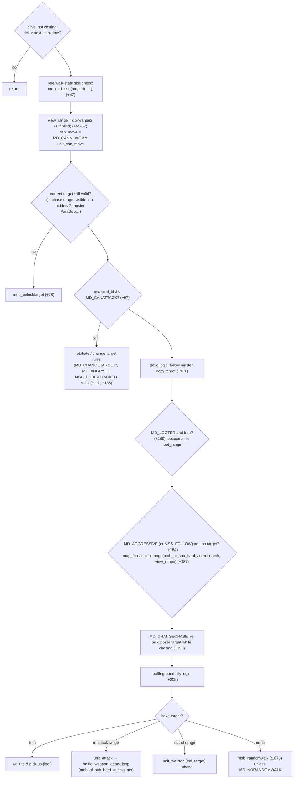

# Monster System (spawning, AI, rewards)

> Status: **Phase 4**. ✅ = verified in source · ⚠️ = inferred · ❓ = unknown.
> Main file: `src/map/mob.cpp` (7.4k lines), `src/map/mob.hpp`. Data: `db/re/mob_db.yml`, `db/re/mob_skill_db.txt`, `mob_summon.yml`, `mob_chat_db.yml`, `mob_item_ratio.yml`, `map_drops.yml`, `db/import/mob_avail.yml` (✅ import-only, `mob.cpp:5882`), `conf/battle/monster.conf`, `conf/battle/drops.conf`. Spawn lines in `npc/**` (see [npc-system.md §7](npc-system.md#7-monster-spawns-from-npc-files)).

## 1. Purpose

`mob.cpp` covers:

- monster definitions
- spawning and respawning (permanent spawns, script summons, slaves, guardians, MVP tombs)
- the AI that drives movement, targeting, attacks and monster skills
- damage tracking
- death rewards: EXP sharing, drops, MVP rewards, kill events

## 2. Data

### 2.1 Definition: `s_mob_db`

✅ `struct s_mob_db` (`mob.hpp:261`), loaded by `MobDatabase` (`TypesafeCachedYamlDatabase<uint32,…>`, type `MOB_DB` v5, `mob.hpp:287`):

| Field | Meaning |
|---|---|
| `id`, `sprite` (AegisName), `name`, `jname`, `title`, `group_id` | Identity |
| `lv` | Level |
| `base_exp`, `job_exp`, `mexp` | **Rates applied at load time** (§6) |
| `status` (`status_data`) | HP, SP, ATK, DEF, stats, `speed`, `adelay`/`amotion`/`dmotion`, `def_ele`/`ele_lv`, `size`, `race`, `class_`, `mode`, attack range `rhw.range` |
| `range2` / `range3` | View / chase range |
| `race2` | Extra race groups (Treasure, Goblin, …) |
| `dropitem` / `mvpitem` | `vector<shared_ptr<s_mob_drop>>`: item, rate, steal protection, `randomopt_group`… |
| `skill` | `vector<shared_ptr<s_mob_skill>>`, attached from `mob_skill_db.txt` |
| `vd`, `option` | View data and look options |
| `damagetaken` | Damage % taken |

`get_bosstype()` returns normal, boss or MVP, derived from `mode` (`MD_MVP`) and class.

**Mode flags** (✅ `enum e_mode`, `src/common/mmo.hpp:244+`): `MD_CANMOVE`, `MD_LOOTER`, `MD_AGGRESSIVE`, `MD_ASSIST`, `MD_CASTSENSORIDLE`, `MD_NORANDOMWALK`, `MD_NOCAST`, `MD_CANATTACK`, `MD_CASTSENSORCHASE`, `MD_CHANGECHASE`, `MD_ANGRY`, `MD_CHANGETARGETMELEE`, `MD_CHANGETARGETCHASE`, `MD_TARGETWEAK`, `MD_RANDOMTARGET`, `MD_IGNOREMELEE/MAGIC/RANGED/MISC`, `MD_MVP`, `MD_KNOCKBACKIMMUNE`, `MD_TELEPORTBLOCK`, `MD_FIXEDITEMDROP`, `MD_DETECTOR`, `MD_STATUSIMMUNE`, `MD_SKILLIMMUNE`. In YAML they are set through `Ai: <type>` (e.g. `04`, `21`, which expand to mode sets) plus `Modes:` overrides. See `doc/mob_db_mode_list.txt` and `doc/mob_db.txt`.

**Monster skills** (`db/re/mob_skill_db.txt`, still CSV, parsed into `mob_skill_db` at `mob.cpp:76-81`, `:6370`): each `s_mob_skill` has the state (`MSS_IDLE`, `WALK`, `LOOT`, `DEAD`, `BERSERK` = attacking, `ANGRY` = retaliating, `RUSH` = chasing after being hit, `FOLLOW` = chasing without being hit, `ANYTARGET`), skill id and level, rate, cast time, delay, cancelable flag, target (self/target/friend/master…), **condition** (26 `MSC_*` kinds: `always`, `myhpltmaxrate`, `attackpcgt`, `slavelt`, `rudeattacked`, `skillused`, `afterskill`, …) with values, an emotion, and a chat line (`mob_chat_db.yml`).

### 2.2 Instance: `mob_data`

✅ `struct mob_data : public block_list` (`mob.hpp:337`):

| Group | Fields |
|---|---|
| Engine | `ud`, `status`, `base_status` (pointer; separate only for levelled-up or resized mobs), `sc`, `db` (`shared_ptr<s_mob_db>`) |
| Spawn link | `spawn` (`spawn_data*`, shared with siblings from the same line; `nullptr` = one-off), `spawn_timer`, `level` |
| AI state | `state.skillstate` (MSS_), `target_id`, `attacked_id`, `norm_attacked_id`, `next_walktime`, `next_thinktime`, `last_pcneartime`, `last_linktime`, `last_skillcheck`, `move_fail_count`, `walktoxy_fail_count`, `skill_idx`, `skilldelay[MAX_MOBSKILL]`, `attacked_count` |
| Group links | `master_id` / `master_dist` (slaves), `bg_id`, `guardian_data` (WoE), `areanpc_id` |
| Rewards | `dmglog` (`std::deque<s_dmglog>`: who dealt how much, flag PC/homunculus/mercenary), `lootitems`/`lootitem_count`, `tomb_nid` (MVP tomb NPC) |
| Script | `npc_event` (event to run on death) |

`md->name` comes from the DB or is overridden by the spawn line or script.

## 3. Spawning

| Path | Function | Notes |
|---|---|---|
| NPC-file spawn lines | `npc_parse_mob` → `npc_parse_mob2` → `mob_parse_dataset` (`mob.cpp:439`) + `mob_spawn_dataset` + `mob_spawn` | `spawn_data` keeps the area, amount and delays. Dynamic mobs: only spawned while players are on the map (map-and-movement §7) |
| Script `monster` / `areamonster` | `mob_once_spawn` (`mob.cpp:679`) / `mob_once_spawn_area` | No `spawn_data` → no respawn. Optional death event |
| Slaves (summons) | `mob_summonslave(md, ids, amount, skill_id)` (`:3981`), `mob_summon.yml` random groups | `master_id` is set. Slaves follow and warp with their master (`mob_warpslave`, `:3920`) |
| WoE guardians / Emperium | `mob_spawn_guardian` (`:835`) | `guardian_data` (castle, guild) |
| Battleground mobs | `mob_spawn_bg` (`mob.cpp:941`) | `bg_id` |

`mob_spawn(md)` (`mob.cpp:1117`) resets state and HP, picks a random free cell within the spawn area (`map_search_freecell`), `map_addblock`, `clif_spawn`, and runs spawn skills (`mobskill_use(md, tick, MSC_SPAWN)`, `mob.cpp:1222`).

**Respawn**: on death, if the monster has `spawn` data, `mob_setdelayspawn(md)` (`mob.cpp:1064`) schedules `mob_delayspawn` (`:1044`) after `delay1 + rnd()%delay2`, scaled by `boss_spawn_delay` / `plant_spawn_delay` / `mob_spawn_delay` in `monster.conf`. **The same `mob_data` object is reused**: it is removed from the map but not freed.

## 4. AI

### 4.1 Scheduling

✅ Two interval timers, registered in `do_init_mob` (`mob.cpp:7363-7364`):

| Timer | Period | Does |
|---|---|---|
| `mob_ai_hard` (`:2468`) | `MIN_MOBTHINKTIME` = **100 ms** (`mob.hpp:35`) | For **each online player**, `map_foreachinallrange(mob_ai_sub_hard_timer, sd, AREA_SIZE + ACTIVE_AI_RANGE, BL_MOB, …)` (`mob_ai_sub_foreachclient`, `:2348`) runs full AI for monsters near players |
| `mob_ai_lazy` (`:2460`) | 1000 ms | `map_foreachmob(mob_ai_sub_lazy)` (`:2359`). Monsters that saw a player within `mob_active_time` / `boss_active_time` still get full AI. Others only random-walk or try idle skills with probability `mob_nopc_move_rate` / `mob_nopc_idleskill_rate` (`boss_nopc_*` for status-immune bosses) per lazy tick (✅ `mob.cpp:~2440-2452`) |

With `battle_config.mob_ai & 0x20`, the hard timer uses the lazy iteration over all monsters instead. Monsters only think when `tick >= next_thinktime`.

**Cost model**: AI cost scales with *(players × monsters near each player)*, not with the total number of monsters. Monsters on empty maps are almost free, and are even despawned when `dynamic_mobs` is on.

### 4.2 Decision loop: `mob_ai_sub_hard`

✅ `mob_ai_sub_hard(md, tick)` (`mob.cpp:1841`), simplified (offsets from `:1841`):

Supporting functions:

| Function | Line | Role |
|---|---|---|
| `mob_target(md, bl, dist)` | `:1290` | Lock a target and set the state |
| `mob_ai_sub_hard_activesearch` | `:1314` | Pick the closest valid enemy (`battle_check_target`, `status_check_skilluse`, hidden/detector rules), or a random one with `MD_RANDOMTARGET`, or the weakest with `MD_TARGETWEAK` |
| `mob_ai_sub_hard_lootsearch` | `:1412` | |
| `mob_ai_sub_hard_slavemob` | `:1526` | |
| `mob_unlocktarget` | `:1627` | Drop the target and return to idle |
| `mob_can_changetarget` | | |
| `mob_ai_sub_hard_attacktimer` | | Called from `unit_attack_timer_sub` for monsters (`unit.cpp:~3216`) |

### 4.3 Monster skills

✅ `mobskill_use(md, tick, event, damage)` (`mob.cpp:4275`):

- Walks `md->db->skill` filtered by the current `skillstate`, honouring `skilldelay[]` per entry, the rate and the condition (`MSC_*`).
- Then runs `unit_skilluse_id2` / `unit_skilluse_pos2` with the monster's cast time (into the normal skill pipeline, see skill-system), plus the emotion and chat line.
- It is also checked every step while walking (`unit_walktoxy_nextcell`, `unit.cpp:180-200`, throttled by `MOB_SKILL_INTERVAL`).
- `mobskill_event(md, src, tick, flag, damage)` (`:4506`) evaluates reactive conditions when the monster is hit (`MSC_SKILLUSED`, `MSC_CLOSEDATTACKED`, `MSC_LONGRANGEATTACKED`, …).

### 4.4 Taking damage

`status_damage` → `mob_damage(md, src, damage)` (`mob.cpp:2774`) → `mob_log_damage` (`:2672`) appends to or updates `dmglog`, merging per attacker. Homunculus and mercenary damage is attributed to them with a flag. It also updates `attacked_id`, sends HP bars to party members and GMs (`hpmeter_visible`), and fires `mobskill_event`.

## 5. Death and rewards

✅ `mob_dead(md, src, type)` (`mob.cpp:2934`), offsets from `:2934`:

1. **Damage log pass** (`+55-136`): count valid attackers still on the map, total damage, and the first attacker. Determine the **MVP player** with `md->get_mvp_player(first_sd)` (`+138`).
2. **EXP split** (`+140-296`):
   - ✅ `exp_calc_type` (`conf/battle/exp.conf:33-37`): 0 = damage dealt / total damage. 1 = damage dealt / max HP. 2 = same as 0, but the first attacker counts twice. This fork uses 0.
   - `exp_bonus_attacker` / `exp_bonus_max_attacker`, mob-level bonuses (`mobs_level_up_exp_rate`), pet-attack exp rate.
   - The level penalty (`pc_level_penalty_mod`) is **disabled in this fork** because `level_penalty.yml` was emptied.
   - Each attacker either gets `pc_gainexp` directly, or the exp is pooled per party and split with `party_exp_share` (even-share rules). Homunculi get exp too.
   - Zeny from mobs (`zeny_from_mobs`).
3. **Drops** (`+314-420`):
   - For each `dropitem`: `mob_getdroprate(src, db, rate, modifier, md)` (`:2818`) applies size influence, LUK-based increases (`drops_by_luk`, `drops_by_luk2`), PK bonus, item bonuses (`dropaddclass`/`dropaddrace`), VIP and level penalty.
   - Roll `rnd()%10000 < rate` → `mob_setdropitem` (sets `identify` with `itemdb_isidentified`, which this fork always makes identified, plus the random option group) → `mob_item_drop` (`:2582`).
   - Item bonus drops (`bAddMonsterDropItem`, `bAddMonsterDropItemGroup`), `get_zeny_num` script bonus, `map_drops.yml` per-map extra drops, the looter's `lootitems`.
   - Drops are placed with a small delay (`mob_delay_item_drop`, `:2556`) and ownership priority (first/second/third char ids).
4. **MVP reward** (`+~503-600`): `clif_mvp_effect`, MVP exp (`mexp` with penalty and attacker bonus) → `pc_gainexp`. MVP items (`mvpitem`, order per `item_drop_mvp_mode`) go **straight into the MVP's inventory** (`pc_additem`, falling back to a floor drop), with a rare-drop announcement. Unless `nomvploot`.
5. **Quests and achievements**: `quest_update_objective` (party-wide in AREA if configured), `achievement_update_objective(AG_BATTLE)` (`+~640-650`).
6. **Events**: the monster's `npc_event` (spawn-line or script event, attached per `mob_npc_event_type`), `OnNPCKillEvent` → `npc_script_event(NPCE_KILLNPC)` (`+~650-675`).
7. **MVP tomb** (`mvp_tomb_enabled`, the boss spawn's flag, not on `notomb` maps) → `mvptomb_create` (`+~1048`).
8. **Respawn** (`mob_setdelayspawn`) or free (`unit_free`, for one-off spawns).

## 6. Rates and their application points

✅ Global rates in `conf/battle/drops.conf` / `exp.conf` (both **modified in this fork**: drop rates, a 30× boss drop rate, the penalty removed) are applied **at DB load**:

- **EXP**: `base_exp_rate` / `job_exp_rate` are multiplied into each mob's `base_exp`/`job_exp` in `MobDatabase` parsing (`mob.cpp:5077`).
- **Drops**: `mob_drop_ratio_adjust()` (`mob.cpp:6773`, called at `:7218` after loading) rewrites every drop's rate using `item_rate_common/_boss/_mvp`, `item_rate_heal*`, `item_rate_use*`, `item_rate_equip*`, `item_rate_card*`, `item_rate_treasure`, min/max clamps (`mob_drop_adjust`, `:4808`), `logarithmic_drops`, and per-item overrides from `mob_item_ratio.yml` (`item_dropratio_adjust`, `:4830`).

Runtime modifiers (LUK, bonuses, VIP, PK, penalties) are added at kill time in `mob_getdroprate`. That's why `@reloadbattleconf` calls `mob_reload()` when a rate changes (startup doc §7).

## 7. Related systems

| System | Where |
|---|---|
| Steal / Snatch | `pc_steal_item` (`pc.cpp:6814`), uses `dropitem` and steal protection |
| Taming (pets) | `pet.cpp` with `pet_db.yml` catch rates |
| Class change (Metamorphosis, `@mobclass`…) | `mob_class_change` (`mob.cpp:3803`) |
| Monster info queries | Script `getmonsterinfo`, `@mobinfo`; `item_data::mob[]` back-references for "who drops this" |
| Convex Mirror | `bossid_db` (map registries) |
| Guardians, Emperium | guild.cpp, `npc/guild*/` |

## 8. Dependencies

- **Uses**: unit (movement, attack, casting), status (`status_calc_mob_`, SCs, damage), battle (`battle_check_target`, attacks), skill (monster skills via the normal pipeline), map (spawning, area searches), path, clif (spawn, HP bars, MVP effects, chat), pc (exp, zeny, items, penalties), party (exp share), itemdb (drops, random options), npc (death events, OnTouchNPC), quest/achievement, log (MVP and pick logs), pet (taming), guild (guardians).
- **Used by**: npc (spawn lines), script (`monster`, `killmonster`, `getmobdrops`, `getmonsterinfo`…), atcommand (`@monster`, `@mobinfo`, `@killmonster`), skill (summons, Metamorphosis), status (`status_damage` → `mob_damage` / `mob_dead`).

## 9. Customisation guide

| Goal | Where |
|---|---|
| Monster stats, drops, modes, AI type | `db/import/mob_db.yml` (full or partial override) |
| Monster skills | `db/import/mob_skill_db.txt` |
| Spawns | `npc/` spawn lines (custom files listed in `scripts_custom.conf`) |
| Global exp/drop rates, boss rates, respawn scaling | `conf/battle/exp.conf`, `drops.conf`, `monster.conf` (via `conf/import/battle_conf.txt` rather than editing the base files, which this fork does directly) |
| Per-item drop override | `db/import/mob_item_ratio.yml` |
| Per-map extra drops | `db/import/map_drops.yml` |
| Reward on kill (custom points, items) | NPC `OnNPCKillEvent` (global) or a spawn-line event label (per spawn). No C++ |
| New AI behaviour | C++ in `mob_ai_sub_hard` and the search callbacks. Add a new `MD_*` bit (`mmo.hpp`), export it as a constant, map it in the YAML `Modes`, and check it in the AI |
| New monster skill condition | `MSC_*` enum + parsing in the mob skill DB loader (`mob.cpp:~6370`) + evaluation in `mobskill_use`/`mobskill_event` |

Pitfalls:

- `mob_data` is **reused on respawn**. Any new per-life state must be reset in `mob_spawn` (or in the death path), or it leaks into the next life.
- AI runs every 100 ms per nearby monster, so keep per-think work O(1). Use the existing `map_foreachinallrange` searches with tight ranges.
- Rates are baked in at load time. Changing `battle_config` rates at runtime does nothing until `mob_reload`.
- Drop and exp code has many `battle_config` branches (party share modes, `exp_calc_type`, `item_drop_mvp_mode`). Test with the actual config values you run.
