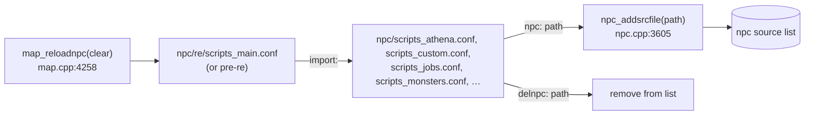

# NPC System

> Status: **Phase 3**. ✅ = verified in source · ⚠️ = inferred · ❓ = unknown.
> This document covers how NPC files are **loaded**, what NPC objects **are**, and how **events** reach scripts. The bytecode compiler and VM are covered in [../scripting-engine.md](../scripting-engine.md).

## 1. Purpose

"NPC files" (`npc/**/*.txt`) are rAthena's content layer. One file format describes six kinds of things:

| Line type (`w2`) | Creates | Parser (`src/map/npc.cpp`) |
|---|---|---|
| `script` | Scripted NPC (dialogs, quests, events, floating "-" controllers) | `npc_parse_script` (`:4381`) |
| `function` + `script` | Global user function | `npc_parse_function` (`:5157`) |
| `duplicate(Name)` | Copy of an existing NPC, sharing its script | `npc_parse_duplicate` |
| `shop`, `cashshop`, `itemshop`, `pointshop`, `marketshop` | Shop NPC | `npc_parse_shop` (`:4002`) |
| `warp`, `warp2` | Warp portal | `npc_parse_warp` (`:3894`) |
| `monster`, `boss_monster` | **Monster spawn** (not an NPC object) | `npc_parse_mob` (`:5218`) |
| `mapflag` | Map property | `npc_parse_mapflag` (`:5420`) |

Barter shops come from `npc/barters.yml` (`BarterDatabase`, `npc.cpp:395`) and stylists from `db/<mode>/stylist.yml` (`StylistDatabase`, `npc.cpp:127`).

## 2. Data structures

✅ `struct npc_data : public block_list` (`src/map/npc.hpp:158`):

| Field | Meaning |
|---|---|
| `ud`, `vd`, `sc`, `status` | NPCs are full units: they can move (`unit_data`), have a sprite (`view_data`), and carry visual SC options |
| `name` / `exname` | Display name / **unique** name. `exname` keys `npcname_db` and prefixes events (`exname::OnLabel`) |
| `class_` | Sprite id (`4_M_SAGE_A`), `JT_FAKENPC` (-1) for floating NPCs, `JT_HIDDEN_WARP_NPC`… |
| `subtype` | `NPCTYPE_WARP`, `SHOP`, `SCRIPT`, `CASHSHOP`, `ITEMSHOP`, `POINTSHOP`, `TOMB`, `MARKETSHOP`, `BARTER` (`map.hpp`) |
| `src_id` | For duplicates: the id of the source NPC |
| `instance_id` | Set on instance copies |
| `path` | Source file. Used by `@unloadnpcfile` / `npc_unloadfile` |
| `state` | `NPCVIEW_ENABLE`/`DISABLE`/`HIDE*` (`enablenpc`, `disablenpc`, `hideonnpc`) |
| `u.scr` | `script` (`script_code*`), `xs/ys` (OnTouch area), `label_list[]`, NPC timer state (`timer`, `timerid`, `timer_event[]`, `rid`), `guild_id` |
| `u.shop` | `shop_item[]`, `count`, `itemshop_nameid` / `pointshop_str` (currency), `discount` |
| `u.warp` | `xs/ys`, destination `mapindex`, `x`, `y` |
| `u.tomb` | MVP tomb: `md`, `kill_time`, killer name |

Global registries (`npc.cpp`):

| Name | Type | Content |
|---|---|---|
| `npcname_db` | strdb | `exname` → `npc_data*` (`npc_name2id`) |
| `ev_db` | strdb | `"NPC::OnLabel"` → `event_data {nd, pos}` |
| `script_event[NPCE_MAX]` | vectors | cached handlers for global player events (§5.2) |
| `npc_path_db` | strdb | per-file bookkeeping |
| `fake_nd` | `npc_data*` | invisible NPC used to run scripts that have no NPC (✅ `npc_create_npc(-1,0,0)` in `do_init_npc`, `npc.cpp:6370`) |
| `userfunc_db` (script.cpp) | strdb | global functions |

## 3. Loading

### 3.1 Which files



Order matters: files are parsed in list order, so **global functions must be loaded before the NPCs that `callfunc` them at load time** (`npc/other/Global_Functions.txt` comes first in `scripts_main.conf`), and a later `function` with the same name overwrites an earlier one.

### 3.2 Parsing a file

✅ `npc_parsesrcfile(filepath)` (`npc.cpp:5646`):

1. Read the whole file. A UTF-8 BOM is **rejected** (the file stops loading with an error).
2. For each line, `sv_parse` splits it on **TAB** into up to four fields:
   ```
   w1                         w2        w3              w4
   <map>,<x>,<y>,<dir>  TAB   script TAB <Name>#<hidden> TAB <sprite>,{ ...body... }
   -                    TAB   script TAB <Name>         TAB -1,{ ... }          (floating, no map)
   function             TAB   script TAB <FuncName>     TAB { ... }
   <map>,<x>,<y>{,<xs>,<ys>} TAB monster TAB <Name> TAB <mob_id>,<amount>{,<delay1>,<delay2>,<event>,<size>,<ai>}
   <map>                TAB   mapflag TAB <flag>        TAB <value>
   ```
   Fewer than 3 fields: "Unknown syntax", and the **rest of the file is skipped**.
3. Validate the map in `w1`. If the map isn't loaded on this map-server, the NPC is skipped. The body is still consumed with `npc_skip_script` so parsing can carry on.
4. Dispatch on `w2` (table in §1). Each parser returns the position after its definition.

### 3.3 Script NPC creation

✅ `npc_parse_script` (`npc.cpp:4381-4500`):

1. Parse the placement (`w1`) and the optional OnTouch area (`xs`,`ys` in `w4`: `<sprite>,<xs>,<ys>,{`).
2. `parse_script(body, filepath, line, SCRIPT_USE_LABEL_DB)` compiles the body. Every `Label:` is recorded in `scriptlabel_db`.
3. `npc_convertlabel_db` (`:4267`) copies the labels into `nd->u.scr.label_list[]`.
4. `npc_create_npc(m, x, y)`, `npc_parsename` (splits `Name#unique` / `Name::unique` into `name` and `exname`), `npc_parseview` (the sprite constant).
5. On a map: `map_addnpc`, `npc_setcells` (marks OnTouch cells), `status_set_viewdata`, `clif_spawn`. Then `map_addiddb` and `strdb_put(npcname_db, exname, nd)`.
6. For each label: `npc_event_export` (`:1211`) registers labels that start with **`On`** (case-insensitive) as `"exname::Label"` in `ev_db`. `npc_timerevent_export` handles `OnTimer<ms>` labels for the NPC timer.

### 3.4 After all files

`do_init_npc` (`npc.cpp:6324`) loads every listed file, then (⚠️ the steps below are taken from `npc_reload`, which runs the same tail; `do_init_npc`'s own order has not been checked line by line):

| Step | Effect |
|---|---|
| `npc_read_event_script()` (`:6004`) | Builds `script_event[]` for the global player events (§5.2) |
| `npc_event_runall("OnInit")` | Called from `npc_event_do_oninit` at the end of `MapServer::initialize` (`npc.cpp:1420`) |
| `add_timer_interval(npc_event_do_clock, 1000)` | Starts the clock-event timer |
| `OnInterIfInit` / `OnInterIfInitOnce` | Run when the char-server link comes up (`inter_init_event_name`) |
| `OnAgitInit` (and `2`/`3`) | Run after the castle data has loaded (`agit_init_event_name`) |

## 4. Interaction: player → NPC

### 4.1 Clicking

✅ `CZ_CONTACTNPC` → `clif_parse_NpcClicked` → `npc_click(sd, nd)` (`npc.cpp:2212`, called at `clif.cpp:~12246`):

- Guards: NPC disabled or hidden, too far away, player already busy (`sd->npc_id`), or other blocking states → `MSI_BUSY` / ignore.
- Dispatch on `subtype`:

| Subtype | Action |
|---|---|
| `NPCTYPE_SHOP` | `clif_npcbuysell` (buy/sell window) → `npc_buylist` / `npc_selllist` when the reply arrives |
| `CASHSHOP` / `ITEMSHOP` / `POINTSHOP` | `clif_cashshop_show` |
| `MARKETSHOP` | `clif_npc_market_open` (stock is persisted in the `market` table) |
| `SCRIPT` | **`run_script(nd->u.scr.script, 0, sd->id, nd->id)`**, which starts at position 0 (the main body) |
| `TOMB` | Tomb info dialog |

From here the dialog loop (`next`/`menu`/`close`) is handled by the VM and `npc_scriptcont`. See [scripting-engine.md §4.4](../scripting-engine.md#44-pausing-for-the-client-dialogs).

### 4.2 Walking into an NPC (OnTouch)

✅ When a unit's move lands on a cell flagged by `npc_setcells`, `unit_walktoxy_timer` calls `npc_touch_areanpc(sd, m, x, y, nd)` / `npc_touch_area_allnpc` (`unit.cpp:521-526`, `:683-685`):

| NPC type | What happens |
|---|---|
| Warp | `pc_setpos` to the destination |
| Script with `OnTouch_` | `npc_event(sd, "exname::OnTouch_", 1)`. Fires once per entry; the player is remembered in `sd->npc_ontouch_` until they leave (`npc_touchnext_areanpc`, `npc.cpp:1858`) |
| Script with `OnTouch` | Fires once and sets `nd->touching_id` (one player at a time) |
| Script with no touch label | Behaves as a click |
| `OnTouchNPC` | Fires when a **monster** walks into the area (✅ `npc_touch_areanpc2(mob_data*)`, `npc.cpp:1997`, `:2048`) |

### 4.3 Chat and other triggers

- `OnPCRE` / `defpattern` / `activatepset`: regex reactions to chat near the NPC (`npc_chat.cpp`, PCRE).
- `OnWhisperGlobal`: whispers to `npc:<Name>`. `OnCommand`: custom `@`-commands bound with `bindatcmd`.
- `OnBuyItem` / `OnSellItem`: script-driven shops (`callshop`, `npcshop*`).

## 5. Events

### 5.1 Event naming and dispatch

An **event** is a label named `On…` inside an NPC script, addressed globally as `"<exname>::<Label>"`.

| Function | Use |
|---|---|
| `npc_event(sd, "NPC::OnX", ontouch)` (`npc.cpp:1794`) | Run one event for a player |
| `npc_event_do("NPC::OnX")` / `npc_event_do_id(name, rid)` (`:1317` / `:1305`) | Run one event without a player / with a player id |
| `npc_event_doall("OnX")` (`:1322`) | Run `::OnX` in **every** NPC (via `npc_event_doall_sub` over `ev_db`) |
| `npc_event_doall_id`, `npc_event_doall_path` | The same, attached to a player / limited to one file |
| `npc_event_runall("OnX")` (`:1328`) | Like doall, used for `OnInit` |
| Script side | `donpcevent "NPC::OnX";`, `doevent`, `addtimer t,"NPC::OnX";`, `initnpctimer` / `OnTimer<ms>` |

✅ **Busy players**: `npc_event_sub` (`npc.cpp:1745`). If `sd->npc_id != 0` (already in a dialog), the event name is queued in `sd->eventqueue[MAX_EVENTQUEUE]` (2 slots; `map.hpp`), or dropped with *"player's event queue is full"*. ✅ The queue is drained by `npc_event_dequeue` (`npc.cpp:1176-1202`): it re-schedules `eventqueue[0]` with `pc_addeventtimer(sd, 100, …)` and shifts the rest down. Otherwise it calls `run_script(ev->nd->u.scr.script, ev->pos, sd->id, ev->nd->id)`, which starts at the label's position.

### 5.2 Global player events

✅ `enum npce_event` (`npc.hpp`) → label names from `script_config` (defaults in `script.cpp:263-271`, overridable in `conf/script_athena.conf`). Every NPC that defines the label receives the event. The handlers are cached in `script_event[type]` by `npc_read_event_script`, and `npc_script_event(sd, type)` (`npc.cpp:5824`) runs each one through `npc_event_sub`.

| Enum | Label | Fired from |
|---|---|---|
| `NPCE_LOGIN` | `OnPCLoginEvent` | `clif_parse_LoadEndAck`, first load (`clif.cpp:10981`) |
| `NPCE_LOADMAP` | `OnPCLoadMapEvent` | `clif_parse_LoadEndAck` on maps with the `loadevent` mapflag (`clif.cpp:11132`) |
| `NPCE_LOGOUT` | `OnPCLogoutEvent` | `map_quit` (`map.cpp:2264`), `pc.cpp:7064`, `@kick`-type paths (`atcommand.cpp:6843`) |
| `NPCE_BASELVUP` / `NPCE_JOBLVUP` | `OnPCBaseLvUpEvent` / `OnPCJobLvUpEvent` | `pc.cpp:8293` / `:8351`, `@blvl`/`@jlvl` |
| `NPCE_DIE` | `OnPCDieEvent` | player death, in `status_damage`'s death path (`status.cpp:1786`, after any battleground `die_event`) |
| `NPCE_KILLPC` | `OnPCKillEvent` | `pc.cpp:9949` |
| `NPCE_KILLNPC` | `OnNPCKillEvent` | monster killed by a player (`mob.cpp:3608`) |
| `NPCE_IDENTIFY` | `OnPCIdentifyEvent` | `skill_identify` (`skill.cpp:10571`), after setting `@identify_idx` |

**Fork note:** this fork's `itemdb_isidentified` always returns 1, so dropped items are already identified. `OnPCIdentifyEvent` will therefore rarely fire, if ever.

### 5.3 Time-based events

✅ `npc_event_do_clock` (`npc.cpp:1368`) runs every 1 s, starting after `OnInit`. Whenever the minute, hour or day changes, it fires (through `npc_event_doall`):

| Label pattern | When |
|---|---|
| `OnMinute<mm>` | every hour at minute `mm` |
| `OnClock<hhmm>` | daily at `hh:mm` |
| `On<Day><hhmm>` (`OnSun`…`OnSat`) | weekly |
| `OnHour<hh>` | daily at `hh:00` |
| `OnDay<MMDD>` | yearly |

**NPC timers** (`initnpctimer`, `startnpctimer`, `stopnpctimer`, `setnpctimer`): each NPC has a millisecond timer, attachable to one player (`u.scr.rid`). `OnTimer<ms>` labels are pre-sorted into `u.scr.timer_event[]`, and `npc_timerevent_start` (`npc.cpp:1542`) schedules the next one with `add_timer`. `OnTimerQuit` fires if the attached player logs out.

Other system events: `OnAgitStart`/`OnAgitEnd` (WoE), `OnGuildBreak`, `OnInstanceInit`/`OnInstanceDestroy` (per instance copy, see `npc_instanceinit` `npc.cpp:4762`), `OnNaviGenerate`, `OnInterIfInit(Once)`.

## 6. Duplicates and instances

- `duplicate(Source)` (`npc_parse_duplicate`, `npc.cpp:4525`) creates a new `npc_data` with its own position, name and sprite, but ✅ **the same `script_code` pointer and label list** (`nd->u.scr.script = dnd->u.scr.script`, `:~4602-4603`). `src_id` points at the original, even when duplicating a duplicate. Labels and events are re-exported under the duplicate's `exname`. Because `.variables` live in `script_code.local`, it follows that **duplicates share NPC variables with their source**. Scripts often use `strnpcinfo(…)` to tell copies apart.
- Script-side `duplicate`/`duplicate_dynamic` and `npc_duplicate_npc` (`npc.cpp`) create duplicates at runtime (for example per-player NPCs with an `owner`).
- **Instances**: when an instance is created, every NPC on the instance's source maps is duplicated onto the instance map copies (`npc_instanceinit`, `npc.cpp:4762`), and `exname::OnInstanceInit` runs. Instance variables (`'var`) live in the instance, not in the NPC. Details in content-systems (phase 5).

## 7. Monster spawns from NPC files

✅ `npc_parse_mob` (`npc.cpp:5218`): `w1=<map>{,x,y{,xs,ys}}`, `w4=<mob id>,<amount>{,<delay1>{,<delay2>{,<event>{,<size>{,<ai>}}}}}`. It fills a `spawn_data` (`map.hpp`), then `npc_parse_mob2` (`:5198`) spawns the monsters. With `battle_config.dynamic_mobs`, the spawn is instead stored in the map's `moblist[]` (`map_addmobtolist`, `npc.cpp:5392`) and only spawned while players are on that map. The optional `event` is an `NPC::OnLabel` that runs when one of these monsters dies (`OnMyMobDead`-style idioms). Monster behaviour itself: monster-system (phase 4).

## 8. Reload and unload

✅ `npc_reload` (`npc.cpp:6058`), from `@reloadscript`:

1. Clear guild flags, the path list, `npc_path_db`, `npcname_db` and `ev_db`. Save market stock (`npc_market_fromsql`).
2. Walk every object: NPCs (except `fake_nd`) → `npc_unload`; spawned monsters → `unit_free`. Clear dynamic mob lists and their timers, and warn if any NPCs survived.
3. Re-parse every source file, then `npc_read_event_script`, `OnAgitInit`, `OnInit`, `map_data_copyall`, `do_reload_instance`, `OnInterIfInit` (if char is connected), `npc_market_checkall`.

`@loadnpc <file>` → `npc_addsrcfile` + `npc_parsesrcfile`. `@unloadnpcfile <file>` → `npc_unloadfile`: unloads the file's NPCs and their duplicates, removes its mob spawns, and refreshes the event cache. Use these for iterating on one file without a full reload.

## 9. Dependencies

| Depends on | For |
|---|---|
| script | compiling and running every script NPC; `userfunc_db`; constants |
| map | `map_addnpc`, cells, block grid, `map_mapname2mapid` |
| unit / path | moving NPCs (`npcwalkto`), OnTouch on unit movement |
| clif | spawn/despawn, dialogs, shop windows |
| pc | events, `pc_setpos` (warps), currencies |
| mob | spawn lines, `OnNPCKillEvent`, mob event labels |
| itemdb | shop item validation; item scripts calling `callfunc` |
| instance, guild, battleground | instance copies, WoE events, BG NPCs |
| SQL (map) | `market`, `barter` tables, script `query_sql` |

Depended on by: pc (login/logout events), mob (kill events), skill (a few NPC-triggered skills), atcommand (`@reloadscript`, `@loadnpc`), instance, guild (`OnAgit*`).

## 10. Customisation guide

| Goal | Best place |
|---|---|
| New quest, shop, warp, event or dialog | **Script**: a new file under `npc/custom/`, listed in `npc/scripts_custom.conf` (this fork already does this for `change_dress.txt`, `endower.txt`) |
| Change an official NPC | Copy it into `npc/custom/` and `delnpc:` the original in `scripts_custom.conf` (⚠️ or edit it in place and accept merge conflicts; this fork edits several official quest files directly) |
| Shared helper logic | `function` NPC loaded early, called with `callfunc` |
| React to logins, kills, level-ups | `OnPC*Event` labels in a floating `-` NPC |
| Scheduled task | `OnClock`/`OnMinute`/`OnHour`/`OnDay` labels |
| New capability scripts can't express | **C++ script command** (see [scripting-engine.md §8](../scripting-engine.md#8-adding-a-script-command)) |
| New global player event | Add an `npce_event` value + `script_config` name + default string, call `npc_script_event(sd, NPCE_X)` at the trigger site, and update `npc_get_script_event_name` |
| New NPC line type | Add a branch in `npc_parsesrcfile`'s dispatch and a `npc_parse_*` function. Rarely justified |

Side effects to watch:

- `OnInit` runs again on every `@reloadscript`, so make it idempotent (`$` variables survive, `.` variables don't).
- Events fired while a player is in a dialog are queued (2 slots) or dropped.
- Area OnTouch NPCs cost a cell-flag check on every step. Keep `xs`/`ys` small.
- `OnClock` handlers run on the main thread for every NPC that defines them. Keep them short.
