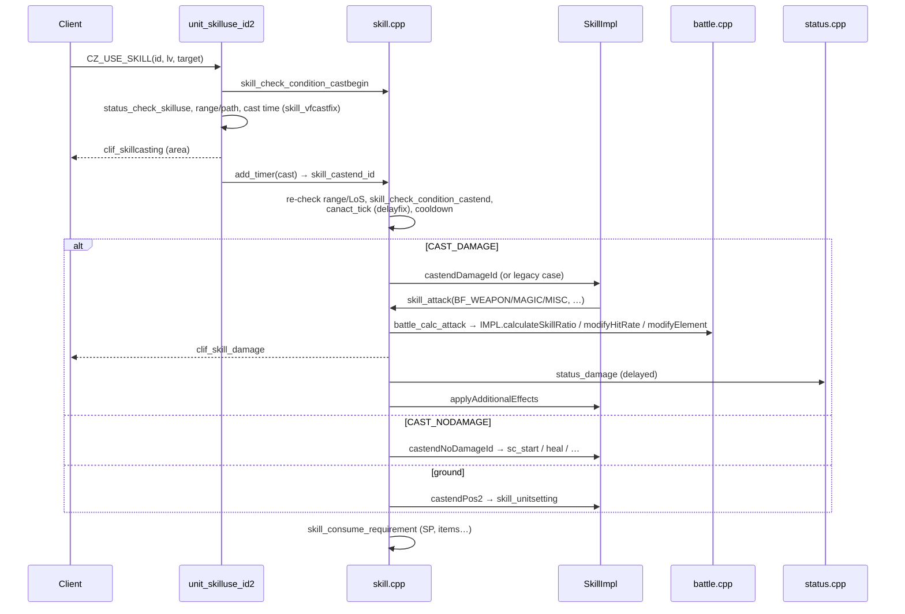

# Skill System

> Status: **Phase 4**. ✅ = verified in source · ⚠️ = inferred · ❓ = unknown.
> Main files: `src/map/skill.cpp` (16.3k lines), `src/map/skill.hpp`, **`src/map/skills/**`** (1,244 per-skill files), `src/map/unit.cpp` (casting state machine). Data: `db/<re|pre-re>/skill_db.yml` (1,635 skills in RE), `skill_tree.yml`, `conf/battle/skill.conf`.
> Damage maths is covered in [combat-system.md](combat-system.md), status effects in [status-system.md](status-system.md).

## 1. Purpose

The skill system turns "unit X uses skill S at level L on target T (or cell x,y)" into:

1. requirement validation
2. cast time
3. a delayed cast-end
4. a range and line-of-sight re-check
5. resource consumption
6. the effect: damage, buff or debuff, placing ground units, summoning, warping…
7. cooldowns and after-cast delay
8. client notifications

The same pipeline serves players, monsters (`mobskill_use`), homunculi, mercenaries, elementals and NPC-type skills.

## 2. Skill data

### 2.1 `s_skill_db`

✅ `struct s_skill_db` (`skill.hpp:265`), loaded by `SkillDatabase` (`TypesafeCachedYamlDatabase<uint16,…>`, `skill.hpp:325`). Most arrays are indexed by level (`MAX_SKILL_LEVEL`):

| Group | Fields (YAML keys ≈ field names) |
|---|---|
| Identity | `nameid` (Id), `name` (AEGIS name, e.g. `SM_BASH`), `desc` |
| Targeting | `inf` (passive / enemy / place / self / friend / trap), `range[]`, `splash[]`, `hit` (normal/multi-hit display), `inf2` (≈ 90 `INF2_*` flags: `IsQuest`, `IsSong`, `TargetTrap`, `IgnoreLandProtector`, `NoTargetSelf`, …) |
| Damage | `element[]`, `nk` (`NK_*`: NoDamage, Splash, SplashSplit, IgnoreAtkCard, IgnoreElement, IgnoreDefense, IgnoreFlee, IgnoreDefCard, Critical…), `num[]` (hits), `skill_type` (`BF_WEAPON`/`MAGIC`/`MISC`), `blewcount[]` (knockback), `damage` (map/zone damage adjust), `copyable` (Plagiarism/Reproduce) |
| Timing | `cast[]`, `fixed_cast[]` (RE), `delay[]` (after-cast delay), `walkdelay[]`, `cooldown[]`, `upkeep_time[]`/`upkeep_time2[]` (Duration1/2), `castcancel`, `cast_def_rate`, `castnodex`/`delaynodex` |
| Cost | `require` (`s_skill_require`, `skill.hpp:237`): `hp[]`, `mhp[]`, `sp[]`, `ap[]`, `*_rate[]`, `zeny[]`, `weapon` (bitmask), `ammo`/`ammo_qty[]`, `state` (`e_require_state`: hiding, riding, cart, sight, explosionspirits…), `spiritball[]`, `itemid[]`/`amount[]`, `eqItem`, `status` (required SCs) |
| Ground units | `unit_id`/`unit_id2`, `unit_layout_type[]`, `unit_range[]`, `unit_interval`, `unit_target`, `unit_flag` (`UF_*`) |
| Misc | `maxcount[]`, `giveap[]`, `nocast` (from `skill_nocast_db.txt`, zone restrictions), `sc` (default SC), `abra_probability[]`, `improvisedsong_rate`, `unit_nonearnpc_*` |
| **Behaviour** | **`impl`**: `std::unique_ptr<const SkillImpl>` (§4) |

Getters: `skill_get_range2`, `skill_get_time` / `time2`, `skill_get_ele`, `skill_get_inf2(id, INF2_X)`, `skill_get_casttype(id)` (`CAST_GROUND` / `CAST_DAMAGE` / `CAST_NODAMAGE`), `skill_get_sc`, `skill_get_cooldown`, … Lookup: `skill_db.find(id)`, `skill_name2id`, `skill_get_index(id)` (index into `mmo_charstatus::skill[]`; the comment at `skill.hpp:327` marks the index layer as legacy).

### 2.2 Other skill data files

| File | Class | Purpose |
|---|---|---|
| `skill_tree.yml` | `SkillTreeDatabase` (pc.hpp) | Who can learn what (see character-system) |
| `create_arrow_db.yml` | `SkillArrowDatabase` (`skill.hpp:481`) | Arrow Crafting |
| `abra_db.yml` | `AbraDatabase` (`:499`) | Hocus-pocus random skills |
| `spellbook_db.yml` | `ReadingSpellbookDatabase` (`:2831`) | Warlock spellbooks |
| `magicmushroom_db.yml` | `MagicMushroomDatabase` (`:2854`) | Magic Mushroom random skills |
| `re/produce_db.txt`, `skill_changematerial_db.txt` | TXT loaders | Crafting, Change Material |
| `skill_damage_db.txt` | TXT → `skill_db.damage` | Per-map/zone damage adjustments |
| `re/skill_nocast_db.txt` | TXT → `nocast` | Zone-based cast restrictions |

`skill_readdb` (`skill.cpp:16245`) loads them all. `skill_reload` (`:16292`) backs `@reloadskilldb`.

## 3. Execution pipeline

### 3.1 Request → cast begin

✅ Client `CZ_USE_SKILL` → `clif_parse_UseSkillToId` → `unit_skilluse_id(sd, target_id, skill_id, skill_lv)` (`clif.cpp:~12964`). Ground skills use `CZ_USE_SKILL_TOGROUND` → `unit_skilluse_pos`. Monsters use `mobskill_use`, and homunculi/mercenaries their own handlers (`clif.cpp:12785`, `:12838`).

`unit_skilluse_id2(src, target_id, skill_id, skill_lv, casttime, castcancel, ignore_range)` (`unit.cpp:2077`), steps as offsets from that line:

| # | Step | Where (offset) |
|---|---|---|
| 1 | Source alive, `canact_tick` passed, not already casting, target exists | `+13-33` |
| 2 | **`skill_isNotOk(id, sd)`** (`skill.cpp:819`: map/zone restrictions, mapflags, **cooldown** via `sd.scd`, `:841`) then **`skill_check_condition_castbegin(sd, id, lv)`** (`skill.cpp:8244`: SP/HP/item/weapon/state/SC requirements) | `+39`, `+57`, `+248` |
| 3 | Many per-skill special cases (target substitution, self-only, combos…) | `+50-240` |
| 4 | `status_check_skilluse(src, target, id, 0)`: SC blocks (silence, `sc.cant.cast`…) | `+141` |
| 5 | `battle_check_target` for enemy/friend validity | `+180` |
| 6 | Range: `skill_get_range2`. Out of range → set `stepaction` and walk to the target (cast on arrival) | `+263-274` |
| 7 | Path checks: `unit_can_reach_bl`, projectile path | `+281-287` |
| 8 | Cast time: per-skill modifiers → `skill_castfix_sc` (SC effects) → `skill_vfcastfix` (RE variable/fixed split, DEX/INT, item bonuses) | `+393-395` (`skill.cpp:10208`, `:10256`; pre-RE `skill_castfix` `:10125`) |
| 9 | `clif_skillcasting` (cast bar for everyone in the area) | `+410` |
| 10 | Store `ud->skill_id`, `skill_lv`, `skilltarget`; `unit_set_castdelay` | `+454-464` |
| 11 | `casttime > 0` → `ud->skilltimer = add_timer(tick + casttime, skill_castend_id, src->id, 0)`; otherwise call `skill_castend_id` immediately | `+486-492` |

Ground-targeted skills follow the same path through `unit_skilluse_pos2` → `skill_castend_pos` (`TIMER_FUNC`, `skill.cpp:5250`) → `skill_castend_pos2` (`:5404`).

Casting can be **interrupted**: damage with `castcancel` (unless the player has Phen or a similar effect), `unit_skillcastcancel` from `status_damage`, movement, SCs, the target dying or leaving.

### 3.2 Cast end

✅ `TIMER_FUNC(skill_castend_id)` (`skill.cpp:4855`), offsets from `:4855`:

1. Re-resolve the caster and target. Clear `ud->skilltimer`.
2. Re-check that the target is valid, in range (`skill_get_range2 + skill_add_range`), and in line of sight (`path_search_long(..., CELL_CHKWALL)` for non-NODAMAGE skills). On failure: `clif_skill_fail`, and **items may still be consumed** (`skill_consume_requirement(..., 3)`) (`+143-157`).
3. **`skill_check_condition_castend`** (`skill.cpp:9332`) re-validates requirements that could change during the cast (ammo, items, SP). Failure → `skill_consume_requirement(..., 1)` and fail (`+164-167`).
4. Skill-immune / Emperium checks (`+206`).
5. **After-cast delay**: `ud->canact_tick = tick + skill_delayfix(...)` (`skill_delayfix`, `:10388`); `EFST_POSTDELAY` icon (`+226`, `+258`).
6. **Cooldown**: `pc_get_skillcooldown` → `skill_blockpc_start(sd, id, ms)`. Homunculi and mercenaries have their own variants (`+232-252`).
7. **Execute**: `CAST_NODAMAGE` → `skill_castend_nodamage_id(src, target, id, lv, tick, flag)` (`:4366`), otherwise `skill_castend_damage_id` (`:4179`) (`+304-307`).
8. **Consume** remaining requirements: `skill_consume_requirement(sd, id, lv, 1)` (`:9600`) (`+343`).
9. Bookkeeping: auto-repeat (`skill_keep_using`), dance adaptation block, and so on.

### 3.3 Effect dispatch

| Function | Legacy `case` labels remaining | Then |
|---|---|---|
| `skill_castend_damage_id` (`skill.cpp:4179`) | **10** | `default:` → `skill->impl->castendDamageId(...)` (`:~4239`), else "Unknown skill" warning |
| `skill_castend_nodamage_id` (`:4366`) | 70 | `skill->impl->castendNoDamageId(...)` (`:~4591`) |
| `skill_castend_pos2` (`:5404`) | 13 | `skill->impl->castendPos2(...)` (`:~5446`) |
| `battle_calc_attack_skill_ratio` (`battle.cpp:4407`) | 9 | `impl->calculateSkillRatio` |

(✅ counts from `grep -c 'case [A-Z]'` over each function's range.) **Most skills are now implemented in `src/map/skills/`.** The legacy switches only keep cross-cutting special cases.

**Splash/AoE**: a damage skill with a splash area runs `map_foreachinrange(skill_area_sub, target, splash, BL_CHAR, src, skill_id, skill_lv, tick, flag|BCT_ENEMY|SD_SPLASH|1, skill_castend_damage_id)`. `skill_area_sub` (`skill.cpp:3323`) filters with `battle_check_target` and calls the passed function back for each target with `flag & 1` set (meaning "this is the per-target hit"). `skill_area_temp[]` is a global scratch array used to pass counts and ids between these calls. `SD_LEVEL`, `SD_ANIMATION` and `SD_SPLASH` control the client display.

### 3.4 Hitting a target: `skill_attack`

✅ `skill_attack(attack_type, src, dsrc, bl, skill_id, skill_lv, tick, flag)` (`skill.cpp:2701`):

1. `dmg = battle_calc_attack(attack_type, src, bl, skill_id, skill_lv, flag & 0xFFF)` (`+53`). See combat-system.
2. Pet skill overrides, then **magic reflection** (Kaite, Maya, `bMagicDamageReturn`…), which may swap caster and target (`+81-170`). Other evasion SCs (Hallucination Walk…).
3. Display: `clif_skill_damage(...)` with the damage, number of hits and type.
4. Apply: through `battle_delay_damage` / `battle_fix_damage` → `status_fix_damage` / `status_damage`, so damage lands after the animation delay.
5. `skill_additional_effect` (`:1207`) applies on-hit effects (stun, freeze, item autospell / addeff), then **`impl->applyAdditionalEffects`** (`:1338`). `skill_counter_additional_effect` (`:1693`) handles effects on the caster (`impl->applyCounterAdditionalEffects`, `:1738`).
6. Knockback `skill_blown` (`path_blownpos`), HP/SP drain, `skill_onskillusage` (autospell on skill use).

All of this runs under `map_freeblock_lock`, because the target may die during step 4 ([memory-management.md §4](../memory-management.md#4-deferred-object-destruction)).

### 3.5 Pipeline diagram

## 4. Per-skill classes (`src/map/skills/`)

✅ `class SkillImpl` (`skills/skill_impl.hpp`). Each hook replaces a legacy `switch` block, and the default implementations are no-ops (`skill_impl.cpp`):

| Hook | Called from | Replaces |
|---|---|---|
| `castendDamageId(src, target, lv, tick, flag&)` | `skill_castend_damage_id` | the damage switch |
| `castendNoDamageId(...)` | `skill_castend_nodamage_id` | the support/buff switch |
| `castendPos2(src, x, y, lv, tick, flag&)` | `skill_castend_pos2` | the ground switch |
| `calculateSkillRatio(wd, src, target, lv, ratio&, mflag)` | `battle_calc_attack_skill_ratio` (`battle.cpp:4469`, weapon) and the magic ratio code (`:5983`) | the skill ratio switch |
| `modifyHitRate(hit&, src, target, lv)` | `battle.cpp:~3294` | the hit-rate switch |
| `modifyElement(dmg, src, target, lv, element&, flag)` | `battle.cpp:~3495` | element overrides |
| `modifyDamageData(dmg&, src, target, lv)` | right after each `Damage` is initialised: weapon `battle.cpp:5409`, magic `:5865`, misc `:6339` | damage setup tweaks |
| `applyAdditionalEffects(...)` | `skill_additional_effect` | the on-hit effects switch |
| `applyCounterAdditionalEffects(...)` | `skill_counter_additional_effect` | caster-side effects |

Helper bases:

- `StatusSkillImpl(skill, end_if_running)`: a buff that just runs `sc_start(skill_get_sc)`. It toggles off when `end_if_running` is set.
- `WeaponSkillImpl`: `castendDamageId` = a single `skill_attack(BF_WEAPON)`.
- `SkillImplRecursiveDamageSplash`: the splash pattern.

**Example** (✅ `skills/swordman/bash.cpp`): `SkillBash : WeaponSkillImpl(SM_BASH)` overrides only

- `calculateSkillRatio` (+30% per level)
- `modifyHitRate` (+5% per level)
- `applyAdditionalEffects` (Fatal Blow stun chance at levels 6–10)

**Registration**: each family has `skill_factory_<family>.cpp` with a `switch(skill_id)` returning `std::make_unique<SkillX>()` (`skill_factory_swordman.cpp:296` for `SM_BASH`). `SkillFactoryImpl::create` asks **`SkillFactoryCustom` first**, then each family (`skills/skill_factory.cpp`). `SkillDatabase::loadingFinished` binds the result into `s_skill_db::impl` for every loaded skill (`skill.cpp:~15760`). `skill_factory.cpp` `#include`s every family's `.cpp` (a unity build), and `MAP_GENERATOR` builds skip it.

## 5. Ground skill units

✅ For persistent area skills (Storm Gust, Safety Wall, Pneuma, traps, songs, Land Protector…):

- `skill_unitsetting(src, id, lv, x, y, flag)` (`skill.cpp:5752`) builds the layout from `unit_layout_type` / `unit_range` / `unit_id`. It creates an **`s_skill_unit_group`** (`skill.hpp:389`: owner ids, party/guild/BG ids, `target_flag` BCT_, `bl_flag`, `tick`, `limit`, `interval`, `skill_id`/`lv`, unit list) through `skill_initunitgroup` (`:11887`), plus one **`skill_unit : block_list`** (`skill.hpp:379`, type `BL_SKILL`) per cell (`skill_initunit`). They are added to the map grid and are visible to clients through `clif_getareachar_skillunit` / insight.
- The group is stored in the caster's `ud->skillunits`.
- Effects:
  - `skill_unit_onplace` (`:6361`) when a unit **enters** a cell (or one is placed on it)
  - `skill_unit_onplace_timer` (`:6716`) every `interval`, driven by `skill_unit_timer` / `skill_unit_timer_sub` (`:12203`)
  - `skill_unit_onout` (`:7617`) / `skill_unit_onleft` (`:7681`) when it leaves
  - `skill_unit_move` (`:12605`), called from `map_moveblock`, triggers on/out effects as units walk through
  - `ud->skillunittick[]` throttles how often one group can hit the same unit
- Removal: on reaching `limit`, by `skill_delunit` (`:11766`) / `skill_delunitgroup`, by being dispelled (Land Protector removing others), or when the caster dies or logs out for some skills.

## 6. Learning and levels (player side)

`sd->status.skill[skill_get_index(id)] = {id, lv, flag}`. `flag` is `SKILL_FLAG_*` (✅ `mmo.hpp:383-388`): `PERMANENT`, `TEMPORARY` (item-granted), `PLAGIARIZED`, `PERM_GRANTED` (granted by script), `TMP_COMBO`, plus higher values that encode a replaced level. The tree is recalculated by `pc_calc_skilltree`, raised by `pc_skillup`, and read with `pc_checkskill`. Item-granted skills: the `skill` script command, used in item scripts (`bonus` is unrelated). Plagiarism / Reproduce use `copyable`.

## 7. Configuration

`conf/battle/skill.conf` (✅ keys verified): `delay_rate` (`:16`), `min_skill_delay_limit` (`:25`), `castrate_dex_scale` (`:51`), `skill_add_range` (`:69`), `skill_out_range_consume` (`:72`), `skill_wall_check` (`:151`), and many more. Per-skill damage adjustments go in `skill_damage_db.txt` and the `skill_damage` mapflag.

## 8. Dependencies

- **Uses**: battle (damage), status (SC start/end, `status_check_skilluse`, `status_damage`), unit (casting state, walking to range, `canact`), map (`foreachin*`, cells, skill units on the grid), clif (cast bar, damage, unit packets, failure messages), pc (requirements, consumption, skill levels), mob (summons, monster skills), party/guild (target flags, songs), path (LoS, knockback), itemdb (item requirements), script (skills that call scripts ⚠️).
- **Used by**: unit (casting), clif (client requests), mob AI (`mobskill_use`), pet/homunculus/mercenary/elemental AI, script (`skill`, `unitskilluseid`, `itemskill`), status (`status_skill2sc`), battle (autospell).

## 9. Customisation guide

| Goal | Where |
|---|---|
| Change numbers that are in the DB (SP cost, range, cast time, cooldown, duration, element, requirements) | `db/import/skill_db.yml` override. **No C++** |
| Change who can learn a skill | `db/import/skill_tree.yml` |
| Change a skill's formula or effect | Its class in `src/map/skills/<family>/<skill>.cpp` (find it via `skill_factory_<family>.cpp`). Skills not yet migrated live in the legacy `case` labels in `skill.cpp` / `battle.cpp` |
| **Override an official skill without touching upstream files** | Add a class under `src/map/skills/custom/`, return it from `SkillFactoryCustom::create` (`skills/custom/skill_factory_custom.cpp`). The custom factory is consulted first |
| Add a **new skill** | 1) Add an `e_skill` id to the enum in `skill.hpp` (pick an unused id; there's no dedicated custom range marker, ❓). 2) Add a `skill_db.yml` entry (and `skill_tree.yml`). 3) Write a `SkillImpl` subclass and register it in the custom factory. 4) Client data (skillinfo lua) so the client can show and use it. 5) An SC, if it applies one (see status-system) |
| Global cast/delay tuning | `conf/battle/skill.conf`, `skill_vfcastfix` / `skill_delayfix` for formulas |

Side effects:

- Requirements are checked **twice**, at cast begin and at cast end. Keep both checks consistent when adding requirements.
- `skill_area_temp[]` is global scratch shared by nested calls. Don't keep using it across calls that can re-enter `skill_castend_*`.
- Damage is often **delayed** (`battle_delay_damage`). A target may be dead or gone by the time it lands, so check `bl->prev` and use ids.
- `flag` bits passed through the castend functions mean different things at different depths (`1` = per-target call, `SD_*`, `BCT_*`). Follow existing patterns.
