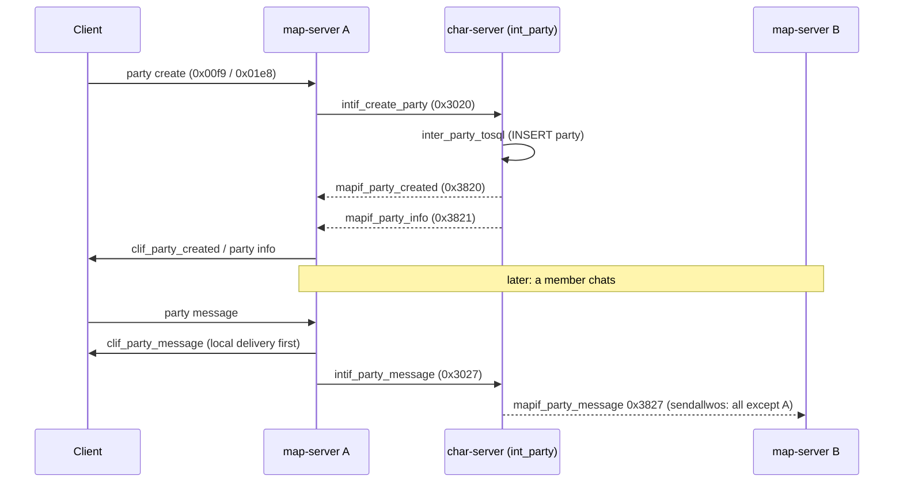
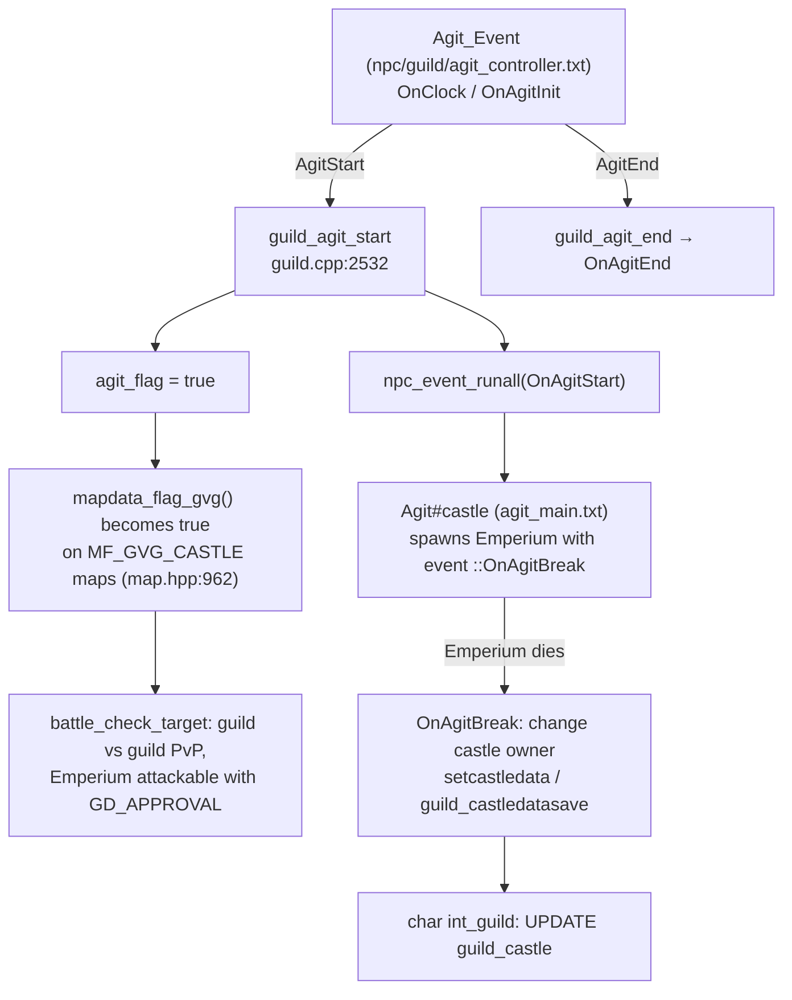

# Social Systems (party, guild, WoE, clan, chat rooms, channels, friends, duel)

> Status: **Phase 5**. ✅ = verified in source · ⚠️ = inferred · ❓ = unknown.
> Main files: `src/map/party.cpp`, `guild.cpp`, `clan.cpp`, `chat.cpp`, `channel.cpp`, `duel.cpp`, friend handlers in `clif.cpp`. Char side: `src/char/int_party.cpp`, `int_guild.cpp`, `int_clan.cpp`. Config: `conf/channels.conf`, `db/castle_db.yml`, `db/guild_skill_tree.yml`, `db/(re/)exp_guild.yml`. Scripts: `npc/guild/`, `npc/guild2/`, `npc/guild3/`.

## 1. Ownership model

The group systems that must work across map-servers (party, guild, clan) are **owned by the char-server**. Map-servers keep a *read cache* and send every change as an `intif` request. The char-server applies it, writes SQL, then broadcasts the result to all map-servers (see [../inter-server.md](../inter-server.md)).

| System | Authority | Map-side cache | Char-side cache | Cross-map-server? |
|---|---|---|---|---|
| Party | char `int_party.cpp` | `party_db` (`DBMap` idb of `party_data`) | `party_db` `unordered_map<int, shared_ptr<party_data>>` (`int_party.cpp:34`) | ✅ yes |
| Guild | char `int_guild.cpp` | `guild_db` of `shared_ptr<MapGuild>` | `guild_db` + `castle_db` (`int_guild.cpp:39-40`), lazy-saved | ✅ yes |
| Clan | char `int_clan.cpp` (static, from SQL `clan`) | `clan_db` idb (`clan.cpp`) | `clan_db` (`int_clan.cpp:24`) | ✅ yes (chat relay) |
| Chat room | map only | `chat_data : block_list` (`BL_CHAT`) | — | ❌ local to one map |
| Channel | map only | `channel_db` / per-map / per-guild | — | ❌ (no `intif` call in `channel.cpp`) ✅ |
| Friends | char saves list (`friends` table) | `sd->status.friends[MAX_FRIENDS=40]` | — | ⚠️ online/offline toggles are only sent to players on the **same map-server** (`map_foreachpc`, `clif.cpp:10977`, `unit.cpp:3978`) |
| Duel | map only | `duel_list` in `duel.cpp` | — | ❌ |

Limits (`mmo.hpp`): `MAX_PARTY 12` (`:99`), `MAX_GUILD 16+10*6 = 76` (`:100`), `MAX_GUILDALLIANCE 16` (`:103`), `MAX_CLAN 500` (`:115`), `MAX_FRIENDS 40` (`:168`), `MAX_CHAT_USERS 20` (`chat.hpp:11`).

## 2. Party

### Data

✅ `party_data` (`party.hpp:25`):

- `party`: the persistent `struct party` (`mmo.hpp`): id, name, `exp` (share mode), `item` (loot mode), `member[MAX_PARTY]` (account_id, char_id, name, class, map, lv, leader, online).
- `data[MAX_PARTY]`: runtime `party_member_data` holding the `sd` pointer of members **on this map-server**.
- `itemc`: round-robin index for shared loot.
- `instance_id`: the party's instance, if any.
- `state.{monk, sg, snovice, tk}`: cached class presence, used by party-dependent skills (`party_check_state`, `party.cpp:228`).

### Lifecycle

| Step | Map | Char |
|---|---|---|
| Create | `party_create` (`party.cpp:144`) sets `sd.party_creating` → `intif_create_party` | `mapif_parse_CreateParty` (`int_party.cpp:505`) checks the name (`search_partyname`), inserts, replies `mapif_party_created` + `mapif_party_info` |
| Ack | `party_created` (`:167`). If the player logged off meanwhile, it immediately leaves the party so it isn't orphaned. Scripts get `$@party_create_id` | — |
| Login | `pc_reg_received` (`pc.cpp:2354`) → `party_member_joined` (`party.cpp:623`): binds `p->data[i].sd`, or requests info if not cached | `inter_party_CharOnline` (`int_party.cpp:836`) marks online, recalculates min/max level |
| Info refresh | `party_recv_info` (`:268`) diffs old vs new members (added/removed/renamed) and updates clients | `mapif_party_info` (`:399`): `fd<0` broadcasts to all maps |
| Invite | `party_invite` (`:383`) → client prompt → `party_reply_invite` (`:571`) → `party_join` / `intif_party_addmember` | `mapif_parse_PartyAddMember` (`:574`) |
| Leave / kick | `party_leave` (`:759`), `party_removemember` (`:699`) → `party_member_withdraw` (`:800`) on ack | `mapif_parse_PartyLeave` (`:634`); empty parties are deleted |
| Options | `party_changeoption` (`:877`) → `party_optionchanged` (`:920`) | `mapif_parse_PartyChangeOption` (`:612`) refuses exp share when the level gap is too wide |
| Leader | `party_changeleader` (`:940`) | `mapif_parse_PartyLeaderChange` (`:761`) |
| Map change | `party_send_movemap` (`:1041`) | `mapif_parse_PartyChangeMap` (`:686`) updates `member.map`/`lv`, re-checks share |
| Break | `party_broken` (`:852`) | `mapif_parse_BreakParty` (`:744`) |

On leave, kick or break, `party_trade_bound_cancel` (`party.cpp:205`) removes party-bound items from the player's inventory.

### Exp and loot sharing

- **Exp-share eligibility** is decided on **char**: `party_check_exp_share` (`int_party.cpp:340`) returns true if fewer than 2 members are online, or `max_lv - min_lv <= party_share_level` (from `conf/inter_athena.conf`), or the **family exception** applies (`party_check_family_share`, `:300`: child plus both parents, all online, same map, parents ≥ lv70). When eligibility is lost, char switches `exp` back to "each take" (`int_party.cpp:61,110`).
- **Distribution** is on map: `party_exp_share` (`party.cpp:1238`) counts members on the monster's map who are alive and not idle (`battle_config.idle_no_share`). It splits base, job and zeny evenly, then applies `party_even_share_bonus` × (count−1)%. In Renewal (`RENEWAL_EXP`), each member's share goes through `pc_level_penalty_mod` (a no-op in this fork, since `level_penalty.yml` is empty).
- **Loot**: `party_share_loot` (`:1298`) handles each-take / party-shared / round-robin (`itemc`).
- **Position dots**: `party_send_xy_clear` (`:1213`) and a periodic timer send member mini-map positions.

### Party booking

`party_booking_register/update/search/delete` (`party.cpp:1475-1563`) are the in-game party finder. These ads are kept in map memory ⚠️. The newer recruitment UI is served by the **web-server** (`partybooking_controller.cpp`, see [../web-server.md](../web-server.md)), which stores data in SQL table `party_bookings`.

## 3. Guild

### Data

✅ `MapGuild` (`guild.hpp:30`) wraps `mmo_guild` (`mmo.hpp`) and adds a `Channel*` (the guild's ally channel), `instance_id` and `chargeshout_flag_id`. `mmo_guild` holds: id, name, master, `guild_lv`, `exp`, `next_exp`, `skill_point`, `max_member`, `average_lv`, `connect_member`, `member[MAX_GUILD]` (with `exp`, `position`, `online`), `position[MAX_GUILDPOSITION]` (name, `mode` permissions, `exp_mode` tax %), `alliance[16]` (`opposition` 0 = ally, 1 = enemy), `expulsion[]`, `skill[]`, `emblem_data`/`emblem_len`/`emblem_id`, `mes1`/`mes2`.

Guild databases:

- `GuildSkillTreeDatabase` (`guild.cpp:71`): `db/guild_skill_tree.yml`.
- `GuildExpDatabase` (char `int_guild.cpp:744`): `exp_guild.yml`. Char computes guild level-ups.
- `CastleDatabase castle_db` (`guild.cpp:38`): `db/castle_db.yml`.

### Lifecycle

The flows mirror party: `guild_create` (`guild.cpp:689`) → char → `guild_created` (`:722`) and `guild_recv_info` (`:822`). Invite is `guild_invite`/`guild_reply_invite` (`:925`, `:1002`). Leave and expel are `guild_leave` (`:1156`) and `guild_expulsion` (`:1189`), followed by `guild_member_withdraw` (`:1249`). Positions, notice and emblem use `guild_change_*` → `*_changed` acks. Master change is `guild_gm_change` (`:2193`). Break is `guild_break` (`:2289`).

`guild_has_permission` (`:2640`) checks the member's position `mode` bits (`GUILD_PERM_INVITE`, `GUILD_PERM_EXPEL`, `GUILD_PERM_STORAGE`…).

### Guild exp (tax)

✅ `guild_payexp` (`guild.cpp:1681`) takes `exp × position.exp_mode%` from a member's base exp gain. It accumulates in a map-side `guild_expcache_db` (ERS-allocated). Every `GUILD_PAYEXP_INTERVAL` = 10 s (`guild.cpp:50`, timer at `:2737`), `guild_payexp_timer_sub` (`:624`) flushes each entry to char as `intif_guild_change_memberinfo(GMI_EXP)`. Char adds it to the guild total and levels the guild. So **up to 10 s of guild exp can be lost on a map crash** ⚠️.

### Char-side lazy save

✅ Char keeps guilds in memory with a `save_flag` bitmask (`GS_BASIC`, `GS_MEMBER`, `GS_POSITION`, `GS_ALLIANCE`, `GS_EXPULSION`, `GS_SKILL`, `GS_EMBLEM`…, `GS_MASK 0x03FF`; `int_guild.hpp:14-25`). `guild_save_timer` (`int_guild.cpp:51`) saves **one dirty guild per tick**, spreading `autosave_interval` across all cached guilds (`interval / guild_db.size()`). Guilds whose flag reaches `GS_REMOVE` are dropped from the cache. At shutdown `inter_guild_sql_final` (`:811`) flushes every dirty guild.

### Guild skills

`guild_skillup` (`guild.cpp:1728`) → char → `guild_skillupack`. `guild_checkskill` reads levels. Aura skills (`GD_LEADERSHIP`, `GD_GLORYWOUNDS`, `GD_SOULCOLD`, `GD_HAWKEYES`) are applied as status changes by `guild_guildaura_refresh` (`:1786`). Emergency Call and similar skills are blocked for a time by `guild_block_skill` (`:1825`).

### Alliances and oppositions

`guild_reqalliance` (`:1853`) → `guild_reply_reqalliance` (`:1915`) → char → `guild_allianceack` (`:2030`). `guild_isallied` (`:2630`) is used by `battle_check_target` to treat allied guilds as friends in GvG.

## 4. War of Emperium (WoE)

WoE is **script-driven**; the C++ code only provides flags, castle data and hooks.

- **Three editions**, each with its own flag (`map.cpp:141-143`) and events: `agit_flag` (FE, `OnAgitStart`/`OnAgitEnd`), `agit2_flag` (SE, `OnAgitStart2`), `agit3_flag` (TE, `OnAgitStart3`, `MF_GVG_TE_CASTLE`).
- **The schedule is a script**: `npc/guild/agit_controller.txt` hard-codes Tue/Thu 21-23 and Sat 16-18 through `OnClock` labels. Edit that file to change WoE times. There's no C++ config for it ✅.
- **Map flags**: `mapdata_flag_gvg` (`map.hpp:962`) is true for `MF_GVG`, for `MF_GVG_TE`, or for `MF_GVG_CASTLE` only while `agit_flag || agit2_flag` (and `MF_GVG_TE_CASTLE` while `agit3_flag`). `mapdata_flag_gvg2` (`:977`) ignores WoE state, for "is a castle map" checks.
- **Emperium** (`MOBID_EMPERIUM`): immune to skills without `INF2_TARGETEMPERIUM` (`battle.cpp:2154`). It needs the attacker's guild to have `GD_APPROVAL` (`battle.cpp:2159`), and guildless players can't hit it (`battle.cpp:8089`).
- **Castle data** (`guild_castle`, `mmo.hpp:780`): owner `guild_id`, `economy`, `defense`, `triggerE/D`, `nextTime`, `payTime`, guardian slots. It's loaded from char at startup (`guild_castledataloadack`, `guild.cpp:2483`) and written back with `guild_castledatasave` (`:2390`). Scripts use `getcastledata`/`setcastledata`.
- **Guild break**: `castle_guild_broken_sub` (`guild.cpp:2132`) runs `<castle npc>::OnGuildBreak` for each owned castle.
- **Guild flags** in towns: `guild_flag_add/remove` (`:2650`/`:2667`), refreshed when ownership changes.

## 5. Clan

✅ Clans are **static groups defined in SQL** (`clan`, `clan_alliance` tables), not created by players. Char loads them all (`int_clan.cpp`) and sends them to each map at connect. `clan_load_clandata` (`clan.cpp:33`) copies them into `clan_db`, with members cleared. Joining and leaving (`clan_member_join`/`leave`, `:158`/`:180`) are invoked by scripts (`clan_join`, `clan_leave` builtins, `script.cpp:28491`), update `sd->status.clan_id`, and notify char (`intif_clan_member_joined`, `intif.cpp:3725`). Clan chat goes through char like party chat (`clan_send_message`, `:215`).

## 6. Chat rooms

✅ `chat_data : block_list` (`chat.hpp:13`, `BL_CHAT`) is a map object at the owner's position, so nearby players see it through normal area visibility.

| Function | Role |
|---|---|
| `chat_createpcchat` (`chat.cpp:77`) | Player room. Refused on `MF_NOCHAT` maps, while vending, or when the player is already in a room |
| `chat_createnpcchat` (`:401`) | NPC "waiting room" (`waitingroom` script command), with `trigger` user count and `npc_event` |
| `chat_joinchat` (`:128`) | Password, `limit`, `zeny`, `minLvl`/`maxLvl`, and the `kick_list` ban map are checked |
| `chat_leavechat` (`:191`) | The owner leaving passes ownership to the next user (`chat_changechatowner`) or deletes the room |
| `chat_triggerevent` (`:457`) | When `users >= trigger`, runs the NPC event (used by arenas and BG queues) |

## 7. Channels

✅ `Channel` (`channel.hpp:40`) with four types (`:33`): `CHAN_TYPE_PUBLIC` (from `conf/channels.conf`), `CHAN_TYPE_PRIVATE` (`@channel create`), `CHAN_TYPE_MAP` (auto `#map`, one per map), `CHAN_TYPE_ALLY` (guild plus allies, owned by `MapGuild::channel`).

- `channel_send` (`channel.cpp:446`) applies `msg_delay` flood control (bypassed by `PC_PERM_CHANNEL_ADMIN`), formats `"<alias> <name> : <msg>"`, and calls `clif_channel_msg`.
- `channel_read_config` (`:1390`) parses `conf/channels.conf` (libconfig). Autojoin channels (`channel_autojoin`, `:1296`) are joined on login.
- Channels are **local to one map-server**. With multiple map-servers, `#main` is split per server ⚠️.

## 8. Friends

✅ The list is `sd->status.friends[40]` (`mmo.hpp:609`), saved by char into the `friends` table with a diff (`char.cpp:460-495`). Packets: `clif_parse_FriendsListAdd` (`clif.cpp:15432`) → target prompt → `clif_parse_FriendsListReply` (`:15485`); `clif_parse_FriendsListRemove` (`:15554`). On login and logout, `clif_friendslist_toggle_sub` notifies every online player **on this map-server** who has the player as a friend. Both sides need each other in their lists for a friendship to be mutual ⚠️.

## 9. Duel

✅ `@duel` / `@invite` / `@accept` / `@reject` / `@leave` (`duel.cpp`). A `duel` struct (`duel.hpp:10`) counts members and invites and holds a player limit. `sd->duel_group` marks members. `battle_check_target` treats players in the same duel group as enemies (`battle.cpp:8081-8083`), unless `duel_allow_pvp`/`duel_allow_gvg` forbid duels on PvP/GvG maps. `duel_checktime` (`:64`) enforces `duel_time_interval` between duels. `duel_allow_*` battle config entries restrict where duels may happen.

## 10. Extension points

| Want to… | Where |
|---|---|
| Change WoE schedule | `npc/guild/agit_controller.txt` (and `guild2`/`guild3` start scripts) |
| Add a castle | `db/castle_db.yml` + castle scripts + `MF_GVG_CASTLE` mapflag |
| Change party share range | `party_share_level` in `conf/inter_athena.conf`; `party_even_share_bonus`, `idle_no_share` in `conf/battle/party.conf` |
| Change guild size or skills | `db/guild_skill_tree.yml` (`GD_EXTENSION` raises `max_member`); `MAX_GUILD` in `mmo.hpp` (also a SQL/packet-size concern) |
| Add a public channel | `conf/channels.conf` |
| React to party/guild events in script | `OnPCLoginEvent` + `getcharid(1/2)`; `$@party_create_id` after `party_create` |
| Add a clan | `INSERT` into the `clan` SQL table (`sql-files/main.sql`) |

## 11. Open questions

- ❓ Whether the friend online toggle works across multiple map-servers. The code paths found only use `map_foreachpc`.
- ⚠️ Party booking ad storage on the map side (in memory, not persisted) versus the web-server `party_bookings` table.
