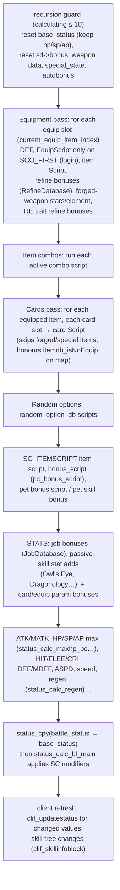
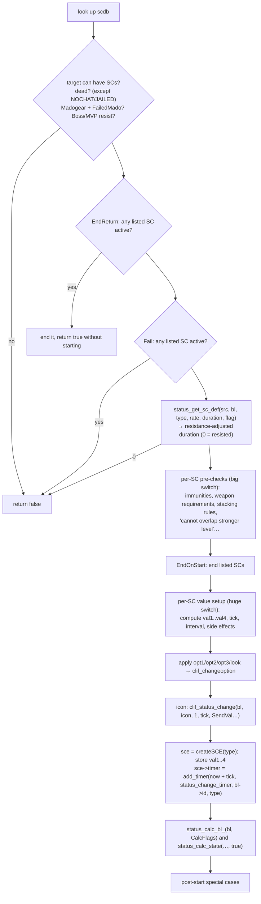

# Status System (stats, status changes, HP/SP)

> Status: **Phase 4**. ✅ = verified in source · ⚠️ = inferred · ❓ = unknown.
> Main file: `src/map/status.cpp` (16.5k lines), `src/map/status.hpp`. Data: `db/<re|pre-re>/status.yml` (1019 entries in RE), `conf/battle/status.conf`.

## 1. Purpose

`status.cpp` is the **single source of truth for derived numbers** for every unit type. It covers:

1. **Stat calculation**: base and battle status (STR…LUK, trait stats, HP/SP/AP, ATK/MATK, DEF/MDEF, HIT/FLEE, CRIT, ASPD, speed, element, size, race).
2. **Status changes ("SC")**: buffs, debuffs, ailments, toggles, and internal markers. Starting them, timing them, ending them, and their effect on stats.
3. **HP/SP changes**: `status_damage`, `status_heal`, `status_percent_change`, `status_revive`, natural regeneration.
4. **Other data DBs**: refine (`RefineDatabase`), size fix, element attribute table, enchant grade.

## 2. Data structures

### 2.1 Two status layers per unit

| Layer | Getter | Content |
|---|---|---|
| **Base status** | `status_get_base_status(bl)` | Stats from job, level, equipment, cards, item scripts and passive skills, **without** temporary SCs |
| **Battle status** | `status_get_status_data(bl)` | Base status after **SC modifiers**. This is what combat reads |

✅ `struct status_data` (`status.hpp:3372`) holds `hp, sp, ap, max_*`; the 6 base stats and 6 trait stats (`pow, sta, wis, spl, con, crt`); `batk`, `watk`/`watk2` (RE), `matk_min/max`, `speed`, `amotion`/`adelay`/`dmotion` (attack and damage motion), `mode` (monster mode flags), `hit, flee, cri, flee2, def2, mdef2`, `aspd_rate`, `patk, smatk, res, mres`, `def, mdef`, `def_ele, ele_lv, size, race, class_`, and per-hand `weapon_atk rhw, lhw`.

Where they live:

| Unit | Base | Battle |
|---|---|---|
| Player | `sd->base_status` | `sd->battle_status` |
| Monster | `md->base_status` pointer (✅ `mob.hpp:341`: separate only for levelled-up or tiny/large mobs, otherwise the DB's status) | `md->status` |
| Other units | their own fields | their own fields |

Players also have huge bonus tables filled in by item scripts: `sd->bonus`, `right_weapon` / `left_weapon`, the `subele`/`addrace`/… arrays, `special_state`, autobonus lists. These are covered in item-system.md.

### 2.2 Status changes

✅ `class status_change` (`status.hpp:3479`) is embedded in each unit as `sc`:

- `option`, `opt1`, `opt2`, `opt3`: the client-visible state bitfields. `opt1` is the body state (stone, freeze, stun, sleep…), `opt2` the health state (poison, curse, silence, blind…), `option` the look (hiding, cloaking, cart, riding, Madogear…). They are sent to clients with `clif_changeoption`.
- `cant.{move, pickup, drop, cast, chat, equip, unequip, consume, attack, warp, deathpenalty, interact}`: **behaviour locks**, computed from the active SCs' `States` (`status_calc_state`, `status.cpp:5571`). Other systems check these instead of individual SCs (`sc.cant.move` etc.).
- `data`: `std::unordered_map<sc_type, status_change_entry>`, accessed through `getSCE(type)`, `hasSCE`, `createSCE`, `deleteSCE`, `empty`, iteration.
- `status_change_entry { timer; val1..val4 }` (`status.hpp:3470`): the expiry timer id plus four free-form integers. **What each `valN` means depends entirely on the SC** (level, caster id, remaining counter…). Check the SC's start case in `status_change_start` before using them.

### 2.3 The status DB

✅ `struct s_status_change_db` (`status.hpp:3274`), loaded by `StatusDatabase` (`TypesafeCachedYamlDatabase<uint16,…>`, type `STATUS_DB`, version 4):

| YAML key | Field | Effect |
|---|---|---|
| `Status` | `type` | `SC_` enum (without the prefix) |
| `Icon` | `icon` | `EFST_` client icon |
| `DurationLookup` | `skill_id` | Skill whose `Duration` fields decide the length when started from an attack's additional effect |
| `States` | `state` (SCS_) | `NoMove`, `NoCast`, `NoAttack`, `NoPickItem`, … → `sc.cant.*`. Conditional variants are evaluated by code |
| `CalcFlags` | `calc_flag` (SCB_) | **Which stats to recalculate** when it starts or ends (§3.3) |
| `Opt1`/`Opt2`/`Opt3`/`Options` | `opt1..3`, `look` | Client state bits |
| `Flags` | `flag` (SCF_) | Behaviour: `BossResist`, `MvpResist`, `NoDispell`, `NoClearance`, `NoSave`, `RemoveOnDamaged`, `SendVal1..3`, `DisplayPc`/`DisplayNpc`, `FailedMado`, `RemoveOnChangeMap`, `OverlapIgnoreLevel`, … |
| `Fail` | `fail` | The SC cannot start while any of these is active |
| `EndOnStart` | `endonstart` | These SCs end when this one starts |
| `EndReturn` | `endreturn` | If any of these is active, end it and **don't** start this one (mutual cancel, e.g. Quagmire vs. agility buffs ⚠️) |
| `EndOnEnd` | `endonend` | These end when this one ends |
| `MinDuration`, `MinRate` | | Floors applied after resistance |
| `Script` | `script` | Script run when the SC starts (for players) |

Items: `db/re/status.yml`; overrides in `db/import/status.yml`; documentation in `doc/status_change.txt` and `doc/yaml/db/status.yml` ⚠️. Some SCs can be disabled per map via `db/status_disabled.txt` (`status_change_isDisabledOnMap`).

## 3. Stat calculation

### 3.1 Entry points

| Call | When |
|---|---|
| `status_calc_pc(sd, opt)` → `status_calc_pc_` (`status.cpp:4997`) → `status_calc_pc_sub` (`:3754`) | Login (`SCO_FIRST`), equip/unequip, level up, stat point change, skill change, `@reloaditemdb` (`SCO_FORCE`)… |
| `status_calc_mob_(md, opt)` (`:2775`), `status_calc_pet_` (`:3068`), `status_calc_homunculus_` (`:5049`), `status_calc_mercenary_`, `status_calc_elemental_`, `status_calc_npc_` | Spawn / level / evolve |
| `status_calc_bl(bl, flags)` → `status_calc_bl_(bl, flag, opt)` (`:6525`) | **Incremental** recalculation after an SC starts or ends, or a bonus changes |

### 3.2 Player pipeline (`status_calc_pc_sub`)

✅ Order, from `status.cpp:3754-4895`:



Notes:

- **`EquipScript` is not part of the recalculation.** It runs once when an item is equipped (`pc_equipitem`, `pc.cpp:~12264`), and inside `status_calc_pc_sub` only on `SCO_FIRST`, at login (`status.cpp:3919-3924`). `UnEquipScript` runs in `pc_unequipitem` (`pc.cpp:12362`). Use them for one-off effects, such as starting an SC, not for `bonus`.
- **Item `Script` (and card, combo and random-option scripts) runs during every full calculation.** `bonus`/`bonus2`/… script commands write into `sd->bonus` and the related tables. That's why these scripts must not have side effects, and why they are re-run on every equip change.
- **Re-entrancy guard**: a script can trigger another `status_calc_pc`. The `calculating` counter aborts nested runs, and the outer run checks `if (!calculating)` after each `run_script` to bail out cleanly (`status.cpp:~3923`, `:~3998`). `status_calc_pc_` also restores the player's previous `script_state` (`sd->st`) afterwards, so an open NPC dialog isn't broken (`:4997-5008`).
- `current_equip_item_index`, `current_equip_combo_pos` and `current_equip_card_id` are globals that tell scripts which item or card is being evaluated (used by `getequip*`, `getequiprefinerycnt` with `EQI_CURRENT` ⚠️).

### 3.3 Incremental recalculation (SCB flags)

✅ `std::bitset<SCB_MAX>` (`status.hpp:3108-3157`), with flags such as `SCB_BASE`, `SCB_MAXHP`, `SCB_MAXSP`, `SCB_STR`…`SCB_LUK`, `SCB_WATK`, `SCB_MATK`, `SCB_HIT`, `SCB_FLEE`, `SCB_DEF`, `SCB_MDEF`, `SCB_SPEED`, `SCB_ASPD`, `SCB_DEF_ELE`, `SCB_MODE`, `SCB_SIZE`, `SCB_RACE`, `SCB_DYE`, …

`status_calc_bl_(bl, flag, opt)` (`status.cpp:6525`):

1. Copy the old battle status (to compare later).
2. If `SCB_BASE` is set, run the full base calculation for that unit type (the per-type `status_calc_*_` functions).
3. **`status_calc_bl_main(bl, flag)`** (`:5837`): for each flagged stat, recompute **battle = f(base, SCs)** using the dedicated modifier functions: `status_calc_str`, `status_calc_batk`, `status_calc_speed` (`:8018`), `status_calc_def`, `status_calc_aspd`, … (prototypes at `status.cpp:77-99`). **These functions hold the `if (sc->getSCE(SC_X)) value += …` code for every SC's stat effect.**
4. For players, send `clif_updatestatus` for every value that changed.

When an SC starts or ends, its `CalcFlags` decide what is recalculated. **If a new SC changes a stat, it needs both the YAML `CalcFlags` entry and code in the matching `status_calc_<stat>` function.**

## 4. Status change lifecycle

### 4.1 Starting: `status_change_start`

✅ Signature (`status.cpp:10152`):

```cpp
bool status_change_start(block_list* src, block_list* bl, sc_type type, int32 rate,
                         int32 val1, int32 val2, int32 val3, int32 val4, t_tick duration, uint8 flag, int32 delay);
```

Wrappers (✅ inline functions, `status.hpp:3665-3671`): `sc_start(src, bl, type, rate, val1, duration, delay=0)`, `sc_start2`, `sc_start4`. `rate` is out of 10000. `flag` is `SCSTART_*`: `NOAVOID` (ignore resistance), `NOTICKDEF`, `NORATEDEF`, `LOADED` (restored from SQL), `NOICON`. A non-zero `delay` defers the start through `status_change_start_timer` (`:10114`).

Stages:



Anchors (offsets from `status.cpp:10152`):

| Step | Location |
|---|---|
| Boss/MVP resist | `+42-47` |
| `EndReturn` | `+51-64` |
| `Fail` | `+68-72` |
| `status_get_sc_def` | `+78` |
| Option bits | `+3002-3019` |
| Icon | `+3036-3044` |
| `createSCE` + timer | `+3060-3067` |
| Recalculation | `+3069-3093` |

### 4.2 Resistance: `status_get_sc_def`

✅ `status.cpp:9620`. It returns the adjusted duration, or 0 if the SC was resisted, based on:

- the SC type
- the target's stats (VIT/INT/LUK/level, etc.) and equipment resistances (`sd->reseff`, `sd->sc_def`…)
- `MinRate` / `MinDuration`
- `flag` (`NOAVOID` / `NOTICKDEF` / `NORATEDEF`)
- `battle_config` multipliers (`pc_sc_def_rate`, `mob_sc_def_rate`, `pc_max_sc_def`… in `conf/battle/status.conf` ⚠️ exact keys)

Formulas differ between renewal and pre-renewal.

### 4.3 Ticking: `status_change_timer`

✅ `TIMER_FUNC(status_change_timer)` (`status.cpp:14135`) fires when an SC expires, or on each tick of an **interval** SC (`status_get_sc_interval(type)`):

- Poison, bleeding, regen-type SCs, Dancing SP drain, Hiding SP drain and the like do their per-tick work in a `switch (type)` and re-arm the timer (`sc_timer_next`) while time remains.
- Otherwise it calls `status_change_end(bl, type, tid)`.

### 4.4 Ending: `status_change_end`

✅ `status_change_end(bl, type, tid = INVALID_TIMER)` (`status.cpp:13434`). `tid` is passed when called from the SC's own timer, so it doesn't delete itself twice.

1. Delete the timer, run per-SC cleanup (a big switch: restore look, end linked effects, notify partners…), `deleteSCE`, `status_calc_state(…, false)`.
2. `EndOnEnd` → end the dependent SCs (`+605`).
3. Clear `opt1`, `opt2/3`, look bits → `clif_changeoption` (`+628-659`).
4. Remove the icon: `clif_status_change(bl, icon, 0, …)`.
5. Recalculate with `CalcFlags` (`status_calc_bl_`).

Bulk helpers: `status_change_clear(bl, type)` (`:13370`) for death or logout, `status_change_clear_buffs` for Dispell, Clearance and the like (honouring `NoDispell` / `NoClearance`).

### 4.5 Persistence

✅ At logout or map-server change, `chrif_save_scdata` stores the remaining SCs (type, remaining tick, val1-4) in SQL `sc_data` via char ([database-architecture.md §6](../database-architecture.md#6-character-persistence)). ✅ Before that, `map_quit` ends the SCs flagged `NoSave`, and those flagged `NoSaveInfinite` when they are infinite (`map.cpp:2268-2290`), so they never reach SQL. On login, char sends them back, and they are restarted with `SCSTART_LOADED`. The last load step, `pc_scdata_received`, then sets `pc_loaded`.

## 5. HP/SP changes

| Function | Notes |
|---|---|
| `status_damage(src, target, hp, sp, ap, walkdelay, flag, skill_id)` (`status.cpp:1492`) | Central damage sink. Skill units get `skill_unit_ondamaged`. Ends `RemoveOnDamaged` SCs and a list of special ones (Endure counters, Gravitation, Dancing, Cloaking Exceed…), may cancel casting (`unit_skillcastcancel`), then calls `pc_damage` / `mob_damage` for side effects (aggro, damage log), applies walk delay, and on death dispatches to `pc_dead` / `mob_dead` / `hom_dead` / `mercenary_dead` / `elemental_dead`. Kaizel, Rebirth and similar SCs revive the unit (`status_revive` + `status_change_clear`) (`status.cpp:~1682-1764`). Fires `OnPCDieEvent` (`:1786`) |
| `status_heal(bl, hp, sp, ap, flag)` (`:1803`) | Clamps to max and sends updates. Negative values become damage |
| `status_percent_change(src, target, hp%, sp%, ap%, flag)` (`:1905`) | Percentage heal or damage (`percentheal`, some skills) |
| `status_revive(bl, per_hp, per_sp, per_ap)` (`:1983`) | Resurrection |
| `status_zap(bl, hp, sp, ap)` (`status.hpp:3539`) | Inline wrapper over `status_damage` with no attacker (pure drain) |

`flag` bits (✅ doc comment above `status_damage`, `status.cpp:~1480-1488`):

| Bit | Meaning |
|---|---|
| `1` | Passive damage: doesn't remove SCs or cancel casting |
| `2` | Fail if there isn't enough HP/SP to subtract |
| `4` | A monster killed this way gives no EXP or loot |
| `8` | Used to damage the SP of a dead character |
| `16` | Coma damage: logged as normal damage, but HP/SP is actually set to 1 |

### Natural regeneration

✅ `status_natural_heal_timer` runs every `NATURAL_HEAL_INTERVAL` (500 ms, `map.hpp`), registered at `status.cpp:16506-16511`. It iterates `regen_db` (units that can regenerate) and uses each unit's `regen_data` (rates from `status_calc_regen`, `:5264`, and `status_calc_regen_rate`, `:5377`): sitting bonuses, skill bonuses (HP/SP Recovery, Meditatio…), and SC blocks.

## 6. Data DBs owned by status.cpp

| Class | File | Used by |
|---|---|---|
| `StatusDatabase`★ | `status.yml` | everything above |
| `RefineDatabase` (`status.hpp:121`) | `refine.yml` (**modified in this fork**) | Refine bonuses in `status_calc_pc_sub`; refine chances for the refine UI/NPCs (item-system) |
| `SizeFixDatabase` (`:146`) | `size_fix.yml` | Weapon-type × size damage modifiers (combat) |
| `AttributeDatabase` (`:158`) | `attr_fix.yml` | Element × element modifiers (combat) |
| `EnchantgradeDatabase` (`:216`) | `enchantgrade.yml` | Enchant grade bonuses (RE) |

## 7. Dependencies

- **Uses**: pc (job DB, skills, inventory), itemdb (scripts, combos, random options), script (running item scripts), skill (passive levels, SC↔skill links), clif (status, icon and option packets), unit (walk delay, cast cancel), map (mapflag-disabled SCs), timers.
- **Used by**: battle (reads battle status, SC checks everywhere), skill (starts and ends SCs; checks `sc.cant`), pc, mob, unit (`unit_can_move` uses `sc.cant.move` and specific SCs), clif, script (`sc_start`, `sc_end`, `getstatus`), atcommand.

## 8. Customisation guide

| Goal | Where |
|---|---|
| Change an existing SC's flags, icon, locks, cancellation rules | `db/import/status.yml` override. **No C++** |
| Change an SC's numbers (e.g. Blessing +STR) | C++: the `status_calc_<stat>` function for that stat (e.g. `status_calc_str`), or the value setup in `status_change_start`'s switch |
| Add a new SC | 1) Add `SC_X` to `enum sc_type` (`status.hpp`) and export the constant (`script_constants.hpp`). 2) Add a `status.yml` entry with `CalcFlags`/`States`/`Flags`. 3) Add value setup in `status_change_start` if it uses `valN`. 4) Add stat effects in `status_calc_*`. 5) Add tick behaviour in `status_change_timer` if it has an interval. 6) Add cleanup in `status_change_end` if needed. 7) Add an `EFST_` icon if one is shown |
| Change resistance formulas | `status_get_sc_def` (`status.cpp:9620`) and `conf/battle/status.conf` |
| Change max HP/SP/stat formulas | `status_calc_maxhp_pc` and friends, `status_calc_misc` (`:2600`), `JobDatabase` data (`job_stats.yml`, `job_basepoints.yml`, **modified in this fork**) |
| Item-granted stats | Item scripts (`bonus bStr,…`) in the item DB. No C++ |

Side effects and pitfalls:

- Forgetting `CalcFlags` means the SC "works" in code but the stats are never recalculated.
- `valN` meanings are SC-specific, and other modules read them (for example `sc->getSCE(SC_X)->val2`). Changing them silently breaks those readers. Grep for every `SC_X` use first.
- Starting or ending an SC can recurse: `status_calc` → item script → `sc_start` → recalculation. Keep SC scripts and item scripts simple.
- `status_change_end` while iterating `sc` (for example in `status_change_clear`) must not invalidate the iterator. Existing code collects the types first ⚠️.
