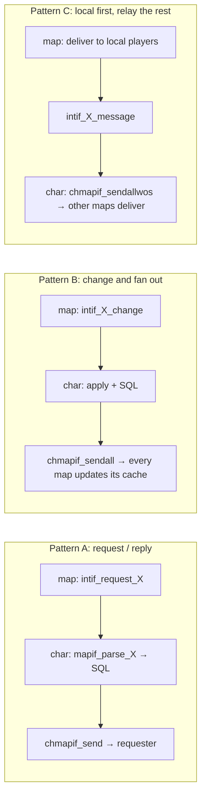

# Inter-Server Communication (char-server `inter` layer and relay patterns)

> Status: **Phase 5**. ✅ = verified in source · ⚠️ = inferred · ❓ = unknown.
> Main files: `src/char/inter.cpp` (dispatcher, whisper, registry, broadcast), `src/char/int_*.cpp` (one module per subsystem), `src/char/char_mapif.cpp` (char↔map link, `0x2b**`), `src/char/char_logif.cpp` (char↔login). Map side: `src/map/intif.cpp` (inter client), `src/map/chrif.cpp` (char client).
> Read first: [networking.md](networking.md), [packet-system.md](packet-system.md) (packet tables and lengths), [server-architecture.md](server-architecture.md) (topology).

## 1. Two protocols on one socket

A map-server holds **one** TCP connection to the char-server. Two packet families share it:

| Family | Range | Map side | Char side | Purpose |
|---|---|---|---|---|
| **chrif** | `0x2af8`–`0x2b34` | `chrif.cpp` | `char_mapif.cpp` (`chmapif_parse`, `:1398`) | Session plumbing: map list, auth, save char, map-server change, online/offline, fame, SC/skill-cooldown/bonus-script save, char ban |
| **inter** | requests `0x3000`–`0x30A?`, replies `0x3800`–`0x38A?` | `intif.cpp` (`intif_parse`, length table `packet_len_table`, `intif.cpp:37`) | `inter.cpp` (`inter_parse_frommap`, `:1408`, length table `inter_recv_packet_length`, `:58`) | Game data owned by char: party, guild, storage, pet, homun, merc, elemental, mail, auction, quest, clan, achievement, whisper, registry, broadcast |

✅ `chmapif_parse` handles the `0x2b**` packets it knows. Anything else goes to `inter_parse_frommap`. If that returns 0 too, the map-server is **disconnected** for sending an unknown packet (`char_mapif.cpp:1450-1458`).

✅ `inter_parse_frommap` handles the core inter packets itself (`0x3000` broadcast, `0x3001` whisper request, `0x3002` whisper reply, `0x3003` whisper-to-GM, `0x3004`/`0x3005` registry save/load, `0x3006` name change, `0x3007` accinfo, `0x3009` item broadcast). For everything else it tries each module in order (`inter.cpp:1433-1444`):

```
inter_party → inter_guild → inter_storage → inter_pet → inter_homunculus → inter_mercenary
→ inter_elemental → inter_mail → inter_auction → inter_quest → inter_clan → inter_achievement
```

Each `inter_X_parse_frommap` is a `switch(RFIFOW(fd,0))` that returns 1 if it handled the packet.

### Packet id blocks (from `inter_recv_packet_length`, `inter.cpp:58-70`)

| Range | Module | File |
|---|---|---|
| `0x3000`–`0x3009` | core (broadcast, whisper, registry, name change, accinfo) | `inter.cpp` |
| `0x3018`–`0x3019` | guild storage | `int_storage.cpp` |
| `0x3020`–`0x302A` | party | `int_party.cpp` |
| `0x3030`–`0x3042` | guild (`int_guild.cpp:1927-1944`) | `int_guild.cpp` |
| `0x3050`–`0x3056` | auction | `int_auction.cpp` |
| `0x3048`–`0x304E` | mail (RoDEX, `int_mail.cpp:733-739`) | `int_mail.cpp` |
| `0x3060`–`0x3064` | quest, achievement | `int_quest.cpp`, `int_achievement.cpp` |
| `0x3070`–`0x307F` | mercenary, elemental | `int_mercenary.cpp`, `int_elemental.cpp` |
| `0x3080`–`0x308B` | pet, storage | `int_pet.cpp`, `int_storage.cpp` |
| `0x3090`–`0x3093` | homunculus | `int_homun.cpp` |
| `0x30A0`–`0x30A3` | clan | `int_clan.cpp` |

Replies use the same low byte with `0x38xx` (for example `0x3020` create party → `0x3820` created).

## 2. Relay patterns

There are three ways char sends results back (`char_mapif.cpp:30-100`):

| Helper | Recipients | Typical use |
|---|---|---|
| `chmapif_send(fd, …)` | One map-server (the requester) | Load replies: storage data, pet data, quest log |
| `chmapif_sendall(…)` | **All** map-servers | State changes everyone must cache: `mapif_party_info` with `fd<0` (`int_party.cpp:399`), guild info, member added or left |
| `chmapif_sendallwos(sfd, …)` | All **except** the sender | Chat relays where the sender already delivered locally: party message (`int_party.cpp:488`), guild message, broadcast (`inter.cpp:1052`) |



### Whisper: a fan-out with acknowledgement counting

✅ `mapif_parse_WisRequest` (`inter.cpp:1167`):

1. The map-server only asks char after it fails to find the target locally.
2. Char checks the name exists in `char` (SQL). If it doesn't, it replies "not online" straight away.
3. It creates a `WisData` (`inter.cpp:76`, id, origin fd, `count`) in `wis_db`, and `mapif_wis_message` sends it to **all** map-servers. `count` is set to the number of servers it went to (`chmapif_sendall` return value, `inter.cpp:1084`).
4. Each map replies `0x3002` (`mapif_parse_WisReply`, `:1238`): 0 = delivered, 1 = not here, 2 = ignored. Char decrements `count`. On the first non-"not here" answer, or once every server has answered, it sends the result to the origin and erases the entry.
5. Entries older than `WISDATA_TTL` = 60 s (`inter.cpp:45`) are cleaned by `check_ttl_wisdata` (`:1113`) on the next whisper.

### Registry variables: three owners

✅ `inter_savereg` (`inter.cpp:601`) routes by variable scope:

| Prefix | Owner | Storage |
|---|---|---|
| `##var` (global account) | **login-server** | `chlogif_send_global_accreg` (`char_logif.cpp:175`) → login `0x2728` (`loginchrif.cpp:812`) → `global_acc_reg_num/str` tables |
| `#var` (account) | char | `acc_reg_num` / `acc_reg_str` |
| `var` (permanent char) | char | `char_reg_num` / `char_reg_str` |

Loading (`mapif_parse_RegistryRequest`, `:1329`) asks login for `##` vars when flagged (`chlogif_request_accreg2`, `inter.cpp:1336`).

## 3. Char-side caches and save policy

| Module | Cache | Write policy |
|---|---|---|
| party | `party_db` (`int_party.cpp:34`) | Written through on every change (`inter_party_tosql`) |
| guild | `guild_db`, `castle_db` (`int_guild.cpp:39-40`) | **Lazy**: `save_flag` bits plus a round-robin `guild_save_timer` (one guild per slot, `int_guild.cpp:51`). Flushed at shutdown |
| clan | `clan_db` (`int_clan.cpp:24`) | Loaded once; membership saved through the char row |
| storage, pet, homun, merc, elemental, quest, achievement, mail | none (SQL each time) | Written through |
| auction | `auction_db` + end timers | Written through |
| online state | `online_char_db` (`char.cpp`) | Memory only (`char.online` column mirrors it) |

## 4. Link failures and reconnect

### Map loses char

✅ `chrif_on_disconnect` (`chrif.cpp:1498`) clears the list of other map-servers (`map_eraseallipport`) and tries to reconnect every second (`check_connect_char_server`). **Players stay online on the map** while the link is down. When it comes back, `chrif_on_ready` (`chrif.cpp:541-556`):

1. Re-sends the user list (`send_users_tochar`).
2. Replays pending auth nodes (`chrif_reconnect`: `ST_LOGOUT` nodes are saved with `CSAVE_QUIT`, `ST_MAPCHANGE` requests are sent again).
3. Re-saves storages changed while offline (`do_reconnect_storage`) and dirty guild castles (`guild_castle_reconnect`).

Inter requests sent while the link was down are **dropped**: `intif_*` functions return 0 early when `CheckForCharServer()` (`intif.cpp:61`) reports no link. Party chat, whispers and guild changes during an outage are lost ⚠️.

### Char loses a map

✅ `chmapif_on_disconnect` → `chmapif_server_reset` (`char_mapif.cpp:1505`):

1. Tells the other map-servers that this server's maps are gone (`0x2b20`).
2. Marks every character on that server with `server = -2`, "online on a server we can't reach" (`char_db_setoffline`, `char.cpp:210-219`). Those accounts stay locked as online until the map-server reconnects and re-sends its users, or until they're kicked.

### Char loses login

Char keeps running and players stay in game. New logins fail until the link is back ⚠️. See [login-and-char-servers.md](login-and-char-servers.md).

## 5. Adding an inter packet

1. Choose a free id in a module's block, and set its length in **both** `inter_recv_packet_length` (`inter.cpp:58`, for the request) and the map `packet_len_table` (`intif.cpp:37`, for the reply, indexed from `0x3800`). Use `-1` for variable length.
2. Map side: write `intif_X(...)`, which builds the packet with `WFIFOHEAD(inter_fd, len)` … `WFIFOSET`, and add a `case 0x38xx: intif_parse_X(fd)` in `intif_parse`.
3. Char side: add a `case 0x30xx:` in the module's `inter_X_parse_frommap`, then `mapif_parse_X` → SQL → reply with `chmapif_send` / `sendall` / `sendallwos`.
4. Keep the structs you send byte-identical on both sides, since the protocol is `memcpy` of packed structs. Both servers must be rebuilt together.

## 6. Open questions resolved here

- Roadmap 9 (multi-map-server): ✅ map lists are exchanged at connect (`0x2afa` → `chmapif_parse_getmapname`, `char_mapif.cpp:244`) and broadcast to other maps. `chmapif_parse_reqchangemapserv` (`:609`) creates an `auth_node` with `changing_mapservers = 1` for the destination.
- Roadmap 24 (final-save ack at shutdown): ❓ still open. Map's `do_final_chrif` closes after flushing, and nothing found guarantees `0x2b21` is received first.
