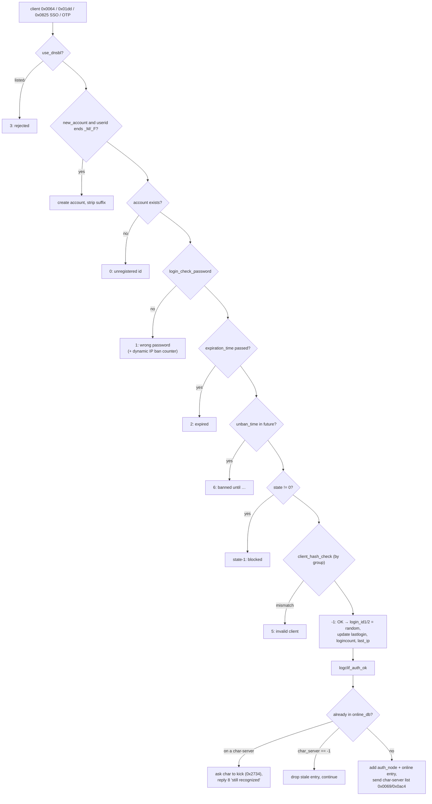

# Login & Char Server Internals

> Status: **Phase 5**. ✅ = verified in source · ⚠️ = inferred · ❓ = unknown.
> Login: `src/login/login.cpp` (auth core, online/auth DBs, config), `loginclif.cpp` (client), `loginchrif.cpp` (char link), `account.cpp` (AccountDB on SQL), `ipban.cpp`, `loginlog.cpp`. Char: `src/char/char.cpp` (core, persistence, create/delete), `char_clif.cpp` (client), `char_mapif.cpp` (map link), `char_logif.cpp` (login link), `inter.cpp` + `int_*.cpp` ([inter-server.md](inter-server.md)). Config: `conf/login_athena.conf`, `conf/char_athena.conf`, `conf/inter_athena.conf`.
> Read first: [networking.md](networking.md) §5 (client lifecycle with packet ids), [database-architecture.md](database-architecture.md) §6 (character saves).

## 1. Login server

### State

| Structure | File | Purpose |
|---|---|---|
| `online_db` (`account_id → online_login_data{char_server, waiting_disconnect}`) | `login.cpp:72-130` | Which char-server owns each logged-in account. `char_server = -1` means authed but not at char yet. `-2` means owned by an unreachable char-server |
| `auth_db` (`account_id → auth_node{login_id1/2, sex, ip, …}`) | `login.cpp:132-175` | One-time session keys waiting for the char-server to confirm (`0x2712` → `logchrif_parse_reqauth`, `loginchrif.cpp:72`) |
| `AccountDB` (vtable of function pointers) | `account.cpp` | SQL access to `login`, `global_acc_reg_*`, web tokens, VIP. Implemented by `account_db_sql_*` (`:122-460`) |
| `ch_server[]` | `loginchrif.cpp` | Connected char-servers (name, ip, port, users) |

### Authentication chain

✅ `login_mmo_auth` (`login.cpp:296`) runs these checks in order; the first to fail decides the result code sent to the client:

- **Passwords** (`login_check_password`, `login.cpp:444`): compares plaintext when `passwdenc == 0`, or the `md5(key+pass)` / `md5(pass+key)` challenge modes (0x01/0x02). With `use_MD5_passwords` (`conf/login_athena.conf:118`, **`no` in this fork**), the client password is MD5'd before comparison (`loginclif.cpp:279`). Otherwise **passwords are stored in plaintext in `login.user_pass`** ✅. This is a security choice to review before production.
- **Account creation** with the `_M`/`_F` suffix is off (`new_account: no`, `:56`).
- **Dynamic IP ban** (`ipban_dynamic_pass_failure_ban`, `:134-140`): 7 failures in 5 minutes gives a 5-minute ban. It's checked by `ipban_check` (`ipban.cpp:40`) on connect. Failures are logged through `loginlog.cpp`.
- **Web token**: on success, `account_db_sql_enable_webtoken` (`account.cpp:914`) creates the token the client later uses against the web-server ([web-server.md](web-server.md)). It's cleared on logout (`disable_webtoken`, `:952`).
- **Duplicate login** (`logclif_auth_ok`, `loginclif.cpp:47`): if the account is online on a char-server, login sends `0x2734` (kick), arms `waiting_disconnect` (`AUTH_TIMEOUT` = 30 s, `login.hpp:150`) and refuses with code 8.
- `login_online_data_cleanup` (`login.cpp:201`) removes entries left at `char_server == -2`.

### Char-server link (`loginchrif.cpp`)

| Packet | Handler | Purpose |
|---|---|---|
| `0x2712` | `logchrif_parse_reqauth` (`:72`) | Char checks a client's `login_id1/2` and gets account data |
| `0x2714` | `logchrif_parse_ackusercount` (`:132`) | User count per char-server |
| `0x2716` | `logchrif_parse_reqaccdata` (`:236`) | Account data (email, group, expiration, birthdate, pincode, VIP) |
| `0x2728` / `0x272e` | `logchrif_parse_upd_global_accreg` (`:450`) / `req_global_accreg` (`:555`) | `##` variables live here |
| `0x272a`, `0x2724`, `0x2725`, `0x2727` | unban, account state, ban, sex change | GM commands relayed from map → char → login |
| `0x272b` / `0x272c` / `0x272d` | set account online / offline / bulk sync (`:504-553`) | Keeps `online_db` matching char's view |
| `0x2738` / `0x2739` | `updpincode` (`:603`) / `pincode_authfail` (`:625`) | Pincode storage and failure ban |
| `0x2742` | `reqvipdata` (`:656`) | VIP status (`VIP_ENABLE` builds) |
| `0x2720` | `accinfo` (`:725`) | `@accinfo` |

On char-server disconnect (`logchrif_on_disconnect`, `:876`), its accounts are marked `char_server = -2`, and the cleanup timer clears them later.

## 2. Char server

### State

| Structure | File | Purpose |
|---|---|---|
| `char_db` (`char_id → shared_ptr<mmo_charstatus>`) | `char.cpp:83` | **Last saved copy** of each online character, used by `char_mmo_char_tosql` to write only the changed columns and tables. Erased on logout (`char_set_char_offline`, `:170-174`) |
| `online_char_db` (`account_id → online_char_data{char_id, server, waiting_disconnect, pincode_success}`) | `char.cpp:88` | `server`: map-server index, `-1` = at char select, `-2` = on an unreachable map-server |
| `auth_db` (`account_id → auth_node`) | `char.cpp` | Tokens for the map-server to confirm (`0x2b26` → `chmapif_parse_reqauth`) |
| `map_server[]` | `char_mapif.cpp` | Connected map-servers with their map lists (`maps`), ip, port, users |
| fame lists | `char.cpp:54-56`, `char_read_fame_list` (`:1997`) | Top blacksmith, chemist and taekwon. Sent to all maps (`chmapif_send_fame_list`, `char_mapif.cpp:102`) |

### Character select flow (`char_clif.cpp`)

1. `chclif_parse_reqtoconnect` (`0x0065`, `char_clif.cpp:821`) checks with login (`0x2712`). It then sends the char list (`chclif_mmo_char_send`, `:477`, via `char_mmo_chars_fromsql`, `char.cpp:910`). With `pincode_enabled` (`conf/char_athena.conf:217`, **off in this fork**) it shows the pincode window (`chclif_pincode_sendstate`, `:160`).
2. `chclif_parse_charselect` (`:1074`):
   1. Loads the full character (`char_mmo_char_fromsql`, `char.cpp:1023`, into `char_db`) and marks it online with `server = -2` while pending (`char_set_char_online(-2, …)`).
   2. Finds the map-server that owns `last_point.map` (`char_search_mapserver`, `char.cpp:2082`). If none does, it falls back to the first reachable "accessible map" (major city) and rewrites `last_point` (`char_clif.cpp:1140-1166`).
   3. Creates an `auth_node` (`:1194-1203`) and sends the map ip and port (`chclif_send_map_data`, `:902`).
3. The map-server confirms the auth (`0x2b26`) and then the session belongs to that map.

### Creating characters

✅ `char_make_new_char` (`char.cpp:1394`):

- Name check (`char_check_char_name`, `:1334`: length, allowed letters, `char_name_option`, reserved names, uniqueness).
- Slot range, and the account's character count < `MAX_CHARS`.
- Stat rules (only for clients that still send stats): total 30, each 1–9, opposite pairs add up to 10. Newer clients start at `start_status_points`.
- Start job (Novice or Summoner/Doram), random start point from `start_point` (or `start_point_doram`), and start items from `start_items`. All come from `conf/char_athena.conf` (split by `char_config_split_startpoint`/`startitem`, `:2830`/`:2870`).
- `char_new: yes` (`conf/char_athena.conf:88`) allows creation.

### Deleting characters

✅ `char_delete` (`char.cpp:1545`). The modern two-step flow (`chclif_parse_char_delete2_req` → wait `char_del_delay` = 86400 s, `conf/char_athena.conf:176` → `char_delete2_accept` with birthdate check) sets `delete_date`. Deletion is refused when:

- base level ≥ `char_del_level` (0 = no limit, `:171`),
- `char_del_restriction` forbids deleting while in a guild or party.

On delete, char removes the character from its party and guild, divorces partners and adoptive family, deletes the homunculus and elemental, and runs 20 `DELETE` statements (`char.cpp:1545-1758`) across `inventory`, `cart_inventory`, `skill`, `char_reg_num/str`, `quest`, `achievement`, `mail`, `memo`, `hotkey`, `friends`, `pet`, `sc_data`, `bonus_script` and finally `char`. A `charlog` row is written. **Account storage is untouched**.

### Other features

| Feature | Code | Config |
|---|---|---|
| Rename | `chclif_parse_reqrename` (`char_clif.cpp:1421`) → `char_rename_char_sql` (`char.cpp:1267`); also `rename` count from item | `char_rename_party`, `char_rename_guild` |
| Slot move | `chclif_parse_moveCharSlot` (`char_clif.cpp:72`) | `char_move_enabled: yes`, `char_movetoused: yes`, `char_moves_unlimited: no` (`:247-255`) |
| Maintenance mode | `char_maintenance` (only GM groups ≥ level) | `:84` (0) |
| User cap | `max_connect_user` | `:95` (-1 = unlimited) |
| Family | `char_married`, `char_child`, `char_family` (`char.cpp:1863-1903`) | Used by party family share |
| Character ban | `chmapif_parse_reqcharban` (`char_mapif.cpp:1183`) | `char.unban_time` |
| Status, skill cooldown and bonus-script persistence | `chmapif_parse_save_scdata` (`:946`), `req_saveskillcooldown` (`:510`), `bonus_script_save` (`:1344`) | Tables `sc_data`, `skillcooldown`, `bonus_script` |

### Online consistency

✅ `char_set_char_online` (`char.cpp:121`) sets `char.online = 1`. If another map-server already claims the account, it kicks it there (`mapif_disconnectplayer(…, 2)`). Then it tells login (`0x272b`). `char_set_char_offline` (`:162`) reverses this and drops the `char_db` copy. At startup and when map links reset, `char_set_all_offline` (`:233`) and `char_db_setoffline` (`:210`, see [inter-server.md §4](inter-server.md#4-link-failures-and-reconnect)) clean up stale rows.

## 3. Extension points

| Want to… | Where |
|---|---|
| Change start map, items or stats | `conf/char_athena.conf` (`start_point`, `start_items`, `start_status_points`) |
| Enforce hashed passwords | `use_MD5_passwords: yes` in `conf/login_athena.conf` **and** migrate `login.user_pass` to MD5 |
| Gate login by client | `client_hash_check` + `client_hash` entries per group |
| Add account fields | `mmo_account` (`account.hpp`) + `account_db_sql_*` + `login` table + `0x2717` account-data packet to char |
| Add a char-select feature | `char_clif.cpp` (`PacketDatabase` handler) + `chclif_*` reply |

## 4. Open questions

- Roadmap 25 (MySQL reconnect): ❓ the keepalive timer is disabled (`sql.cpp:217`). Behaviour after `wait_timeout` depends on the client library's auto-reconnect option ⚠️.
- Whether `delete_date` enforcement also runs on the old single-step delete packet (`chclif_parse_delchar`, `char_clif.cpp:1356`) for clients that still send it ⚠️.
