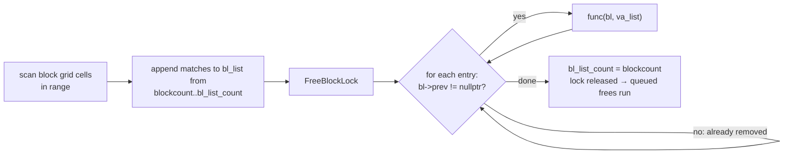

# Memory Management

> Status: **Phase 2**. ✅ = verified in source · ⚠️ = inferred · ❓ = unknown.

rAthena mixes four generations of memory handling:

| Generation | Mechanism | Where |
|---|---|---|
| 1. C allocation wrappers | `aMalloc` / `aCalloc` / `aRealloc` / `aFree` / `CREATE` / `RECREATE` | everywhere in legacy code |
| 2. Pooled fixed-size entries | ERS (`ers_new` / `ers_alloc` / `ers_free`) | timers' payloads, script states, DB nodes, registry entries |
| 3. Generic containers | `DBMap` (`idb_*`, `strdb_*`, …) and `VECTOR`/`BHEAP` macros | object registries, legacy indexes |
| 4. Modern C++ | `std::shared_ptr`, `std::unordered_map`, `std::vector`, `std::unique_ptr` | YAML DBs, char-server caches, `SkillImpl` |

## 1. Allocation wrappers and the built-in memory manager

✅ `src/common/malloc.hpp`:

- **The built-in manager is the default.** `USE_MEMMGR` is defined unless `NO_MEMMGR` is set or an external debugging allocator is used (`MEMWATCH`, `DMALLOC`, `GCOLLECT`) (`malloc.hpp:15-22`). CMake `ENABLE_MEMMGR=default|yes|no` (`CMakeLists.txt:336-350`) and autotools `--enable-manager` (`configure.ac:~1001`) can override it.
- With `USE_MEMMGR`, `aMalloc(n)` expands to `_mmalloc(n, __FILE__, __LINE__, __func__)`, so every allocation records where it came from. `LOG_MEMMGR` (leak logging) is on, except in MINICORE builds.
- Without it, `aMalloc_` & co. forward to the system allocator (⚠️ `malloc.cpp:75-125`).
- Helper macros: `CREATE(ptr, T, n)` = zero-filled `aCalloc(n, sizeof(T))`; `RECREATE(ptr, T, n)` = `aRealloc`; `CREATE_BUFFER` / `DELETE_BUFFER` use a VLA on GCC and the heap elsewhere.

### Manager internals (`src/common/malloc.cpp`)

```
block (≈40 KB data area)                    unit_head (per allocation)
┌──────────────────────────────────┐        ┌───────────────────────────┐
│ block_next, unfill_prev/next     │        │ block*  (nullptr = large) │
│ unit_size, unit_hash, unit_count │        │ file, line, size          │
│ unit_used, unit_unfill, maxused  │        │ checksum                  │
│ data[16*128 + 64*608]            │        └───────────────────────────┘
└──────────────────────────────────┘
```

- Small requests are rounded to a size class (`size2hash`): 16-byte steps up to 2 KB, then 64-byte steps. They are carved out of `block`s that hold units of one size class. Free units go back to `hash_unfill[class]`.
- Blocks are allocated `BLOCK_ALLOC` (104) at a time.
- Requests larger than a block go straight to `malloc` with a `unit_head_large` header, kept on a doubly linked list.
- `memmgr_usage_bytes` tracks the total. `malloc_usage()` reports it (it is shown when `SHOW_SERVER_STATS` is enabled).
- At shutdown, `memmgr_final` (`malloc.cpp:604`) walks every block and the large list. It writes every unfreed unit, with its file and line, to a `*.leaks` log (`memmer_logfile`), frees it, and prints "No memory leaks found" or "Memory leaks found and fixed".
- `memmgr_verify(ptr)` / `malloc_verify_ptr` validate pointers (used by `nullpo`/debug paths ⚠️).

**Fork note:** `malloc.cpp` was refactored for readability in this fork (commit `5a5e015a8`). For example, upstream's `int16 size_hash` was renamed to `int16 block_index` (`malloc.cpp:~241`). ✅ The type is `int16` in upstream too, so this isn't a regression. It's still an existing quirk: for large requests `size2hash` returns `0xffff`, which becomes `-1` as an `int16` and turns back into `0xffff` when passed to `hash2size(uint16)`. So the large-allocation branch is chosen correctly, but only because of that implicit round-trip. Small requests produce indices ≤ 736, which fit.

### Rules

- Free what you `aMalloc` with `aFree`, not `free`/`delete`. Under the manager the pointer is offset past `unit_head`, so mixing them corrupts the heap.
- C++ objects that live in `aCalloc`'d memory are built with **placement new** and torn down with an explicit destructor call:
  - `mob_data`: `aCalloc` + `new(md) mob_data()` (`mob.cpp:467-468`)
  - `map_session_data`: `CREATE(sd, TBL_PC, 1)` + `new(sd) map_session_data()` (`clif.cpp:10719-10720`); destroyed via `node->sd->~map_session_data()` in `chrif.cpp:155`/`:1913`, then freed
  - Every other `block_list` subtype is destroyed in `map_destroyblock` (see §4).
- New C++-only code should use RAII (`std::unique_ptr`, containers) rather than `aMalloc`.

## 2. ERS — Entry Reusage System

✅ `src/common/ers.hpp`, `ers.cpp:293`:

- `ERS* ers_new(size, name, options)` returns a pool of fixed-size entries. Pools with the same entry size share one root manager. `ers_alloc(pool, T)` takes an entry from the free list or allocates a new chunk. `ers_free(pool, p)` returns the entry to the pool, and the memory is reused rather than released.
- Options (✅ `ers.hpp:74-79`):

  | Option | Meaning |
  |---|---|
  | `ERS_OPT_CLEAR` | When the pool is destroyed, silently clear entries that were never freed (instead of reporting them as leaks) |
  | `ERS_OPT_WAIT` | Wait for entries to come in order before listing them |
  | `ERS_OPT_FREE_NAME` | The pool's name string is dynamic memory and is freed with the pool |
  | `ERS_OPT_CLEAN` | Zero an entry on `ers_free`, so it comes back clean on the next allocation |
  | `ERS_OPT_FLEX_CHUNK` | Use its own cache instead of sharing one, because the chunk size changes |

  There are also the `ERS_CACHE_OPTIONS` and `ERS_CLEAN_OPTIONS` presets.
- Not thread-safe (stated in the header). Memory is only returned to the OS when every pool sharing that size has been destroyed (`ers_destroy`, `ers_final`).

Pools in use (✅ `grep ers_new`):

| Pool | Owner | Entry |
|---|---|---|
| `db.cpp::db_alloc_ers`, `db_iterator_ers`, per-DB `nodes` | `db.cpp:2570`, `:2794-2795` | DBMap objects, iterators, tree nodes |
| `battle.cpp::delay_damage_ers` | `battle.cpp:9219` | delayed damage events |
| `chrif.cpp::auth_db_ers` | `chrif.cpp:1959` | login auth nodes |
| `clif.cpp::delay_clearunit_ers` | `clif.cpp:25885` | `block_list` copies used for delayed unit clears |
| `guild.cpp::expcache_ers` | `guild.cpp:2728` | guild exp cache |
| `mapreg.cpp:mapreg_ers` | `mapreg.cpp:333` | `$` variable entries |
| `npc.cpp::timer_event_ers`, `npc_sc_display_ers` | `npc.cpp:6343-6344` | NPC timer events, SC display |
| `pc.cpp: pc_sc_display_ers`, `num_reg_ers`, `str_reg_ers` | `pc.cpp:16162-16164` | SC display, script registry entries |
| `script.cpp::st_ers`, `stack_ers`, `array_ers` | `script.cpp:4854-4856` | `script_state`, script stacks, script arrays |
| `skill.cpp::skill_timer_ers` | `skill.cpp:16321` | timer-skill payloads |

## 3. DBMap — legacy generic container

✅ `src/common/db.hpp` / `db.cpp` (3031 lines):

- Implementation: a hash table of `HASH_SIZE` (283) buckets, each a **red-black tree** (`db.cpp:60-112`).
- Key types `DB_INT`, `DB_UINT`, `DB_STRING`, `DB_ISTRING` (case-insensitive), `DB_INT64`, `DB_UINT64`. Shorthand constructors: `idb_alloc`, `uidb_alloc`, `strdb_alloc`, `stridb_alloc`, `i64db_alloc`, `ui64db_alloc`.
- Ownership flags (`db.hpp:113-131`): `DB_OPT_BASE` owns nothing; `DB_OPT_DUP_KEY` copies string keys; `DB_OPT_RELEASE_KEY` and `DB_OPT_RELEASE_DATA` call `aFree` on removal; `DB_OPT_ALLOW_NULL_KEY/DATA`. **Choosing the wrong flag leaks memory or double-frees.**
- Access goes through the struct's function pointers: `db->get(db, key)`, `db->put(...)`, `db->remove(...)`, `db->foreach(...)`, `db->iterator(db)`, `db->size(db)`, `db_destroy(db)`. Typed helpers include `idb_get`, `idb_put`, `uidb_remove`, `strdb_get`, `i64db_get`.
- The same headers provide the `VECTOR_*` and `BHEAP_*` macro containers, used by the timer heap and by A* pathfinding (`db.hpp:1391`, with the warning that heap details affect pathfinding).

Map-server registries (all `DB_OPT_BASE`, so values are *not* owned) are created in `MapServer::initialize` (`map.cpp`):

| Registry | Key → value | Purpose |
|---|---|---|
| `id_db` | block id → `block_list*` | Any object by GID (`map_id2bl`) |
| `pc_db` | account id → `map_session_data*` | Online players (`map_id2sd`, `map.cpp`) |
| `mobid_db`, `bossid_db` | id → `mob_data*` | Monster lookup and fast MVP search |
| `map_db` | map index → `map_data_other_server` | Maps hosted on *other* map-servers ⚠️ |
| `nick_db`, `charid_db` | char id → name / `map_session_data*` | Name cache, online-by-char-id |
| `regen_db` | id → `block_list*` | Units that need natural HP/SP regeneration |
| `iwall_db` (`strdb`, `DB_OPT_RELEASE_DATA`) | name → `iwall_data` | Script-created invisible walls (owns its data) |

New code trends toward `std::unordered_map` (for example the char-server's `char_db`, `std::unordered_map<uint32, std::shared_ptr<mmo_charstatus>>` at `char.cpp:83`) and `rathena::util::umap_find`.

## 4. Deferred object destruction

The single most important memory rule on the map-server.

✅ `src/map/map.cpp:120-360`:

```cpp
#define block_free_max 1048576
block_list *block_free[block_free_max];      // pending-destroy queue
static int32 block_free_count, block_free_lock;
#define BL_LIST_MAX 1048576
static block_list *bl_list[BL_LIST_MAX];     // scratch array for map_foreach*
```

- `map_freeblock(bl)`: if `block_free_lock == 0`, destroy now (`map_destroyblock`); otherwise **queue** it in `block_free[]`.
- `map_freeblock_lock()` increments the lock. `map_freeblock_unlock()` decrements it, and when it reaches 0 it destroys everything queued.
- `class FreeBlockLock` is the RAII wrapper (lock in the constructor, unlock in the destructor).
- `map_destroyblock(bl)` (`map.cpp:~235-286`) calls the right destructor based on `bl->type` (`~mob_data`, `~pet_data`, `~npc_data`, …) and then `aFree(bl)`. **Exception:** `BL_PC` skips the destructor there. A player's destructor runs later, in `chrif_auth_delete`, once char has acknowledged the final save.

How `map_foreachin*` makes callbacks safe (`map_foreachinrangeV`):



`bl_list` is used as a stack (`blockcount` = where this call started), so **nested** `map_foreach*` calls are safe. The `prev == nullptr` check works because `map_delblock` unlinks an object from the grid before it is freed.

Rules:

1. Any code that may kill or remove units (damage, `mob_dead`, `unit_free`, script commands) and then keeps using pointers must hold a freeblock lock across that region. `skill.cpp`, `battle.cpp`, `unit.cpp`, `mob.cpp` and `map.cpp` do this (✅ `map_freeblock_lock`/`FreeBlockLock` appear in each).
2. Never `aFree` a `block_list` directly. Use `unit_free(bl, clrtype)` (`unit.cpp:3915`) or `map_freeblock`.
3. After calling something that might delete `bl`, check `bl->prev` (still on a map?) or re-resolve the id before touching it again.

## 5. Modern C++ ownership

- **YAML DBs** hold `std::shared_ptr<T>` values in an `unordered_map` (`TypesafeYamlDatabase::data`), plus an optional `vector<shared_ptr<T>>` index cache. `find()` returns a `shared_ptr` copy, so holding the `shared_ptr` keeps an entry alive across a reload. **Raw pointers do not.** See the reload hazard in [startup-and-initialization.md](startup-and-initialization.md#7-runtime-reload-reload-commands).
- `s_skill_db::impl` is a `std::unique_ptr<const SkillImpl>`, created by the factory in `SkillDatabase::loadingFinished` (`skill.cpp:~15760`).
- Char-server caches (`char_db`, `online_char_db`, `auth_db`) use `std::shared_ptr` values.

## 6. Fixed-size buffers and limits

Many limits are compile-time constants in `src/common/mmo.hpp` (`MAX_INVENTORY`, `MAX_STORAGE`, `MAX_CART`, `MAX_SKILL`, `MAX_PARTY`, …) and `src/map/map.hpp` (`MAX_NPC_PER_MAP 512`, `MAX_MOBSKILL 50`, `MAX_LEVEL 275`, …). `mmo_charstatus` is a large POD struct that is `memcpy`'d whole between map and char (`chrif.cpp:~322`), so **every server must be built with the same values**. `chrif_authok` checks the struct size and rejects a mismatch (`RFIFOW(fd,2) - 25 != sizeof(mmo_charstatus)`, `chrif.cpp:~661`).
