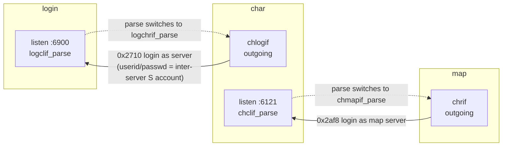
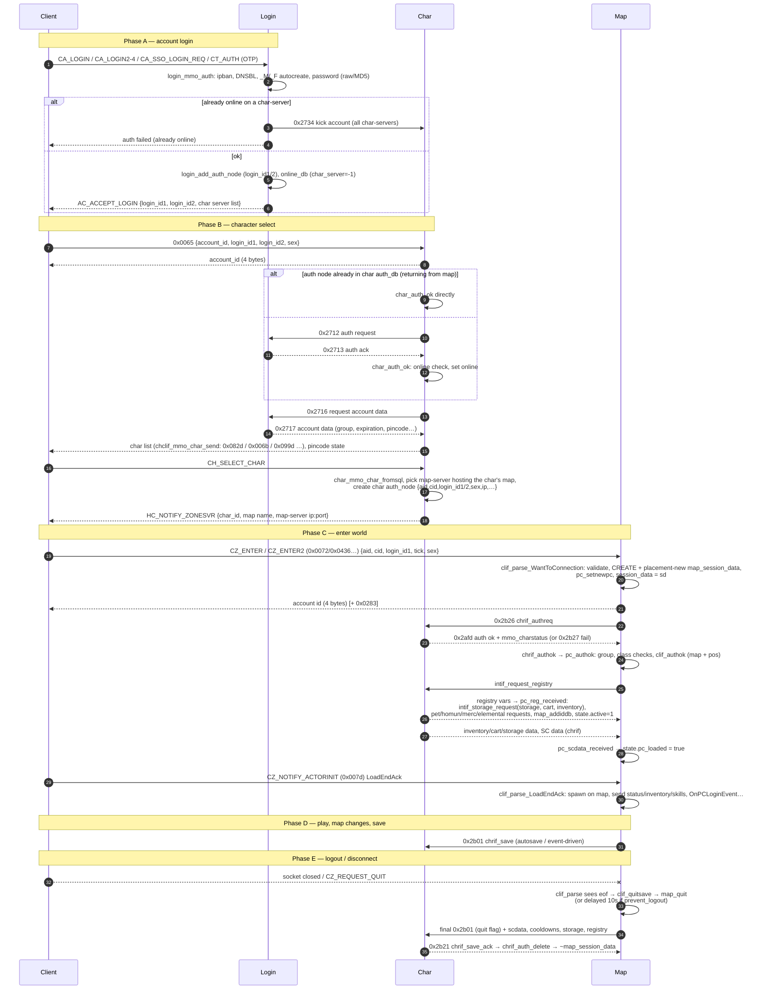

# Networking

> Status: **Phase 2**. ✅ = verified in source · ⚠️ = inferred · ❓ = unknown.
> Packet formats and dispatch tables are covered in [packet-system.md](packet-system.md).

## 1. Socket layer overview (`src/common/socket.*`)

- **Plain TCP, non-blocking**, IPv4 only (`sockaddr_in`). There is no TLS. The web-server's HTTP comes from httplib.
- **Session table.** `struct socket_data* session[MAXCONN]` is indexed directly by fd. `MAXCONN = FD_SETSIZE` (`socket.hpp:25`). On Windows, `sock2fd`/`sock2newfd` map `SOCKET` handles to small ints (`socket.cpp:87-128`). fd 0 is reserved.
- **Per-session state** (`socket.hpp:92`):

  | Field | Meaning |
  |---|---|
  | `rdata`, `rdata_size`, `rdata_pos`, `max_rdata` | Read FIFO: bytes received, and how far the parser has consumed |
  | `wdata`, `wdata_size`, `max_wdata` | Write FIFO |
  | `rdata_tick`, `wdata_tick` | Last recv/send time, used for stall detection |
  | `flag.eof`, `flag.server`, `flag.ping` | Close pending; inter-server link; keepalive state |
  | `client_addr` | Peer IPv4 address |
  | `func_recv`, `func_send`, `func_parse` | Callbacks. Usually `recv_to_fifo`, `send_from_fifo` and the server's parser |
  | `session_data` | Opaque per-connection object owned by the server (`login_session_data`, `char_session_data`, `map_session_data`) |

- **Buffer sizes** (`socket.cpp:257-263`, `socket.hpp:28`): `RFIFO_SIZE` 2 KB, `WFIFO_SIZE` 16 KB, `WFIFO_MAX` 1 MB (client links). Inter-server links are realloc'd to `FIFOSIZE_SERVERLINK` 256 KB. The largest client packet the server will send is `socket_max_client_packet = 0x6000` (`socket.cpp:243`).
- **Readiness.** `select()` is the default. `epoll` is used when built with `SOCKET_EPOLL` (CMake `ENABLE_EXTRA_SOCKET_POLL`, default OFF, `CMakeLists.txt:328`; autotools `--enable-epoll` ⚠️).
- **`SEND_SHORTLIST`** is always defined (`socket.hpp:192`). `WFIFOSET` adds the fd to a short list, and `do_sockets` flushes only the fds on that list instead of scanning all of them.

### Creating sockets

| Function | Used for |
|---|---|
| `make_listen_bind(ip, port)` (`socket.cpp:532`) | Server listening socket. Its session's `func_recv` is `connect_client`, and `func_parse` is the **default parse** set beforehand with `set_defaultparse()` |
| `connect_client(listen_fd)` (`socket.cpp:473`) | Accepts a connection, sets socket options and non-blocking mode, runs **IP rules / DDoS check** (`connect_check`), adds it to the select/epoll set, `create_session(fd, recv_to_fifo, send_from_fifo, default_func_parse)` |
| `make_connection(ip, port, silent, timeout)` (`socket.cpp:601`) | Outgoing server links (char→login, map→char) |
| `create_session` / `delete_session` (`:726` / `:741`) | Allocate and free the FIFOs and the session struct |
| `do_close(fd)` (`:1424`) | `flush_fifo`, close, remove from the set, `delete_session` |
| `set_eof(fd)` (`:359`) | Mark for closing. The actual close happens in the server's parse function, which sees `flag.eof` and calls `do_close` |

## 2. Reading and writing packets

Reading (in a `func_parse`):

```cpp
if( RFIFOREST(fd) < 2 ) return 0;          // bytes available
uint16 cmd = RFIFOW(fd, 0);                // little-endian u16 at rdata+rdata_pos
... RFIFOL(fd, 2) / RFIFOB / RFIFOCP / RFIFOP(fd,pos) ...
RFIFOSKIP(fd, packet_len);                 // consume
```

Writing:

```cpp
WFIFOHEAD(fd, len);                        // ensure space (realloc)
WFIFOW(fd, 0) = 0x2b26; WFIFOL(fd, 2) = ...;
WFIFOSET(fd, len);                         // commit; queues fd for send
// or, typed:
PACKET_ZC_FOO p{}; p.packetType = HEADER_ZC_FOO; ... socket_send(fd, p);   // socket.hpp:207
```

✅ `WFIFOSET` (`socket.cpp:822`) safety checks:

- A packet that overflowed the buffer it was written into is **fatal**: `exit(EXIT_FAILURE)`.
- `len > 0xFFFF` is fatal.
- `len == 0` produces a warning. The usual cause is a missing packet-length entry.
- On client links: a packet larger than `socket_max_client_packet` is dropped; going past `WFIFO_MAX` sets EOF.
- On server links: once 2× `FIFOSIZE_SERVERLINK` is buffered, it flushes immediately.

All multi-byte fields are host-order reads of little-endian wire data. rAthena assumes a little-endian host (⚠️ there is no byte swapping in `RFIFOW`/`RFIFOL`). IPs sent to clients are converted with `htonl` and `ntows` (see `logclif_auth_ok`).

## 3. The I/O cycle (`do_sockets`)

✅ `socket.cpp:892-1094`, called once per main-loop iteration with `next` = ms until the next timer:

1. **Pre-send.** Flush the shortlist (`send_shortlist_do_sends`). This pushes out packets queued by the timers that just ran.
2. **Wait.** `select(fd_max, &readfds, …, timeout=next)` or `epoll_wait(…, next)`. `EINTR` is ignored; any other error is fatal.
3. `last_tick = time(nullptr)`.
4. **Receive.** For each readable fd, call `func_recv(fd)`. For listening sockets that is `connect_client`; for connections it is `recv_to_fifo`, where `recv` returning 0 or an error sets EOF. With epoll, `EPOLLERR|EPOLLHUP` sets EOF.
5. **Post-send.** Flush again, then for sessions with `flag.eof`, call `func_parse` so the server can clean up and `do_close`.
6. **Parse every session.**
   - **Stall check**: if `last_tick - rdata_tick > stall_time` (default 60 s, minimum 3, set in `conf/packet_athena.conf`): a client session gets EOF; a server session gets `flag.ping = 1`, and the link owner sends a keepalive (for example `chrif_keepalive`) and waits up to 2× `stall_time` (`chrif.cpp:1733-1741`).
   - `func_parse(fd)`.
   - If the read buffer is completely full and still unparsed (`rdata_size == RFIFO_SIZE` at its maximum), the packet is invalid or too large: set EOF.
   - `RFIFOFLUSH(fd)` compacts the read buffer.

## 4. Connection security

✅ `socket.cpp:1096-1372`, configured in `conf/packet_athena.conf`:

| Key | Default here | Effect |
|---|---|---|
| `enable_ip_rules` | yes | Turn allow/deny rules and DDoS checks on or off |
| `order` | deny,allow | `deny,allow` / `allow,deny` / `mutual-failure` |
| `allow`, `deny` | — | IP/mask entries |
| `ddos_interval` / `ddos_count` | 3000 ms / 5 | More than `count` connections from one IP within `interval` → banned |
| `ddos_autoreset` | 600000 ms | Forget the connection history after this long |
| `stall_time` | 60 | Idle timeout (s) |
| `debug` | no | Log access decisions |

Connection history lives in `connect_history[0x10000]`, linked lists keyed by `ip & 0xFFFF`. It is pruned every 5 minutes by `connect_check_clear`. Additional layers: login-side `ipban` (SQL `ipbanlist`, `src/login/ipban.cpp`), DNSBL checks in `login_mmo_auth` (`login.cpp:296+`), `PACKET_OBFUSCATION` on the map-server (see packet-system.md), and per-fd packet-rate throttling in `clif_parse` (3 packets per loop).

## 5. Server-to-server links



- The **char→login** link starts on login's *client* port. `logclif_parse` intercepts `0x2710` before the packet DB (`loginclif.cpp:539`) and authenticates the char-server against a `login` row with sex `S` (the `s1`/`p1` credentials, see the warning in `char.cpp`). ✅ If that succeeds, `logclif_parse_reqcharconnec` (`loginclif.cpp:397`) sets `func_parse = logchrif_parse` and `flag.server = 1`, and grows both FIFOs to `FIFOSIZE_SERVERLINK` (`loginclif.cpp:~441-443`). The same switch happens for map→char in `chclif_parse_maplogin` (`char_clif.cpp:~810-812`).
- The **map→char** link works the same way on char's client port: `chclif_parse` intercepts `0x2af8` and calls `chclif_parse_maplogin` (`char_clif.cpp:786`). Char then switches it to `chmapif_parse`, and the map sends its map list (`0x2afa`, `chmapif_parse_getmapname`).
- **Keepalive**: char→login `0x2719`/`0x2718`; map↔char via `chrif_keepalive` when `flag.ping` is set.
- **Reconnect** is timer-driven: `chlogif_check_connect_logserver` every 10 s (`char_logif.cpp:808`, `:848`), and `check_connect_char_server` every 10 s (`chrif.cpp:1855`, registered in `do_init_chrif` `chrif.cpp:1940+`).
- On disconnect, map runs `chrif_on_disconnect()` and sets `char_fd = -1` (`chrif.cpp:1729-1731`). Char runs `chmapif_on_disconnect(id)` (`char_mapif.cpp:1412`). ⚠️ While the char link is down the map-server keeps running but cannot authenticate new players (`chrif_authreq` sets EOF when `!chrif_isconnected()`, `chrif.cpp:629`) or save anyone.

## 6. Full client connection lifecycle

✅ unless marked. Packet names follow `src/common/packets.hpp` / `src/map/packets.hpp`.



Key code anchors:

| Step | Code |
|---|---|
| Login dispatch | `LoginPacketDatabase` (`loginclif.cpp:483-496`) |
| Credential check | `login_mmo_auth` (`login.cpp:296`), success `logclif_auth_ok` (`loginclif.cpp:47`) |
| Char connect | `chclif_parse_reqtoconnect` (`char_clif.cpp:821`), `0x2712` sent at `~:870` |
| Login→char ack | `chlogif_parse_ackaccreq` (`char_logif.cpp:292`) → `char_auth_ok` (`char.cpp:1965`) → `chlogif_send_reqaccdata` (`0x2716`, `char_logif.cpp:237`) → `chlogif_parse_reqaccdata` → `chclif_mmo_char_send` (`char_logif.cpp:~363`) |
| Char select | `chclif_parse_charselect` (`char_clif.cpp:1074`), `chclif_send_map_data` (`:902`, `HC_NOTIFY_ZONESVR`) |
| Map entry | `clif_parse_WantToConnection` (`clif.cpp:~10640-10740`), `chrif_authreq` (`chrif.cpp:627`), `chrif_authok` (`:650`), `pc_authok` (`pc.cpp:2080`), `pc_reg_received` (`pc.cpp:2354`), `pc_scdata_received` (`pc.cpp:14791`), `clif_parse_LoadEndAck` (`clif.cpp:10746`) |
| Logout | `clif_parse` EOF branch (`clif.cpp:25672-25693`), `clif_quitsave` (`clif.cpp:2137`), `map_quit` (`map.cpp:2221`), `chrif_save` (`chrif.cpp:277`), `chrif_save_ack` (`:418`, packet `0x2b21`) |

**Readiness gating** on the map-server: only `WantToConnection` is accepted before `session_data` exists, and only `LoadEndAck` before the player is on a map (`clif_parse`). `clif_parse_LoadEndAck` returns early until `state.active && state.pc_loaded`. `pc_scdata_received` re-invokes it if the client's LoadEndAck arrived first (`pc.cpp:14801-14804`).

### Special cases

- **Autotrade.** On EOF with `sd->state.autotrade`, the socket is detached (`session_data = nullptr; sd->fd = 0`) and the character stays in the world (`clif.cpp:25674-25678`).
- **Prevent logout.** With `battle_config.prevent_logout`, a player who was recently in combat is detached and quits 10 s later (`clif_delayquit` timer, `clif.cpp:2147-2152`).
- **Map-server change.** `pc_setpos` to a map hosted elsewhere → `chrif_changemapserver` (`chrif.cpp:423`) → char → `chrif_changemapserverack` (`:455`, packet `0x2b06`) → client gets `ZC_NPCACK_SERVERMOVE` (`clif_changemapserver`, `clif.cpp:~2167`). ❓ Full flow to be documented in map-and-movement.md.
- **Duplicate login.** Login sends `0x2734` (kick) to every char-server and waits `AUTH_TIMEOUT` (`login_waiting_disconnect_timer`).
- **Pincode** is disabled in this fork (`conf/char_athena.conf` `pincode_enabled: no`).

## 7. Error handling summary

| Condition | Result |
|---|---|
| Unknown or unsupported packet ID (map) | Warning + `set_eof` (`clif.cpp:25719+`) |
| Variable length < 4 or > 32768 | `set_eof` |
| Fewer bytes than the declared length | Warning + `set_eof` (`clif.cpp:25758`). ⚠️ rAthena assumes a whole packet arrives in one `recv`, so a TCP-fragmented client packet disconnects the client |
| Unknown packet on login/char | `PacketDatabase::handle` → `set_eof` (`common/packets.hpp:689+`) |
| Unknown inter-server packet | `chrif_parse` → `intif_parse` → still unknown → warning + `set_eof` (`chrif.cpp:1747-1754`) |
| Write buffer overflow | Fatal exit (`WFIFOSET`) |
| Idle client > `stall_time` | `set_eof` ("Session #N timed out") |
