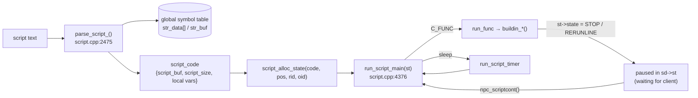

# Scripting Engine

> Status: **Phase 3**. ✅ = verified in source · ⚠️ = inferred · ❓ = unknown.
> The language reference is `doc/script_commands.txt`. This document explains the **implementation** in `src/map/script.cpp` (28.6k lines) and `src/map/script.hpp`.
> For how NPC files are loaded and how events reach the engine, see [gameplay/npc-system.md](gameplay/npc-system.md).

## 1. What the engine is

The engine is a **single-pass compiler** that turns rAthena script text into compact bytecode, plus a **stack-based virtual machine** that runs it. It has no AST: the recursive-descent parser emits bytes directly into a growing buffer, and forward references are fixed up afterwards by backpatching.

Inputs it compiles:

| Source | Entry |
|---|---|
| NPC `script` / `function` blocks in `npc/**/*.txt` | `npc_parse_script` → `parse_script(..., SCRIPT_USE_LABEL_DB)` (`npc.cpp:4381`); `npc_parse_function` (`npc.cpp:5157`) |
| Item `Script`, `EquipScript`, `UnEquipScript` in the item DB | `parse_script(..., SCRIPT_IGNORE_EXTERNAL_BRACKETS)` (`itemdb.cpp:1071`, `:1088`, `:1105`) |
| Other YAML DBs with script fields (combos, random options, pets, …) | same pattern ⚠️ |
| Runtime strings: `bonus_script`, `autobonus`, `@`-command bindings | `parse_script` at runtime ⚠️ |



## 2. Core data structures

✅ `src/map/script.hpp:220-380`:

| Struct | Fields | Role |
|---|---|---|
| `script_code` | `script_buf`, `script_size`, `local` (`reg_db`: NPC-level `.var` storage), `instances` | One compiled script. An NPC's `.variables` live **inside its script_code**, so duplicates, which reuse the same `script_code` (`npc.cpp:~4602`), share them |
| `script_state` | `stack`, `start`/`end` (current call's argument window), `pos` (program counter), `state`, `rid` (attached player's account id), `oid` (NPC id), `script`, `sleep{tick,timer,charid}`, `bk_st`/`bk_npcid` (saved previous state), flags (`freeloop`, `mes_active`, `clear_cutin`, …), `funcname`, `id` | One execution context. Allocated from `st_ers` and tracked in `st_db` |
| `script_stack` | `sp`, `sp_max`, `defsp` (frame base), `stack_data[]`, `scope` (`.@` variables of the current function) | Operand stack + call frames |
| `script_data` | `type` (`c_op`), `u.num` / `u.str` / `u.ri`, `ref` | A tagged stack slot |
| `script_retinfo` | saved `scope`, `script`, `pos`, `nargs`, `defsp` | Return frame pushed by `callfunc`/`callsub` |
| `reg_db` | `vars` (`DBMap`, int64 uid → value), `arrays` | A generic variable store |

`enum e_script_state { RUN, STOP, END, RERUNLINE, GOTO, RETFUNC, CLOSE }` (`script.hpp:314`) drives the VM loop:

| State | Set by | Meaning |
|---|---|---|
| `RUN` | VM | Keep executing |
| `STOP` | `next`, `close2`, progress bar | Pause until the client sends "continue"/"close", then resume at `pos` |
| `RERUNLINE` | `menu`, `select`, `input`, `prompt` | Pause, then **re-execute the same command** when the reply arrives. The command checks `sd->state.menu_or_input` to know which phase it is in |
| `CLOSE` | `close` | Wait for the client to close the dialog, then end |
| `GOTO` | jumps (`goto`, `jump_zero`, `callsub`, …) | `pos` was changed. Counted against the infinite-loop guard |
| `RETFUNC` | `return` | Unwind to the caller's `C_RETINFO` frame |
| `END` | `end`, errors, the end of the script | Free the state |

## 3. Compilation

### 3.1 The global symbol table

✅ `script.cpp:213-229`, `:690-756`:

```cpp
static struct str_data_struct {
    enum c_op type;      // C_NOP (unresolved), C_NAME (variable), C_FUNC (builtin), C_INT (constant), C_PARAM, C_POS (label), C_USERFUNC(_POS)
    int32 str;           // offset into str_buf
    int32 backpatch;     // head of linked list of unresolved uses in the current script_buf
    int32 label;         // label position (C_POS)
    int32 (*func)(script_state*);  // builtin implementation
    int64 val;           // constant value / buildin_func[] index / param id
    int32 next;          // hash chain
    const char* name; bool deprecated;
} *str_data;
```

- **One global table for every script.** Every identifier any script uses (variables, labels, builtins, constants) is interned with `add_str` and gets a permanent integer id. `str_hash[]` gives the hash buckets (`calc_hash`, `SCRIPT_HASH_*` algorithm choice).
- Startup seeds it (`do_init_script`, `script.cpp:4848`):
  - `add_buildin_func()` (`:2231`) registers every `buildin_func[]` entry as `C_FUNC`.
  - `constant_db.load()` loads `db/const.yml` into the `ConstantDatabase` (`script.hpp:2282`).
  - `script_hardcoded_constants()` (`:2396`) `#include`s `script_constants.hpp`, which has **10,693** `export_constant*` lines, each calling `script_set_constant(name, value, isparameter, deprecated)`.
- **Parameters** (`export_parameter`, or `Parameter: true` in `const.yml`) are `C_PARAM`. Reading `Zeny`, `BaseLevel`, `Hp` and so on calls `pc_readparam(sd, id)`, and writing them calls `pc_setparam`.

### 3.2 Bytecode encoding

✅ `script.cpp:759-840`:

| Item | Encoding |
|---|---|
| Opcode (`c_op`) | `add_scriptc`: variable-length, 6 data bits per byte; continuation bytes are `01xxxxxx` and the last byte is `00xxxxxx` |
| Integer literal | `add_scripti`: variable-length, `11xxxxxx`… then a final `10xxxxxx`. Negative literals emit `abs(v)` followed by `C_NEG` |
| Name reference (variable/builtin) | `C_NAME` + a 24-bit str_data id |
| Label reference | `C_POS` + a 24-bit position |
| String literal | `C_STR` + a NUL-terminated string inlined in the buffer |
| End of statement | `C_EOL` (the VM drops unused return values) |

Positions and ids are 24-bit, so a single script is limited to 16 MB of bytecode and the symbol table to 16M entries.

### 3.3 Parser structure

✅ Recursive descent, all functions in `script.cpp`:

```
parse_script_ (2475)
  └─ per statement: label "Name:" → set_label (+ scriptlabel_db if SCRIPT_USE_LABEL_DB)
     └─ parse_line (1495)
          ├─ '{' / '}'          → syntax.curly[] stack / parse_curly_close (1550)
          ├─ parse_syntax (1608)  if / else / for / while / do / switch / case / default /
          │                       break / continue / function
          ├─ parse_variable (1107) a = b; a += b; a++; set-like assignment → emits builtin "set"
          └─ parse_callfunc (960)  cmd args...;   → C_NAME cmd, C_ARG, args..., C_FUNC
                 └─ parse_expr (1481) → parse_subexpr (1418, precedence climbing)
                                       → parse_simpleexpr (1293: literals, names, (…), arrays)
     parse_syntax_close (2039)    closes if/for/while bodies after each statement
```

- **There are no special VM opcodes for control flow.** `if`, `for`, `while`, `do` and `switch` are lowered to synthetic labels (`__IF%x_%x`, `__FR%x_BGN/NXT/J/FIN`, `__WL%x_FIN`, `__DO%x_BGN`, `__SW%x_%x`, `__SW%x_DEF`) and calls to the builtins **`jump_zero`** (`BUILDIN_DEF(jump_zero,"il")`, `script.cpp:28257`) and **`goto`**. So a loop iteration costs real builtin calls.
- **Errors** jump back out with `longjmp(error_jump)` to the `setjmp` in `parse_script_` (`:~2494`). The partial buffer is freed and `nullptr` is returned, and the caller (for example `npc_parse_script`) skips that NPC. `disp_error_message2` prints the source excerpt with a caret.
- **Finalisation** (`:~2568-2590`): append `C_NOP`, shrink the buffer, then for every symbol still `C_NOP` (used but never defined as a label) turn it into a `C_NAME` variable and walk its **backpatch chain** to write the id into each use. A `C_USERFUNC` that was declared but never defined is an error.
- Options (`script_parse_options`, `script.hpp`): `SCRIPT_USE_LABEL_DB` (collect labels for NPC events), `SCRIPT_IGNORE_EXTERNAL_BRACKETS` (item scripts have no outer `{}`), `SCRIPT_RETURN_EMPTY_SCRIPT`.
- `DEBUG_DISASM` (a `#define` commented out at `script.cpp:5`) dumps the bytecode after compiling (`:~2593-2625`). `DEBUG_DUMP_STACK` (`:8`) dumps the stack.

### 3.4 Labels and functions

- **Labels** inside an NPC (`OnInit:`, `L_Menu:`) are recorded in `scriptlabel_db` during parsing, then converted into `nd->u.scr.label_list` (`npc_convertlabel_db`, `npc.cpp:4267`). Labels that start with `On` are exported as events (see npc-system.md).
- **Global functions** (`function<TAB>script<TAB>Name<TAB>{…}`) compile to their own `script_code`, stored in `userfunc_db` (strdb). A later definition with the same name **overwrites** the earlier one and logs `Overwriting user function` (`npc.cpp:~5190`).
- **Local functions** (`function Name; … function Name { … }`) are `C_USERFUNC` / `C_USERFUNC_POS` labels inside the same script.
- `callfunc "Name", args…` (`BUILDIN_FUNC(callfunc)`, `script.cpp:~5400`) looks the function up in `userfunc_db`, pushes a `C_RETINFO` frame (saving the caller's `scope`, `script`, `pos` and `defsp`), opens a new `.@` scope and jumps to position 0 of the callee. `callsub L_Label, args…` does the same within the current script.

## 4. Execution (the VM)

### 4.1 Starting a script

✅ `run_script(code, pos, rid, oid)` (`script.cpp:4186`) runs `script_alloc_state` (`:3625`) and then `run_script_main(st)`.

- `rid` = the player's `block_list` id (account id), or 0. `oid` = the NPC's id, or 0 for item scripts.
- Who calls it: `npc_click` (`run_script(nd->u.scr.script, 0, sd->id, nd->id)`, `npc.cpp:~2275`), `npc_event_sub` (`run_script(ev->nd->u.scr.script, ev->pos, …)`, `npc.cpp:~1785`), item use and equip (`status.cpp:3993-4176` runs equipment and card scripts during `status_calc_pc_` with `oid = 0`), `bonus_script`, and so on.

### 4.2 The main loop

✅ `run_script_main` (`script.cpp:4376-4500`):

1. `script_attach_state(st)` (`:4347`): if the script has a player (`rid`), set `sd->st = st` and `sd->npc_id = oid`. If the player was already in another script, that state is kept in `st->bk_st` and restored later. This also starts the NPC idle-timeout timer.
2. If the state was `RERUNLINE`, re-run the pending builtin first.
3. While `state == RUN`, fetch an opcode (`get_com`) and handle it:

   | Opcode(s) | Action |
   |---|---|
   | `C_INT` / `C_STR` / `C_NAME` / `C_POS` / `C_ARG` | push onto the stack |
   | `C_FUNC` | `run_func(st)` |
   | `C_EOL` | pop everything above `defsp` |
   | `C_ADD` … `C_L_SHIFT` | `op_2` |
   | `C_NEG` / `C_NOT` / `C_LNOT` | `op_1` |
   | `C_OP3` | `op_3` |
   | `C_REF` | set `op2ref` |
   | `C_NOP` | `END` |

4. **Infinite-loop guards**: `script_config.check_cmdcount` and `check_gotocount` (`conf/script_athena.conf`). When either runs out, the VM logs `"infinity loop !"` with the source location and ends the script. `freeloop(1)` turns both guards off.
5. After the loop:
   - **Sleeping** (`sleep`/`sleep2`): detach, `add_timer(run_script_timer)`, and add the state to `sleep_db`.
   - **Paused** (`STOP`/`RERUNLINE`/`CLOSE` with a player): leave it attached in `sd->st`.
   - **Ended**: detach (which restores `bk_st`), call `intif_saveregistry` if `sd->vars_dirty`, then `script_free_state`.

### 4.3 Builtin call convention

✅ `run_func` (`script.cpp:4090`). The stack for `cmd a, b;` looks like:

```
index:   start      start+1   start+2  start+3        end
         [C_NAME cmd][C_ARG]  [ a ]    [ b ]   ← sp
```

- `run_func` scans down to find `C_ARG`, sets `st->start` = the `C_NAME` slot and `st->end` = `sp`, then calls `str_data[func].func(st)`.
- **So the first user argument is at index 2.** That's why every builtin uses `script_getstr(st, 2)`, `script_getnum(st, 3)`, `script_hasdata(st, 4)`, and so on.
- The return value is pushed with `script_pushint`/`script_pushstr*`/`script_pushnil`. Afterwards `run_func` pops `start..end`, which leaves the result on the stack.
- A `SCRIPT_CMD_FAILURE` return only produces a warning plus the source location. To stop the script, the builtin must set `st->state = END` itself.
- With `warn_func_mismatch_argtypes`, argument types are checked against the `BUILDIN_DEF` signature (`script_check_buildin_argtype`).
- Deprecated builtins (`BUILDIN_DEF_DEPRECATED`, needs `SCRIPT_COMMAND_DEPRECATION`) warn whenever they're used.

Helper macros (`script.hpp:36-70`, `script.cpp:188-192`):

| Macro | Purpose |
|---|---|
| `script_getdata(st,i)`, `script_hasdata(st,i)`, `script_lastdata(st)` | raw argument access |
| `script_getnum`, `script_getnum64`, `script_getstr`, `script_isstring`, `script_isint`, `script_getref` | converted values / variable reference |
| `script_pushint`, `script_pushint64`, `script_pushstr` (takes ownership), `script_pushstrcopy`, `script_pushconststr`, `script_pushnil` | return values |
| `script_rid2sd(sd)` | the attached player, or a "no player attached" error |
| `script_charid2sd(i,sd)`, `script_accid2sd(i,sd)`, `script_nick2sd(i,sd)`, `script_mapid2sd(i,sd)` | resolve an optional player argument at index `i`, falling back to the attached player |

### 4.4 Pausing for the client (dialogs)

Example: `mes "Hello"; next; mes "Bye"; close;`

```mermaid
sequenceDiagram
    participant C as Client
    participant clif as clif.cpp
    participant npc as npc.cpp
    participant VM as run_script_main
    C->>clif: CZ_CONTACTNPC (click)
    clif->>npc: npc_click(sd, nd)
    npc->>VM: run_script(nd->u.scr.script, 0, sd->id, nd->id)
    VM->>VM: buildin_mes → clif_scriptmes, st->mes_active=1
    VM->>VM: buildin_next → st->state = STOP, clif_scriptnext
    VM-->>npc: loop exits, state stays in sd->st
    C->>clif: CZ_REQ_NEXT_SCRIPT
    clif->>npc: npc_scriptcont(sd, id, false)
    npc->>npc: STOP → RUN
    npc->>VM: run_script_main(sd->st)
    VM->>VM: mes "Bye"; buildin_close → CLOSE, clif_scriptclose
    C->>clif: CZ_CLOSE_DIALOG
    clif->>npc: npc_scriptcont(sd, id, true)
    npc->>npc: CLOSE → END
    npc->>VM: run_script_main → frees the state
```

✅ `npc_scriptcont` (`npc.cpp:2292`) checks that `id == sd->npc_id` and that the NPC idle timeout and progress bar aren't blocking. It then switches state: on a continue, `STOP → RUN` and `RERUNLINE` stays as it is; on a close, `CLOSE → END` and `STOP → RUN` (this is how `close2` works). It then resumes the VM. Builtins that wait on input (`select`, `menu`, `input`, `prompt`) set `RERUNLINE` together with `sd->state.menu_or_input = 1`. When re-run, they read `sd->npc_menu` / `sd->npc_amount` / `sd->npc_str`, which the reply-packet handler filled in.

**Event queueing**: if an event (for example `OnPCLoginEvent` from another NPC) fires while the player is already in a dialog (`sd->npc_id != 0`), it goes into `sd->eventqueue[MAX_EVENTQUEUE=2]` (`npc.cpp:~1750-1760`), or is dropped with a warning when the queue is full.

## 5. Variables and scopes

Identifiers are classified by **prefix** (scope) and **postfix** (`$` means string, anything else an integer, stored as `int64`). An array element is a 64-bit uid: `reference_uid(id, idx) = id | (idx << 32)` (`script.hpp:114`), so `@a[5]` is the symbol `@a` at index 5.

✅ Dispatch lives in `get_val_` (`script.cpp:2685`) and `set_reg_num` / `set_reg_str` (`:3220` / `:3140`):

| Syntax | Scope | Storage | Persistence | Needs player |
|---|---|---|---|---|
| `name` | character | `sd->regs` → `pc_readglobalreg*` / `pc_setregistry` (`pc.cpp:11505`) | SQL `char_reg_num/str`, via `intif_saveregistry` when `sd->vars_dirty` | yes |
| `@name` | character, temporary | `sd->regs` (`pc_readreg2`/`pc_setreg2`, `pc.cpp:11626-11659`) | lost at logout | yes |
| `#name` | account (this char-server) | `sd->regs` → `pc_readaccountreg*` | SQL `acc_reg_num/str` (via char) | yes |
| `##name` | account (global) | `sd->regs` → `pc_readaccountreg2*` | SQL `global_acc_reg_num/str` (char → login `0x2728`) | yes |
| `$name` | server | `mapreg` (`mapreg.cpp`, `regs.vars`, an i64db) | SQL `mapreg`. A new variable is INSERTed immediately; changes set `m->save` and are flushed by `script_autosave_mapreg` every 300 s (`mapreg.cpp:28`, `:341`) and at shutdown | no |
| `$@name` | server, temporary | `mapreg`, but with `save = false` (`name[1] == '@'`, `mapreg.cpp:72-87`) | lost at restart | no |
| `.name` | NPC | `st->script->local` (the NPC's `script_code`) | lost on `@reloadscript`/restart | no |
| `.@name` | function scope | `st->stack->scope` | lost when the function returns | no |
| `'name` | instance | the instance's `reg_db` (`instances` map, by `script_instancegetid(st)`) | lost when the instance is destroyed | no |
| `getvariableofnpc(.v, "NPC")` / `getvariableofpc` | another NPC's or player's scope | via `data->ref` | — | — |

`not_server_variable(prefix)` (`script.hpp:126`) is true for everything except `$`, `.` and `'`. Those are the scopes that need an attached player. ✅ Without one, `get_val_` logs `cannot access player variable` and returns `0` or `""` (`script.cpp:2700-2711`).

**Arrays**: `script_array` (`id`, `size`, `members[]`) records which indexes are in use, so `getarraysize` is fast. See `script_array_*` (`script.cpp:2889-3086`).

**Registry save path**: `pc_setregistry` marks `sd->vars_dirty = true`. `intif_saveregistry` (`intif.cpp:396`) sends the dirty entries when the script ends (`run_script_main` epilogue) and during `chrif_save`.

## 6. Builtin commands

✅ `struct script_function buildin_func[]` (`script.cpp:27928`), with **676** `BUILDIN_DEF` entries, terminated by `{nullptr, nullptr, nullptr, nullptr}`:

```cpp
#define BUILDIN_DEF(x,args)          { buildin_ ## x , #x , args, nullptr }   // script.cpp:4909
#define BUILDIN_DEF2(x,x2,args)      { buildin_ ## x , x2 , args, nullptr }   // :4910 — same C function exposed under another script name
#define BUILDIN_FUNC(x)              int32 buildin_ ## x (struct script_state* st)   // :4913
```

The argument signature string (`add_buildin_func`, `script.cpp:2231`) must match `(v|s|i|r|l)*\?*\*?`:

| Char | Meaning |
|---|---|
| `v` | any value |
| `s` | string |
| `i` | int |
| `r` | variable **reference** (the builtin writes to it, e.g. `set`, `getmapxy`) |
| `l` | label |
| `?` | one optional argument |
| `*` | any number of further optional arguments |

Some builtins are wired up specially by name: `setr` (the `set` reference), `callsub`, `callfunc` and `getelementofarray` have their ids cached (`buildin_set_ref` and similar) so the parser can emit them for assignments and `a[i]`.

## 7. Script ↔ C++ interaction

| Direction | Mechanism |
|---|---|
| Script → C++ | builtins (`buildin_*`) call into `pc_*`, `clif_*`, `mob_*`, `itemdb_*`, `party_*`, `guild_*`, `quest_*`, `instance_*` and so on. **Practically every subsystem** is reachable from scripts (see the include list of `script.cpp` in [dependency-map.md](dependency-map.md)) |
| Script → SQL | `query_sql` / `query_logsql` on `qsmysql_handle` / `logmysql_handle`. Synchronous on the main thread |
| C++ → script | `run_script(code, pos, rid, oid)`; named events through `npc_event`, `npc_event_do`, `npc_event_doall*`, `npc_script_event(sd, NPCE_*)` (see npc-system.md) |
| C++ ↔ script values | `pc_setreg`/`pc_readreg`, `pc_setglobalreg`, `mapreg_setreg`; constants via `script_set_constant`; `C_PARAM` via `pc_readparam`/`pc_setparam` |
| Item bonuses | Equipment and card scripts run inside `status_calc_pc_` with `oid = 0`. `bonus`/`bonus2`/… builtins call `pc_bonus` (`pc.cpp:3725`) / `pc_bonus2` (`:4498`), which write into `map_session_data` bonus fields. `current_equip_item_index` (`status.cpp:69`) tells `getequip*` builtins which item is running |

## 8. Adding a script command

1. Write the body in `src/custom/script.inc` (included into `script.cpp` at `:27878`) to keep it out of upstream merges, or next to similar commands in `script.cpp`:
   ```cpp
   /// addzenybonus <amount>{,<char_id>};
   BUILDIN_FUNC(addzenybonus){
       map_session_data* sd;
       if( !script_charid2sd(3, sd) )          // optional char id at index 3, default = attached player
           return SCRIPT_CMD_FAILURE;
       int32 amount = script_getnum(st, 2);
       if( amount <= 0 ){
           ShowError("buildin_addzenybonus: invalid amount %d.\n", amount);
           return SCRIPT_CMD_FAILURE;
       }
       pc_getzeny(sd, amount, LOG_TYPE_SCRIPT, 0);  // existing API: pc_getzeny(sd, zeny, log type, log_charid), pc.cpp:5829
       script_pushint(st, sd->status.zeny);
       return SCRIPT_CMD_SUCCESS;
   }
   ```
2. Register it in `src/custom/script_def.inc` (`script.cpp:28657`, inside `buildin_func[]`):
   `BUILDIN_DEF(addzenybonus,"i?"),`
3. Constants the command needs go in `script_constants.hpp` (`export_constant(MY_ENUM_VALUE);`) or `db/const.yml`.
4. Document it in `doc/script_commands.txt`.
5. Rebuild the map-server. No other server is affected.

Checklist:

- **Validate every argument.** Scripts are trusted content, but bugs in them shouldn't crash the server.
- If the command can **kill or remove units**, hold a freeblock lock around the code (see [memory-management.md](memory-management.md#4-deferred-object-destruction)).
- If it **waits for the client**: set `st->state = STOP` or `RERUNLINE` and send the packet that prompts the client. For `RERUNLINE`, handle both phases with an `sd->state.menu_or_input` style flag.
- **Never block.** For delays, use `sleep`-style timers rather than loops.
- Use `script_rid2sd` / `script_*2sd` instead of `map_id2sd(st->rid)`, so missing players are reported consistently.

## 9. Trace: one NPC from file to execution

`npc/custom/healer.txt` style:

```
prontera,150,150,4	script	Healer	4_M_SAGE_A,{
	mes "[Healer]";
	mes "Let me heal you.";
	close2;
	percentheal 100,100;
	end;
OnInit:
	.uses = 0;
	end;
}
```

| # | Step | Code |
|---|---|---|
| 1 | The map-server collects `npc: npc/custom/healer.txt` from `npc/scripts_custom.conf` | `map_reloadnpc` (`map.cpp:4258`) |
| 2 | `do_init_npc` → `npc_parsesrcfile` splits the line on TABs into `w1=prontera,150,150,4`, `w2=script`, `w3=Healer`, `w4=4_M_SAGE_A,{` | `npc.cpp:5646` |
| 3 | `w2 == "script"` → `npc_parse_script` → `parse_script(body, SCRIPT_USE_LABEL_DB)`. Symbols `mes`, `close2`, `percentheal`, `end` are already `C_FUNC`; `OnInit` becomes a label; `.uses` becomes a `C_NAME` variable | `npc.cpp:4381`; `script.cpp:2475` |
| 4 | Bytecode roughly: `C_NAME mes C_ARG C_STR "[Healer]" C_FUNC C_EOL … C_NAME close2 C_ARG C_FUNC C_EOL … C_NOP` | §3.2 |
| 5 | `npc_create_npc`, name/sprite parsed, `map_addnpc`, `map_addiddb`, `npcname_db` entry, label list converted, `Healer::OnInit` exported into `ev_db` | `npc.cpp:4420-4500`, `npc_event_export` (`:1211`) |
| 6 | After all NPCs load, `npc_event_do_oninit` → `npc_event_runall("OnInit")` runs `Healer::OnInit` with no player: `.uses = 0` writes to `script_code.local` | `npc.cpp:1420` |
| 7 | A player clicks: `CZ_CONTACTNPC` → `clif_parse_NpcClicked` → `npc_click` → `run_script(script, 0, sd->id, nd->id)` | `clif.cpp:~12246`, `npc.cpp:2212` |
| 8 | `mes` ×2 → `clif_scriptmes`; `close2` sends a close button and sets `STOP`; the VM exits with the state in `sd->st` | §4.4 |
| 9 | The client presses Close → `npc_scriptcont(..., true)`: `STOP → RUN` → `percentheal` → `end` (`END`) → detach, save the registry if dirty, free the state | `npc.cpp:2292` |

## 10. Reload

`@reloadscript` → `map_reloadnpc(true)`, `script_reload()` (`script.cpp:4877`), `npc_reload()` (`npc.cpp:6058`). `script_reload` clears `userfunc_db`, `scriptlabel_db`, the atcommand bindings and **every running `script_state`** (open dialogs are aborted; see the atcommand pre-steps in [startup-and-initialization.md](startup-and-initialization.md#7-runtime-reload-reload-commands)). It then calls `mapreg_reload()` (✅ `script.cpp:~4902`). NPC `.variables` are reset because they live in the discarded `script_code`. `$` variables survive, since they are in `mapreg`.

## 11. Pitfalls and design notes

- **The symbol table only grows.** No code removes `str_data` entries (⚠️ based on reading `add_str` and `script_reload`; no removal path was found), so reloads can only add symbols. That's harmless in practice.
- **Global namespace**: two `function` definitions with the same name across files silently overwrite each other (with an info log). Load order is the order of `npc:` lines.
- **Item scripts run often**: equipment and card scripts run on **every** `status_calc_pc`, so keep them cheap. No `sleep` or dialogs.
- **Player state across pauses**: a paused `script_state` is tied to the player through `sd->st`. ✅ On logout, `map_quit` calls `npc_event_dequeue(sd)` when `sd->npc_id` is set (`map.cpp:~2240`). `npc_event_dequeue(sd, free_script_stack)` (`npc.cpp:1176`) frees `sd->st` with `script_free_state` (`:1187`). A `sleep` state that has a `charid` is re-validated when its timer fires (`run_script_timer`, `script.cpp:~4220`).
- **Infinite-loop limits** can kill legitimate long loops. Use `freeloop(1)` deliberately and sparingly.
