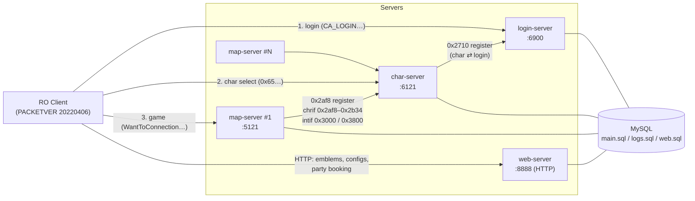
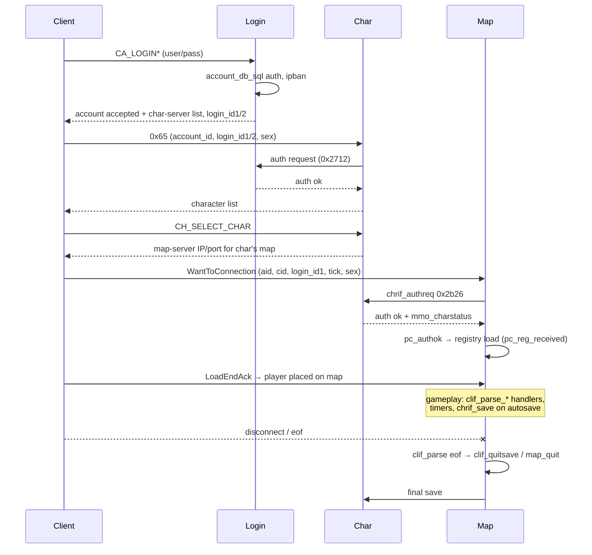
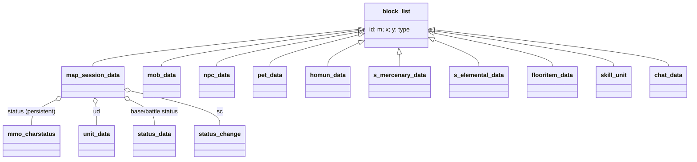

# Server Architecture (Overview)

> Status: **Discovery pass**. The lifecycle, main loop, socket dispatch and packet routing below are ✅ verified in source. Deeper detail is scheduled in [roadmap.md](roadmap.md).

## 1. Process topology



✅ Ports are the defaults in `conf/login_athena.conf:14`, `conf/char_athena.conf:40`, `conf/map_athena.conf:36`, `conf/web_athena.conf:13`.

Key architectural facts:

- ✅ **Star topology around the char-server.** Map-servers never talk to each other or to login directly; everything shared (parties, guilds, whispers, storage, mail) is relayed via char (`src/char/inter.cpp`, `src/char/int_*.cpp`).
- ✅ **Map-servers connect *to* char** (`chrif`), char connects *to* login (`chlogif`). Clients connect to each server in turn.
- ✅ **All servers access SQL directly.** Char owns character data; map also opens its own handles (`mmysql_handle`, `qsmysql_handle` for script `query_sql`, `logmysql_handle` — `src/map/map.cpp:66-102`, `:4399-4446`) for things like `mapreg`, logs, vending/buyingstore persistence and market/barter.
- The web-server is independent of the TCP servers; it reads/writes SQL only.

## 2. Common process lifecycle (`Core`)

All executables subclass `rathena::server_core::Core` (`src/common/core.hpp:59`) and override `initialize`, `finalize`, `handle_main`, `handle_shutdown`, `handle_crash`.

```mermaid
stateDiagram-v2
    [*] --> NOT_STARTED
    NOT_STARTED --> CORE_INITIALIZING: Core::start()
    CORE_INITIALIZING --> CORE_INITIALIZED: malloc, Sql_Init, db_init,<br/>signals, YAML DB init,<br/>timer_init, socket_init
    CORE_INITIALIZED --> SERVER_INITIALIZING
    SERVER_INITIALIZING --> SERVER_INITIALIZED: T::initialize()
    SERVER_INITIALIZED --> RUNNING
    RUNNING --> RUNNING: do_timer() + handle_main()
    RUNNING --> STOPPING: signal_shutdown / SIGTERM / SIGINT
    STOPPING --> SERVER_FINALIZING
    SERVER_FINALIZING --> SERVER_FINALIZED: T::finalize()
    SERVER_FINALIZED --> CORE_FINALIZING
    CORE_FINALIZING --> CORE_FINALIZED: timer_final, socket_final,<br/>db_final, ers_final, malloc_final
    CORE_FINALIZED --> STOPPED
```

✅ `Core::start` (`src/common/core.cpp:333-420`):

1. `chdir` to the executable's directory, set `SERVER_NAME`.
2. `malloc_init`, `display_title`, `usercheck` (warns when run as root).
3. (non-MINICORE) `Sql_Init`, `db_init`, `signals_init`, `do_init_database`, `cevents_init` (Win32), `timer_init`, `socket_init`.
4. `initialize(argc, argv)` — server-specific.
5. **Main loop** (`core.cpp:388-392`):
   ```cpp
   while( this->get_status() == e_core_status::RUNNING ){
       t_tick next = do_timer( gettick_nocache() );   // run due timers, returns ms until next
       this->handle_main( next );                     // default: do_sockets( next )
   }
   ```
6. `finalize()`, then core teardown.

Signals (`core.cpp:148-160`): `SIGTERM`/`SIGINT` → `signal_shutdown()`; `SIGSEGV`/`SIGFPE` → `signal_crash()` then re-raise with default handler.

## 3. Event loop and concurrency model

✅ **Login, char and map servers are single-threaded, event-driven reactors.** There is no `std::thread`, `pthread` or mutex in `src/common`, `src/login`, `src/char` or `src/map` (grep for `std::thread|pthread_|std::mutex|std::atomic` only matches `src/web/`).

One loop iteration:

```mermaid
sequenceDiagram
    participant Loop as Core::start loop
    participant T as timer.cpp
    participant S as socket.cpp do_sockets
    participant P as session[fd]->func_parse

    Loop->>T: do_timer(now)
    T-->>Loop: ms until next timer
    Loop->>S: do_sockets(next)
    S->>S: flush pending writes (func_send)
    S->>S: select()/epoll_wait(timeout = next)
    S->>S: func_recv(fd) for readable fds → rdata FIFO
    S->>S: flush writes; eof sessions → func_parse closes them
    loop every fd
        S->>S: stall-time check (timeout / server ping)
        S->>P: func_parse(fd)
        P->>P: decode packets from RFIFO, call handlers
        S->>S: RFIFOFLUSH(fd)
    end
```

Consequences for developers:

- **Never block** (sleep, synchronous network) in a handler — it stalls every player on that process. SQL queries *are* synchronous and run on the main thread, so expensive queries cause lag.
- **All time-based behaviour uses timers** (`add_timer`, `TIMER_FUNC`): walking (`unit_walktoxy_timer`, `unit.cpp:542`), auto-attack (`unit_attack_timer`, `unit.cpp:3354`), cast completion (`skill_castend_id`, `skill.cpp:4855`; `skill_castend_pos`, `:5250`), status expiry (`status_change_timer`, `status.cpp:14135`), monster AI (`mob_ai_hard` / `mob_ai_lazy`, `mob.cpp:2468` / `:2460`), autosave (`pc_autosave`, `pc.cpp:13002`).
- Timer functions must be registered by name with `add_timer_func_list` for diagnostics.
- ✅ **Web-server exception**: `WebServer::initialize` runs `httplib::Server::listen` on a dedicated `std::thread` (`web.cpp:503`) while the main loop just sleeps (`web.cpp:528-530`). httplib dispatches requests on its own worker pool, hence `SQLLock` (`src/web/sqllock.hpp`) guards SQL handles with mutexes.

## 4. Networking layer (summary)

✅ `src/common/socket.*`:

- Fixed array `session[MAXCONN]` of `socket_data*` indexed by fd (`socket.hpp:92-127`). Each session holds read/write byte FIFOs (`rdata`, `wdata`), timestamps, three function pointers `func_recv`, `func_send`, `func_parse`, and an opaque `session_data` (the server's per-connection object, e.g. `map_session_data*`).
- Listening socket's parse function is set via `set_defaultparse(...)` before `make_listen_bind` — login uses `logclif_parse`, char uses `chclif_parse`, map uses `clif_parse` (✅ `set_defaultparse(clif_parse)` at `clif.cpp:25868` inside `do_init_clif`).
- Outgoing server links via `make_connection` (char→login, map→char).
- Readiness via `select()` (default) or `epoll` (`SOCKET_EPOLL`), optional `SEND_SHORTLIST` for writes.
- Stall detection: client sessions idle longer than `stall_time` are closed; server sessions get a ping flag instead (`socket.cpp:~1050`).
- Packet I/O primitives: `RFIFOW/L/B(fd,pos)`, `RFIFOSKIP`, `WFIFOHEAD`, `WFIFOSET`, and typed `socket_send<PACKET_T>()` (`socket.hpp:207-228`).
- Built-in access control & connection-rate DDoS protection (`connect_check`, `socket.cpp:1100+`), configured in `conf/packet_athena.conf`.

## 5. Packet routing

Three distinct packet-dispatch styles coexist (legacy and modern):

| Link | Parser | Dispatch mechanism | ID range |
|---|---|---|---|
| Client → login | `logclif_parse` (`loginclif.cpp:506`) | Modern `PacketDatabase<login_session_data>` (`loginclif.cpp:483`) + special-case `0x2710` (a char-server registering itself on the client port) | client headers |
| Client → char | `chclif_parse` (`char_clif.cpp:1624`) | `CharPacketDatabase` (`char_clif.cpp:1595`) + special-case `0x65` and `0x2af8` (map-server registering) | client headers |
| Client → map | `clif_parse` (`clif.cpp:25657`) | Global table `packet_db[]` filled by `packetdb_addpacket` from `clif_packetdb.hpp` (774 `parseable_packet` entries, chosen by `#if PACKETVER`) and `clif_shuffle.hpp` | `MIN_PACKET_DB..MAX_PACKET_DB` |
| char → map (control) | `chrif_parse` (`chrif.cpp:1720`) | `switch` + `packet_len_table` | `0x2af8–0x2b34` |
| char → map (inter relay) | `intif_parse` (`intif.cpp:3764`), called from `chrif_parse` when ID not in chrif table | `switch` + `packet_len_table` | `0x3800+` |
| map → char | `chmapif_parse` (`char_mapif.cpp:1398`) → falls through to `inter_parse_frommap` (`inter.cpp:1408`) | `switch` | `0x2af8+` / `0x3000+` |
| login ⇄ char | `logchrif_parse` / `chlogif_parse` | `switch` | `0x2710+` |

✅ **Map-server client parse details** (`clif.cpp:25657-25796`):
- Processes **at most 3 packets per fd per loop** (anti-spam, comment at `:25666`).
- With `PACKET_OBFUSCATION`, packet IDs are XOR-decoded with a rolling key per session (`sd->cryptKey`), updated after each packet.
- Unknown IDs or bad lengths → `set_eof` (disconnect).
- Gate: without a `map_session_data` only `clif_parse_WantToConnection` is accepted; while not yet on a map (`sd->prev == nullptr`) only `clif_parse_LoadEndAck`.
- Handlers have signature `void (*)(int32 fd, map_session_data* sd)` and read fields via per-version offsets in `packet_db[cmd].pos[]`.

Outbound: `clif_send(buf, len, bl, send_target)` (`clif.cpp:477`) fans packets out to `SELF`, `AREA`, `PARTY`, `GUILD`, `ALL_CLIENT`, etc., using the map block grid.

## 6. Client connection lifecycle (high level)



✅ Verified anchors: `logchrif_parse_reqauth` on `0x2712` (`loginchrif.cpp:803`), `chclif_parse_reqtoconnect` on `0x65` (`char_clif.cpp:821`), `chrif_authreq` sends `0x2b26` (`chrif.cpp:627/636`), `chrif_authfail` on `0x2b27`, `pc_authok` (`pc.cpp:2080`), `pc_reg_received` (`pc.cpp:2354`), eof handling in `clif_parse` (`clif.cpp:25672-25693`). Intermediate steps (exact packet IDs for the char-list and redirect, pincode, autotrade) ❓ to be traced in `networking.md`.

## 7. Map-server initialization order

✅ `MapServer::initialize` (`src/map/map.cpp:5327-5470`):

1. Message-file paths, default `inter_config`, `cli_get_options`.
2. `map_config_read(conf/map_athena.conf)` → also collects the map list.
3. `map_reloadnpc(false)` — builds the **list** of NPC files from `npc/(re|pre-re)/scripts_main.conf` (scripts are parsed later in `do_init_npc`).
4. `chrif_checkdefaultlogin`, IP autodetection.
5. `battle_config_read`, `script_config_read`, `inter_config_read`, `log_config_read`.
6. Allocate global object registries: `id_db`, `pc_db`, `mobid_db`, `bossid_db`, `map_db`, `nick_db`, `charid_db`, `regen_db`, `iwall_db`.
7. `map_sql_init`, `log_sql_init`, `mapindex_init`, optional `grfio_init`, `map_readallmaps` (map cache / GRF).
8. Subsystem init, **order matters**:
   `msg → path → atcommand → battle → instance → chrif → clan → clif → script → itemdb → channel → cashshop → skill → mob → pc → status → party → guild → storage → pet → homunculus → mercenary → elemental → quest → achievement → battleground → npc → unit → duel → vending → buyingstore`
9. `npc_event_do_oninit()` — fires every script's `OnInit` label.
10. Optional console-reading timer.

`MapServer::handle_shutdown` (`map.cpp:5316`) kicks every player and flushes sockets; `MapServer::finalize` (`map.cpp:5009`) calls `map_quit` for each player, clears NPCs and maps, then each `do_final_*`.

Login and char follow the same shape — config → SQL engine → inter-server links → timers → `set_defaultparse` → `make_listen_bind` (`login.cpp` `LoginServer::initialize`; `char.cpp` `CharacterServer::initialize`). Char additionally registers periodic timers for user-count broadcast (5 s), online-data cleanup (10 min), clan cleanup (60 min), mail return/delete (1 min), and runs startup SQL cleanups.

## 8. Core in-memory object model (map-server)

✅ Everything that exists on a map derives from `block_list` (`map.hpp:461`): `{ next, prev, id, m, x, y, type }`, where `type` is an `enum bl_type` bitmask (`map.hpp:292`: `BL_PC`, `BL_MOB`, `BL_PET`, `BL_HOM`, `BL_MER`, `BL_ITEM`, `BL_SKILL`, `BL_NPC`, `BL_CHAT`, `BL_ELEM`).



✅ All of these are declared `: public block_list`: `map_session_data` (`pc.hpp:381`, a `class`), `mob_data` (`mob.hpp:337`), `npc_data` (`npc.hpp:158`), `pet_data` (`pet.hpp:184`), `homun_data` (`homunculus.hpp:87`), `s_mercenary_data` (`mercenary.hpp:41`), `s_elemental_data` (`elemental.hpp:76`), `flooritem_data` (`map.hpp:489`), `skill_unit` (`skill.hpp:379`), `chat_data` (`chat.hpp:13`). Legacy code still uses C-style casts between `block_list*` and these types (e.g. `(TBL_PC*)` in `clif_parse`), with `bl->type` as the discriminator.

Objects are:
- registered by ID in `id_db` / `pc_db` / `mobid_db` (`map_addiddb`), and
- linked into a per-map grid of blocks (`map_addblock` `map.cpp:407`, `map_delblock` `:464`), which powers area queries such as `map_foreachinrange` (`:793`) and `map_foreachinallrange` (`:803`) and visibility (`clif_insight`/`clif_outsight`).

The persistent part of a character is `mmo_charstatus` (`common/mmo.hpp:562`), the same struct serialised between map and char and saved by `char_mmo_char_tosql`.
