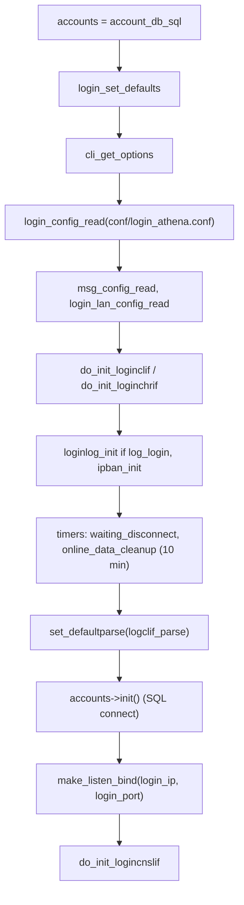
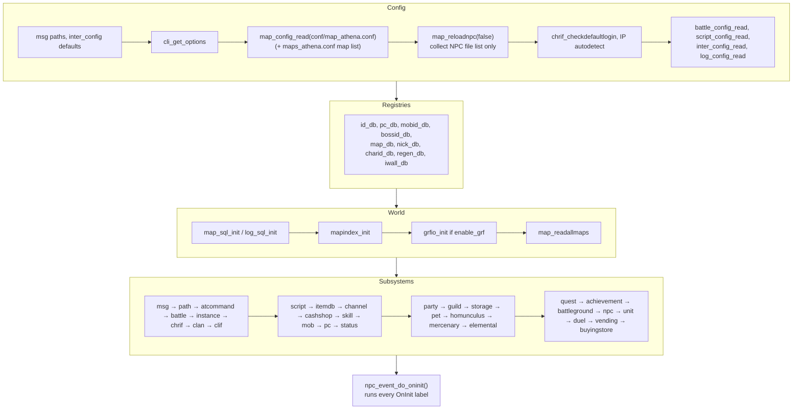

# Startup, Initialization, Reload and Shutdown

> Status: **Phase 2**. ✅ = verified in source · ⚠️ = inferred · ❓ = unknown.
> Prerequisite: [server-architecture.md](server-architecture.md) §2 (the `Core` state machine).

## 1. Common core bootstrap

Every executable enters through `main_core<T>()` (`src/common/core.hpp:95`), which builds the server object `T` on the stack, stores it in `global_core`, and calls `Core::start()` (`src/common/core.cpp:333`).

| Step | Call | Effect |
|---|---|---|
| 1 | `chdir(dirname(argv[0]))` | ✅ Paths in conf files are resolved relative to the **executable's directory**, whatever directory you launch from (`core.cpp:341-355`) |
| 2 | `malloc_init()` | Starts the memory manager (see [memory-management.md](memory-management.md)) |
| 3 | `display_title()`, `usercheck()` | Banner, plus a warning when run as root |
| 4 | `Sql_Init()` | MySQL client library init |
| 5 | `db_init()` (`db.cpp:2793`) | Creates the ERS pools that back every `DBMap` |
| 6 | `signals_init()` | SIGTERM/SIGINT → `signal_shutdown`; SIGSEGV/SIGFPE → `signal_crash` |
| 7 | `do_init_database()` (`database.cpp:390`) | Installs the rapidyaml error callback |
| 8 | `cevents_init()` | Windows only: console-close handler |
| 9 | `timer_init()`, `socket_init()` | Timer heap; socket subsystem: ✅ `socket_init` reads `conf/packet_athena.conf` through `socket_config_read` and starts the 5-minute `connect_check_clear` timer (`socket.cpp:1532+`) |
| 10 | `T::initialize(argc, argv)` | Server-specific. Returning `false` makes the process exit with `EXIT_FAILURE` |
| 11 | Main loop | `while RUNNING: next = do_timer(now); handle_main(next);` |

Steps 4–9 are skipped in **MINICORE** builds (the tools). Tools usually call `set_run_once(true)` or finish their work inside `initialize`.

## 2. Login-server initialization

✅ `LoginServer::initialize` (`src/login/login.cpp`):

There is no outgoing connection: char-servers connect **to** login, on the same client port, and identify themselves with packet `0x2710` (`loginclif.cpp:539`).

## 3. Char-server initialization

✅ `CharacterServer::initialize` (`src/char/char.cpp`):

1. `cli_get_options`, `char_set_defaults`, `char_config_read(conf/char_athena.conf)`, `char_config_adjust`, LAN config.
2. `char_set_default_sql`, `char_sql_config_read(conf/inter_athena.conf)`, messages.
3. Warns when the inter-server credentials are still the default `s1`/`p1`.
4. `inter_init_sql` connects to SQL and loads `InterServerDatabase` (`conf/inter_server.yml`). `char_mmo_sql_init`, `char_read_fame_list`.
5. IP autodetection when `login_ip`/`char_ip` are unset.
6. `do_init_chlogif()` opens the **outgoing** link to login and registers `chlogif_check_connect_logserver` (10 s interval, `char_logif.cpp:847-848`), which also handles reconnecting.
7. `do_init_chmapif()` sets up the map-server table.
8. Timers:

   | Timer | Interval |
   |---|---|
   | `chlogif_broadcast_user_count` | 5 s |
   | `char_online_data_cleanup` | 10 min |
   | `char_clan_member_cleanup` | 60 min |
   | `mail_return_timer` | 1 min |
   | `mail_delete_timer` | 1 min |

9. Optional `char_checkdb` (verifies that the tables exist).
10. Startup cleanup SQL: deletes `char` rows with `account_id=0`, empty guilds, and orphaned guild members.
11. `set_defaultparse(chclif_parse)` and `make_listen_bind(bind_ip, char_port)`.

## 4. Map-server initialization

✅ `MapServer::initialize` (`src/map/map.cpp:5327`). The order matters because later subsystems look up data loaded by earlier ones.

Things that are easy to get wrong:

- **`map_reloadnpc(false)` does not parse scripts.** It only gathers the `npc:` file list from `npc/(re|pre-re)/scripts_main.conf` (`map.cpp:4258-4266`). The scripts are parsed in `do_init_npc` (`npc.cpp:6324`), which runs after every data DB has loaded.
- **`do_init_script` runs before `do_init_itemdb`**, because item `Script`/`EquipScript`/`UnEquipScript` fields are compiled while the item DB loads (`itemdb.cpp:1071-1105`).
- **`do_init_clif`** builds the packet table (`packetdb_readdb`) and calls `set_defaultparse(clif_parse)` (`clif.cpp:25868`), then binds the listening socket. It is skipped in the `MAP_GENERATOR` build.
- **`do_init_chrif`** (`chrif.cpp:1940`) only registers the timers `check_connect_char_server` (10 s) and `auth_db_cleanup` (30 s). The actual connection to char is made by that timer about 1 s after start-up, so the map-server is already in its main loop when it first connects.
- **`do_init_pc`** schedules the first `pc_autosave` (`pc.cpp:16144`).
- In the **`MAP_GENERATOR`** build, `initialize` runs the generators (navi, itemmoveinfo, reputation) and calls `signal_shutdown()`.

### Adding a new map subsystem

1. Write `do_init_foo()` and `do_final_foo()`, and declare them in `foo.hpp`.
2. Call `do_init_foo()` in `MapServer::initialize` **after** every subsystem whose data it reads, and before `do_init_npc` if scripts will use it during `OnInit`.
3. Call `do_final_foo()` in `MapServer::finalize`, in the matching position (see §6).
4. If it has a YAML DB, see [database-architecture.md](database-architecture.md#4-yaml-database-framework).
5. If it uses timers, register every callback with `add_timer_func_list(fn, "fn")` so diagnostics can print its name.

## 5. Web-server initialization

✅ `WebServer::initialize` (`src/web/web.cpp:457`):

- If `WEB_SERVER_ENABLE` is not defined (the `PACKETVER` is too old), it calls `signal_shutdown()` straight away.
- Otherwise it loads the config, messages, `inter_config` and `web_sql_init`, then creates the `httplib::Server`, sets up the CORS pre-routing handler and the 14 POST routes, and starts `listen()` on a `std::thread`. It waits up to 10 s for `is_running()`.

## 6. Shutdown

### Trigger paths
- SIGTERM/SIGINT (console Ctrl-C), or the console command `server:shutdown` (also `exit`/`quit`; map: `map.cpp:4092-4093`, when `console` is enabled), call `Core::signal_shutdown()`. That sets `STOPPING` and calls `handle_shutdown()`.
- A crash signal calls `signal_crash()`, which runs `handle_crash()` and then re-raises the signal with the default handler. ✅ `MapServer::handle_crash` (`map.cpp:5122`) makes one emergency attempt: if the char link is up, it runs `map_foreachpc(map_abort_sub)` to save every character, then `chrif_flush_fifo()`. If it crashes again while doing this, or if char is disconnected, the data is lost and a fatal error is logged.

### Map-server
- `handle_shutdown` (`map.cpp:5316`) kicks every player with `clif_GM_kick` and runs `flush_fifos()`.
- `finalize` (`map.cpp:5009`):
  1. `map_quit(sd)` for every player still online. This triggers the final saves (see [database-architecture.md](database-architecture.md#6-character-persistence)).
  2. `map_free_questinfo` for each map.
  3. `do_clear_npc`, then removes every object from every map.
  4. Calls the `do_final_*` functions roughly in reverse dependency order: `atcommand, battle, chrif, clan, clif, npc, quest, achievement, script, instance, itemdb, storage, guild, party, pc, pet, homunculus, mercenary, mob, msg, skill, status, unit, battleground, duel, elemental, cashshop, channel, vending, buyingstore, path`, then `mapindex_final`, `grfio_final`, and the registry DBs.

Then the core tears down `timer_final`, `socket_final`, `db_final`, `ers_final` and `malloc_final`. With the built-in memory manager, `malloc_final` reports leaks (see [memory-management.md](memory-management.md)).

⚠️ `do_final_chrif` runs **early**, before `do_final_pc` and the rest. Final saves are sent during the `map_quit` loop, before any `do_final_*`, and are flushed on the char link at that point. Whether char acknowledges them (`0x2b21`) before the socket closes is ❓ not yet verified.

## 7. Runtime reload (`@reload*` commands)

✅ From `src/map/atcommand.cpp:4343-4520`:

| Command | Calls | Side effects |
|---|---|---|
| `@reloaditemdb` | `itemdb_reload()` (`itemdb.cpp:4969`) | `do_final_itemdb` + `itemdb_read`, `cashshop_reloaddb`, `mob_reload_itemmob_data`; then for **every player**: clears item delays and combos, `pc_setinventorydata` (refreshes the raw `item_data*` pointers), `pc_check_available_item`, `pc_load_combo`, `status_calc_pc(SCO_FORCE)` |
| `@reloadmobdb` | `mob_reload`, `pet_db.reload`, `hom_reload`, `mercenary_db.reload`, `elemental_db.reload` | |
| `@reloadskilldb` | `skill_reload`, `homunculus_db.reload` | `SkillImpl` objects are re-bound in `SkillDatabase::loadingFinished` |
| `@reloadscript` | closes every NPC dialog, clears cut-ins, kicks players out of BG queues, `flush_fifos`, `map_reloadnpc(true)`, `script_reload`, `npc_reload` | Full NPC re-parse; `OnInit` runs again |
| `@reloadbattleconf` | `battle_config_read` | Also runs `mob_reload` if any drop or exp rate changed (rates are baked into mob drop data) |
| `@reloadstatusdb` | `status_readdb(true)` | |
| `@reloadpcdb` | `pc_readdb()` | |
| `@reloadatcommand` | `atcommand_doload`, `pc_groups_reload` | |
| `@reloadcashdb`, `@reloadquestdb`, `@reloadmotd`, … | per-DB reload | |

**Reload hazard (✅ verified pattern):** some structs cache raw pointers into YAML DB entries. For example, `map_session_data::inventory_data[MAX_INVENTORY]` holds `item_data*` (`pc.hpp:492`). `TypesafeYamlDatabase::reload()` runs `clear()` and then `load()`, and the old entries are freed once their last `shared_ptr` reference is gone, so any raw pointer into them dangles until it is refreshed. If your code caches `item_data*`, `s_mob_db*` or similar, refresh it in the matching reload function, the same way `itemdb_reload` re-runs `pc_setinventorydata`.
