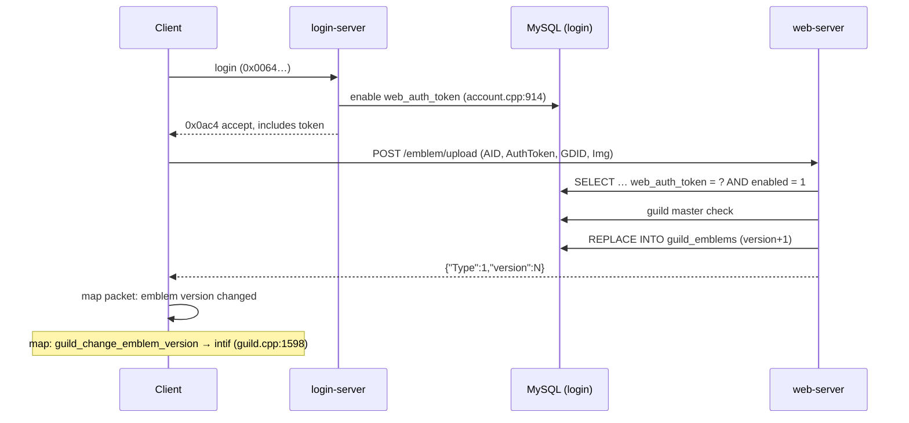

# Web Server

> Status: **Phase 5**. ✅ = verified in source · ⚠️ = inferred · ❓ = unknown.
> Files: `src/web/web.cpp` (core, config, routes), `auth.cpp` (token check), `sqllock.cpp` (DB access lock), `charconfig_controller.cpp`, `userconfig_controller.cpp`, `emblem_controller.cpp`, `merchantstore_controller.cpp`, `partybooking_controller.cpp`, `webutils.cpp`, `http.hpp`. Library: `3rdparty/httplib/httplib.h` (cpp-httplib). Config: `conf/web_athena.conf`. Schema: `sql-files/web.sql` (+ `party_bookings` in `main.sql`).
> Read first: [threading-and-concurrency.md](threading-and-concurrency.md) (the web server is the only multi-threaded server).

## 1. Purpose

Clients from roughly 2020 onward use HTTP instead of game packets for a few features:

- uploading and downloading **guild emblems**,
- saving **UI and hotkey configuration** per account and per character,
- saving **merchant (vending) templates**,
- the **party booking / recruitment** board.

The web-server serves these from the same MySQL databases the other servers use. It does **not** talk to the login, char or map servers over sockets; all coordination goes through SQL ✅ (no socket links in `src/web`).

## 2. Startup and threading

✅ `WebServer::initialize` (`web.cpp`, around `:470-525`):

1. Reads `conf/web_athena.conf` (`web_port: 8888`, `:13`; `print_req_res`, `allow_gifs: yes`, `:54`), `inter_athena.conf` and the messages file.
2. Opens SQL handles for login, char, map and web (`web_sql_init`).
3. Builds the `httplib::Server`, adds the CORS pre-routing handler (`cors_handler`, `web.cpp:173`) and the routes (`:485-498`), and sets a logger.
4. Starts `listen()` in a **separate `std::thread`** (`svr_thr`) and waits up to 10 s for `is_running()`. Startup fails if it never comes up.
5. `WebServer::handle_main` just sleeps. The core loop does nothing else.

cpp-httplib serves requests from a **thread pool** of `max(8, hardware_concurrency − 1)` workers (`httplib.h:97-101`).

### SQLLock: one mutex for every database

✅ `SQLLock` (`sqllock.cpp`) picks a handle (`LOGIN_SQL_LOCK` → `login_handle`, `CHAR_SQL_LOCK`, `MAP_SQL_LOCK`, `WEB_SQL_LOCK`) but guards **all of them with a single global `std::mutex dbmutex`** (`sqllock.cpp:10,18`). So every handler serializes all its database work, whichever database it uses. The pool gives concurrent HTTP parsing and I/O, but **SQL work happens one request at a time**. Throughput is bounded by query latency ⚠️.

## 3. Routes

All routes are `POST` with multipart form fields (`req.get_file_value(...)`). Handlers are declared with `HANDLER_FUNC(x)` = `void x(const Request&, Response&)` (`http.hpp:17`).

| Route | Handler | Auth (`isAuthorized`) | Tables |
|---|---|---|---|
| `/charconfig/save` | `charconfig_save` (`charconfig_controller.cpp:18`) | ✅ token | `char_configs` |
| `/charconfig/load` | `charconfig_load` (`:92`) | ❌ **commented out** (`:100`) | `char_configs` |
| `/userconfig/save` | `userconfig_save` (`userconfig_controller.cpp:18`) | ✅ token | `user_configs` |
| `/userconfig/load` | `userconfig_load` (`:90`) | ❌ **commented out** (`:98`) | `user_configs` |
| `/MerchantStore/save` | `merchantstore_save` (`merchantstore_controller.cpp:18`) | ✅ token | `merchant_configs` |
| `/MerchantStore/load` | `merchantstore_load` (`:97`) | ❌ **commented out** (`:105`) | `merchant_configs` |
| `/emblem/download` | `emblem_download` (`emblem_controller.cpp`) | ✅ token (`:23`) | `guild_emblems` |
| `/emblem/upload` | `emblem_upload` | ✅ token **+ guild master** (`:118`, `isAuthorized(req, true)`) | `guild_emblems` |
| `/party/add`, `/del`, `/get`, `/info`, `/list`, `/search` | `partybooking_*` (`partybooking_controller.cpp`) | ✅ token (`:112-401`) | `party_bookings`, `party`, `char` |

Data is keyed by `account_id` (`AID`), `char_id` (`GID`) where relevant, and **`WorldName`**, so one web-server can serve several char-servers.

## 4. Authentication

✅ `isAuthorized(request, checkGuildLeader)` (`auth.cpp:16`):

1. Reads the `AuthToken` and `AID` form fields.
2. Under `LOGIN_SQL_LOCK`, it checks `login` for `account_id = ? AND web_auth_token = ? AND web_auth_token_enabled = '1'` (prepared statement, `auth.cpp:34-37`).
3. With `checkGuildLeader`, it also reads `GDID` and, under `CHAR_SQL_LOCK`, checks that the account owns the guild's master character (`guild` `LEFT JOIN char`, `auth.cpp:59-79`).

The token is created by login on each successful login. It's disabled on logout (`account_db_sql_disable_webtoken`, `account.cpp:952`) and **every** token is cleared when the login-server starts (`account_db_sql_init` → `remove_webtokens`, `account.cpp:142`, `:960-963`).

## 5. Emblem upload validation

✅ `emblem_upload` (`emblem_controller.cpp`, from `:118`):

- `ImgType` must be `BMP` or `GIF`, and the size must be ≤ `MAX_EMBLEM_SIZE` = 50 000 bytes (`:19`).
- GIF is only allowed with `allow_gifs`, and the file must start with the `GIF` magic. **There's no transparency check for GIF** (TODO at `:183`).
- BMP must start with `BM`, the header size must match the data, and with `emblem_transparency_limit < 100` (`inter_athena.conf`) the transparent-magenta pixel ratio is checked.
- It then increments the version and writes `REPLACE INTO guild_emblems (version, file_type, guild_id, world_name, file_data)`, returning `{"Type":1,"version":N}`. The client then tells the map-server about the new version, and map relays it to guild members (`guild_change_emblem_version`, `guild.cpp:1598`).

## 6. Schema

`sql-files/web.sql`: `guild_emblems` (`:6`), `user_configs` (`:19`), `char_configs` (`:31`), `merchant_configs` (`:43`). `party_bookings` is in `main.sql:988`. Table names are configurable in `inter_athena.conf` (read by `web.cpp:255-265`; defaults at `web.cpp:78-86`).

## 7. Security and robustness notes

| Finding | Detail | Risk |
|---|---|---|
| Unauthenticated loads | `charconfig_load`, `userconfig_load`, `merchantstore_load` skip `isAuthorized` (upstream TODO: the client may not send the token on these paths) | Anyone who can reach port 8888 can read any account's UI, hotkey and merchant configuration by `AID`. Read-only, but it leaks data. Restrict the port with a firewall or reverse proxy, or re-enable the check if your client sends the token |
| `std::stoi` on form fields | `auth.cpp:25`, `:59` and the handlers | Missing or non-numeric fields throw. cpp-httplib catches handler exceptions and returns 500 ⚠️ (no custom `set_exception_handler` is registered) |
| Single DB mutex | `sqllock.cpp:10` | One slow query delays every web request |
| CORS | `cors_handler` (`web.cpp:173-188`) only adds CORS headers when `Origin` exactly matches the configured `allowed_origin_cors`. If that is empty, no CORS headers are sent | Safe default; set it only when a browser panel must call the API |
| No TLS | Plain `httplib::Server`, not `SSLServer` | Tokens travel in clear text. Put HTTPS termination in front ⚠️ |

## 8. Extension points

To add a route:

1. Write `HANDLER_FUNC(my_route)` in a new `*_controller.cpp`.
2. Call `isAuthorized(req, …)` first.
3. Do all SQL inside an `SQLLock` with `SqlStmt` prepared statements.
4. Register it in `web.cpp` with `http_server->Post("/path", my_route)`.
5. Add the file to `src/web/CMakeLists.txt` and `web-server.vcxproj`.

The client only calls the URLs it knows, so custom routes are for your own tools (web panels), not for the official client.
