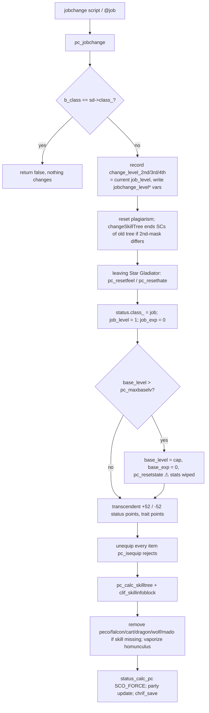
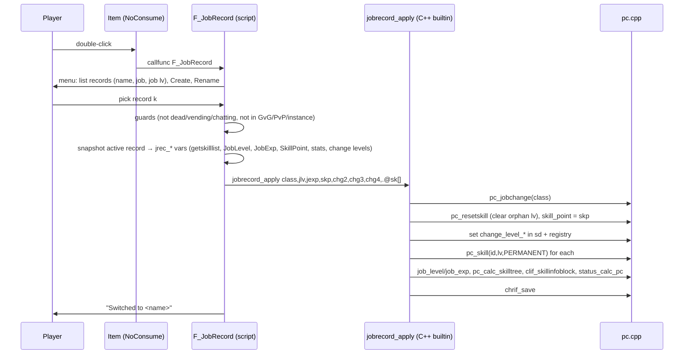

# Deep dive: character progression (skill points, jobs, variables, equipment) and the "job record" feasibility study

> Status: **Deep dive, 2026-11-07**. ✅ = verified in source (with `file:line`) · ⚠️ = inferred · ❓ = unknown.
> Builds on [../../architecture/gameplay/character-system.md](../../architecture/gameplay/character-system.md) (structures, level-up, `SP_*` params), [../../architecture/gameplay/skill-system.md](../../architecture/gameplay/skill-system.md), [../../architecture/gameplay/item-system.md](../../architecture/gameplay/item-system.md) and [../../architecture/scripting-engine.md](../../architecture/scripting-engine.md). This document does not repeat them. It goes into the parts that decide whether a player can keep several **job records** on one character and switch between them at runtime.
> Line numbers are for this checkout (`claude-documentation` branch). Each one is quoted with its function name so it can be found again after drift.

---

## 0. Summary

| Question | Answer |
|---|---|
| Can a character keep several jobs and switch at runtime? | **Yes, it's feasible.** The core already supports most of it: `pc_jobchange`, `pc_resetskill`, `pc_skill`, `pc_setparam`, and character variables for storage. |
| Can it be done purely in NPC script? | **Mostly, but not safely.** One piece of state, the cached job-change levels (`sd->change_level_2nd/3rd/4th`), can't be written correctly from script. If it's wrong, learned skills can be silently dropped on the next save (§2.5). Plan on **one small custom C++ builtin**. |
| What is the biggest conflict with the spec? | **Shared base level vs. per-job level caps.** Novice, 1st and 2nd jobs cap at base level **99**. `pc_jobchange` **truncates** the base level to the new job's cap and **wipes the stat allocation** (§2.3). This affects any character above level 99 (3rd/4th jobs, which go up to 200/275). |
| Second conflict | **Rebirth** (transcendent) resets base level to 1 by design. That clashes with "base level is shared between records" (§2.6). |
| Effort | Medium. Script UI and storage: ~400–600 lines. C++ helper: ~80–150 lines in `src/custom/script.inc`. Optional source changes for the bound starting item and equipment loadouts. |

Open questions for you are in [§9](#9-questions-for-you-design-decisions-that-contradict-the-server).

> **Update 2026-11-08:** the §9 questions have been answered, and the answers change the design (base level per record, equipment stash per record, job-quest progress per record, Doram). §7 and §9 are kept as history. The current design is in **[job-record-system-design.md](job-record-system-design.md)**.

---

## 1. Relevant source files

| File | Role in this study |
|---|---|
| `src/map/pc.cpp` | `pc_jobchange`, `pc_calc_skilltree`, `pc_calc_skilltree_normalize_job(_sub)`, `pc_calc_skillpoint`, `pc_resetskill`, `pc_resetstate`, `pc_skill`, `pc_setparam`, `pc_isequip`, `pc_reg_received`, `pc_useitem` |
| `src/map/pc.hpp` | `JOBCHANGE*_VAR` names (`:59-61`), `e_addskill_type` (`:1483`) |
| `src/common/mmo.hpp` | `e_skill_flag` (`:381`), `s_skill`, `mmo_charstatus`, `BOUND_CHAR` (`:1128`), `MAX_SKILL` (`:92`) |
| `src/char/char.cpp` | Skill save (`char_mmo_char_tosql`, `:418-450`), skill load (`:1170`), new-character starting items (`char_make_new_char_sql`, `:1518`) |
| `src/map/script.cpp` | Builtins: `jobchange`, `skill` (`:10372`), `getskilllist` (`:15075`), `equip` (`:16960`), `resetskill`, `resetstatus`, `getitembound`, `input` |
| `src/map/status.cpp` | `StatusDatabase::changeSkillTree` (`:1103`): ends SCs from the old skill tree |
| `src/map/intif.cpp` | `intif_saveregistry` (`:396`): persists character variables |
| `db/re/job_exp.yml` | `MaxBaseLevel` / `MaxJobLevel` per job group |
| `conf/battle/player.conf` | `player_skillup_limit` (`:35`), `quest_skill_learn` (`:39`), `quest_skill_reset` (`:44`), `transcendent_status_points` (`:125`) |
| `conf/char_athena.conf` | `start_items` (`:124`) |
| `npc/custom/jobmaster.txt` | The fork's job changer: free job items, rebirth via `resetlvl(1)` |
| `npc/re/jobs/**` | Official job quests (character variables + quest log) |

---

## 2. Skill points and learned skills

### 2.1 Where skills live

✅ `mmo_charstatus::skill[MAX_SKILL]` is an array of `s_skill { uint16 id; uint8 lv; uint8 flag; }` indexed by **skill index** (`skill_get_index(skill_id)`), not by skill id. `flag` is an `e_skill_flag` (`src/common/mmo.hpp:381`):

| Flag | Meaning | Saved? |
|---|---|---|
| `SKILL_FLAG_PERMANENT` (0) | Learned with skill points | ✅ yes |
| `SKILL_FLAG_TEMPORARY` (1) | Granted by an item/bonus, not owned | no |
| `SKILL_FLAG_PLAGIARIZED` (2) | Plagiarism / Reproduce | separately (`CLONE_SKILL_FLAG` vars) |
| `SKILL_FLAG_PERM_GRANTED` (3) | Granted by script, ignores the skill tree | ✅ yes (flag kept) |
| `SKILL_FLAG_REPLACED_LV_0 + n` (≥10) | Temporary bonus on top of a learned level `n` | saves `n` |

> **C++ note.** `enum e_skill_flag : int8` is a *scoped-size* enum: its values are stored in one signed byte. The `REPLACED_LV_0 + n` trick packs a number into the enum, so `flag` is both a tag and a value.

### 2.2 Skill points are not stored as a total

✅ `sd->status.skill_point` is only the **unspent** pool. "Spent" points are worked out by adding up learned levels in `pc_calc_skillpoint` (`pc.cpp:2518`). It counts entries with `id && lv > 0`, permanent or replaced, and skips quest skills (unless `quest_skill_learn`) and wedding skills.

Points come in through:
- job level-up (`pc_checkjoblevelup`, +1 per level)
- `pc_setparam(SP_JOBLEVEL)` (`pc.cpp:10438`): `skill_point += new - old` when the level goes **up**; nothing is taken back when it goes down
- `pc_resetskill` (`pc.cpp:9428`): refunds the levels it wipes

So **a record must save `SkillPoint` explicitly**. It can't be recomputed reliably from the job level, because quest skills, platinum skills and GM grants break the arithmetic.

### 2.3 What `pc_jobchange` does to skills (and what it doesn't)

✅ `pc_jobchange(sd, job, upper)` (`pc.cpp:10846`) in order:



Facts the record system depends on:

1. ✅ **Job level is always reset to 1 and job exp to 0** (`pc.cpp:10920`, `pc_jobchange`). Restoring a record means setting them back afterwards.
2. ✅ **Skills are not reset and points are not refunded.** `pc_jobchange` never calls `pc_resetskill`.
3. ✅ **Skills outside the new tree lose their `id` but keep `lv`.** `pc_calc_skilltree` clears `id` on every non-plagiarized, non-granted entry (`pc.cpp:2621`) and then sets `id` again only for skills in the normalized job's tree.
4. ✅ **The char-server only saves entries with `id != 0`** (`char.cpp:432`, `char_mmo_char_tosql`).

**So after Knight → Novice, every Knight skill is still in memory with `id = 0`, is not saved, and is lost at the next save, with no skill-point refund.** This is upstream behaviour (job changes are meant to go forward only), and it's why a record must **snapshot skills before** calling `jobchange`.

5. ✅ `pc_resetskill` loops over `skill_db` and reads `lv` **whatever `id` is** (`pc.cpp:9428`). If it runs after a job change it cleans up those orphaned levels and **adds them to `skill_point`**. A script that runs `resetskill` must set `SkillPoint` afterwards.
6. ✅ `NV_BASIC` is only reset when the current class is Novice (`pc.cpp:9496`), so "new record" must call `resetskill` **after** `jobchange Job_Novice`.
7. ✅ Quest skills are **not** wiped by `resetskill` with this server's config (`quest_skill_learn: no`, `quest_skill_reset: no`, `player.conf:39,44`; logic at `pc.cpp:9505`). They still lose their `id` if the new tree doesn't contain them (point 3), so the snapshot must include them.

### 2.4 Restoring skills

✅ `skill <id>,<lv>,0` → `pc_skill(sd, id, lv, ADDSKILL_PERMANENT)` (`pc.cpp:5435`) writes `id`, `lv`, `flag = PERMANENT` straight into the array and sends `clif_addskill`. It **doesn't check the skill tree**. It only recalculates status for passives. At the next `pc_calc_skilltree` (login, job change), entries outside the tree are dropped again (point 3). So restoring only works **after** the `jobchange` to the record's class.

✅ `getskilllist` (`script.cpp:15075`) returns every entry with `id > 0 && lv > 0` and its flag, which is enough for a snapshot. Store only `flag == 0` (permanent) and `flag == 3` (granted) entries. Take the base level from `REPLACED_LV_0 + n` when the flag is 10 or higher.

### 2.5 The hidden trap: cached job-change levels ⚠ needs C++

✅ `pc_calc_skilltree_normalize_job_sub` (`pc.cpp:2893`) decides **which tree the player sees** when `player_skillup_limit: yes` (`player.conf:35`, enabled here). It subtracts the points a player must have spent in each earlier tier: Novice `max_job_level - 1`, then `change_level_2nd - 1`, `change_level_3rd - 1` and `change_level_4th - 1`. If the player hasn't spent enough, the tree drops back to the earlier job.

- These values live in **`sd->change_level_2nd/3rd/4th`** and are backed by the character variables `jobchange_level`, `jobchange_level_3rd` and `jobchange_level_4th` (`pc.hpp:59-61`).
- ✅ The `sd` fields are read from the registry **only at login** (`pc_reg_received`, `pc.cpp:2360-2362`) and written by `pc_jobchange` when it crosses a tier (`pc.cpp:10880-10893`).
- They're **per character, not per record**. Record A (Knight, changed at job 50) and record B (Crusader, changed at job 40) overwrite each other.
- **A script can set the variable, but the `sd` cache stays stale** until the player relogs. And when you switch *from a Novice record straight to a Knight record*, `pc_jobchange` stores the **Novice's** job level as `change_level_2nd`.

**Failure scenario** ⚠️ (the logic is traced in source but hasn't been run):

Record B (Crusader) is restored while A's value of 50 is still cached. B only has 39 points in the Swordman tree, so normalization returns the Swordman tree. The next `pc_calc_skilltree` clears the `id` of every Crusader skill, and the next save deletes them.

**Fix:** a custom builtin that sets both the `sd` fields and the registry, then re-runs `pc_calc_skilltree` + `clif_skillinfoblock`. §7.2 has an example.

### 2.6 Stats and status points

✅ `pc_resetstate` (`pc.cpp:9347`) sets all six stats to 1 (traits to 0) and **recalculates** `status_point` from `statpoint_db.get_table_point(base_level)`, plus 52 for transcendent/primary 4th classes (`transcendent_status_points`, `player.conf:125`) and trait points for trait jobs. This is exactly the "re-allocate base stats" step the spec wants for a new record.

✅ `pc_jobchange` also adds or removes the 52 transcendent points when crossing between a transcendent and a non-transcendent class. If the player has already spent them, it falls back to a full `pc_resetstate` (`pc.cpp` in `pc_jobchange`, "Give or reduce transcendent status points").

✅ Stats can be set directly with `pc_setparam(SP_STR…)` (`set Str, n`), capped by `pc_maxparameter`. So a per-record stat layout can be restored from script.

---

## 3. Jobs and levels

### 3.1 Level caps per job group (the main conflict)

✅ From `db/re/job_exp.yml` (there's no `db/import/` override in this checkout):

| Job group (examples) | `MaxBaseLevel` | `MaxJobLevel` | Line |
|---|---|---|---|
| Novice, 1st, 2nd (Knight…), Baby | **99** | 10 / 50 / 50 | `:89-150`, `:2027`, `:2335` |
| Transcendent 2nd (Lord Knight…) | **99** | 70 | `:358-373`, `:2453` |
| 3rd (Rune Knight…), incl. trans 3rd | **200** | 70 | `:574-639`, `:2647` |
| 4th (Dragon Knight…), Hyper Novice | **275** | 60 / 70 | `:1042-1067`, `:2815` |
| Summoner | 200 | 60 | `:1620-1622`, `:3697` |

✅ `pc_maxbaselv` just returns `job_db.get_maxBaseLv(class_)` (`pc.cpp:8579`). `pc_jobchange` then does (`pc.cpp:10923`):

```cpp
if (sd->status.base_level > pc_maxbaselv(sd)) {
    sd->status.base_level = pc_maxbaselv(sd);
    sd->status.base_exp=0;
    pc_resetstate(sd);
    ...
}
```

So with this server's 70× exp rates, a Rune Knight at 175 who creates a new record (Novice) **drops to 99 and loses the base exp**. That breaks "base level is saved" and is permanent unless the record system stores the real base level and puts it back.

Different groups also use **different exp curves**: `base_exp` is compared against the curve of the current class. Switching between a normal and a transcendent record at the same level gives a different "next level" requirement ⚠️. That's harmless, but players will notice.

### 3.2 Class identity

✅ `jobchange <job>{,<upper>}` resolves through `pc_jobid2mapid` / `pc_mapid2jobid` and returns false if the target `MAPID` equals the current one. So switching **Novice → Novice** (two fresh records) is a no-op, and the script must handle it. Bard/Dancer are fixed for gender automatically. Doram (`Summoner`) is a different race. `pc_jobchange` updates `LOOK_HAIR` for it (`#if PACKETVER >= 20151001`), but the official path never turns a human into a Doram ⚠️.

### 3.3 Side effects of a job change worth knowing

✅ All in `pc_jobchange`:
- Ends the old tree's SCs (`StatusDatabase::changeSkillTree`, `status.cpp:1103`) only when `MAPID_SECONDMASK` differs.
- Leaving the Star Gladiator line wipes feel/hate maps **and their character variables** (`pc_resetfeel`/`pc_resethate`). A Star Gladiator record would have to snapshot those variables too.
- Removes riding/falcon/cart/dragon/wolf/mado options, vaporizes the homunculus without `AM_CALLHOMUN`, deletes the elemental, closes vending and buying stores, kills the player's clones.
- Refreshes fame lists (Blacksmith/Alchemist/Taekwon rankings).
- Fires `achievement_update_objective(AG_JOB_CHANGE)`. Job-change achievements may be re-triggered ⚠️.
- Ends with `chrif_save(sd, CSAVE_NORMAL)`.

---

## 4. Quest and character variables

### 4.1 Storage model

✅ Permanent character variables (`name`, `name$`, arrays `name[i]`) are kept in `sd->regs` and marked dirty. `intif_saveregistry` (`intif.cpp:396`) sends them to the char-server, which stores them in `char_reg_num` / `char_reg_str` (one row per `(char_id, key, index)`, string values `varchar(254)`, `sql-files/main.sql:315-319`). They're loaded at login before `pc_reg_received` (`pc.cpp:2354`).

- `SCRIPT_MAX_ARRAYSIZE` is effectively unlimited (`UINT_MAX - 1`, `script.hpp:134`). The practical limit is row count and how many packets it takes to send them at login ⚠️.
- `setd`/`getd` build variable names dynamically (`"jrec_sk_" + .@i`), which is how per-record arrays are made.

### 4.2 Job quests use character-wide variables

✅ Official job quests track progress in **plain character variables plus the quest log**. Example: Rune Knight, `npc/re/jobs/3-1/rune_knight.txt`: `job_rune_edq` goes 0 → 23+ and `completequest 3219` runs right before `jobchange roclass(eaclass()|EAJL_THIRD)` (`:541-545`). The variable is never cleared.

Because the variable is **not per record**, a second Knight record walking up to the same NPC finds `job_rune_edq ≥ 23` ⚠️. The NPC branches on `Class` first (`:25`), so the player most likely gets the wrong dialog or a dead end. The fork's **Job Master** (`npc/custom/jobmaster.txt`, loaded from `npc/scripts_custom.conf:11`) skips quests entirely, so this only matters if players use the official NPCs.

Options: (a) tell players to use the Job Master for records, or (b) snapshot and restore a whitelist of job-quest variables per record (`job_*`, `*_Q`, and the related quest-log IDs via `setquest`/`erasequest`). That's a large, fragile list ⚠️.

### 4.3 Variables `pc_jobchange` itself manages

| Variable | Set by | Per-record? |
|---|---|---|
| `jobchange_level`, `jobchange_level_3rd`, `jobchange_level_4th` | `pc_jobchange`, normalize | **Must be** (§2.5) |
| SG feel/hate (`sg_info[].feel_var/hate_var`) | `pc_resetfeel/hate` | Must be, for SG records |
| `TKMISSIONID_VAR` | `pc_resetstate` clears it | Taekwon only |
| `lastJob` | Job Master rebirth | Per record if rebirth is allowed |

---

## 5. Equipment

✅ `pc_isequip(sd, n)` (`pc.cpp:1850`) checks `PC_PERM_USE_ALL_EQUIPMENT`, Super Novice spirit exceptions, `EquipLevelMin/Max` against **base level**, sex, broken state, map restrictions, ammo vs weapon, strip SCs, then **job mask** (`pc_job_can_use_item`, `:1771`) and **class tier** (normal/upper/baby/third/fourth, `pc_isItemClass`, `:1804`).

✅ `pc_jobchange` unequips every item `pc_isequip` rejects (`pc.cpp:10989`, flag 2 = don't recalculate per item). Switching record therefore **auto-strips** gear the new job can't use, and items stay in the inventory.

Loadouts per record:
- ✅ `equip <item id>` (`script.cpp:16960`) equips the **first** inventory slot with that item id. Two copies of the same item with different refines or cards can't be told apart.
- ✅ `getinventorylist` exposes refine, cards, options, bound and so on, but **not `unique_id`** (`script.cpp:15039-15068`). Every inventory item does get a `unique_id` (`pc_additem`, `pc.cpp:6062`).
- So a reliable loadout restore needs a small C++ builtin, for example `equipbyuid <unique_id>`, or the script can store the full `(nameid, refine, card0-3, options)` tuple and match it, which is slow and ambiguous ⚠️.

---

## 6. The trigger item

### 6.1 Binding it at character creation

✅ `char_make_new_char_sql` inserts starting items with **no `bound` column** (`char.cpp:1518-1520`):

```sql
INSERT INTO inventory (char_id, nameid, amount, equip, identify) VALUES (...)
```

`start_items` (`conf/char_athena.conf:124`) can't make an item character-bound without a source change. Two options:

| Option | How | Trade-off |
|---|---|---|
| **A (script, recommended)** | `OnPCLoginEvent`: `if (!countitem(<id>)) getitembound <id>,1,Bound_Char;` | No rebuild. Also repairs characters that lost the item somehow, and covers existing characters |
| B (source) | Add `bound` to the INSERT in `char_make_new_char_sql`, with a new `startitem.bound` field and config parsing | Rebuild char-server. Only affects new characters |

### 6.2 Item definition (`db/import/item_db.yml`)

✅ `Weight` defaults to 0 (`doc/yaml/db/item_db.yml:15`). `Flags: NoConsume: true` keeps the item after use (`:40`). The fork already uses this `Trade` pattern on item 23484 (`db/re/item_db_usable.yml:63784`). Item scripts **can** open dialogs: `F_CashCity` uses `select` from an item script (`npc/other/CashShop_Functions.txt:138`), and `pc_useitem` runs scripts with the player attached (`pc.cpp:6558`).

```yaml
  - Id: 60000              # pick a free id
    AegisName: Job_Record_Book
    Name: Job Record Book
    Type: Usable
    Weight: 0
    Flags:
      NoConsume: true
    Trade:
      NoDrop: true
      NoTrade: true
      NoCart: true
      NoStorage: true
      NoGuildStorage: true
      NoMail: true
      NoAuction: true
      NoSell: true
    Script: |
      callfunc "F_JobRecord";
```

✅ `pc_useitem` refuses while mail is open or while an NPC dialog is open (unless an item is allowed there), and `pc_isUseitem` (`pc.cpp:6276`) applies the usual checks (dead, map restrictions…).

---

## 7. Feasibility and proposed design

### 7.1 Verdict

| Requirement | Feasible? | How / what's needed |
|---|---|---|
| 1. Bound, weight-0 trigger item | ✅ Yes | §6 (item_db + `OnPCLoginEvent`) |
| 2.1 View record status (job, job level, base level, name) | ✅ Yes | Character-variable arrays + `jobname()` |
| 2.2 Switch to a saved record | ✅ Yes, with a C++ helper | Snapshot → `jobchange` → restore skills, levels, points, **change levels** (§2.5) |
| 2.3 New record = Novice, job 1, same base level, stats reset | ⚠️ Yes **only while base level ≤ 99**, or after changing caps | §3.1 truncation. Needs your decision (Q1/Q2) |
| 2.4 Custom record name | ✅ Yes | `input .@name$` + validation, stored in `jrec_name$[i]` |

### 7.2 Recommended architecture (hybrid)



**Storage (character variables, no schema change):**

| Variable | Content |
|---|---|
| `jrec_count`, `jrec_active` | Number of records, index of the active one |
| `jrec_name$[i]` | Custom name |
| `jrec_class[i]`, `jrec_upper[i]` | Job id (`Class`), and whether it's upper/baby |
| `jrec_jlv[i]`, `jrec_jexp[i]`, `jrec_skp[i]` | Job level, job exp, unspent skill points |
| `jrec_chg[i*3 + 0..2]` | `jobchange_level`, `_3rd`, `_4th` |
| `jrec_sk_<i>[]` | Packed `skill_id * 1000 + lv`, permanent and granted skills only (granted ones encoded separately, e.g. negative) |
| `jrec_st_<i>[]` (optional) | `str, agi, vit, int, dex, luk, pow…crt, StatusPoint, TraitPoint` if stats are per record (Q3) |

Rough size: 5 records × ~80 skills ≈ 400 rows in `char_reg_num` per character. That's acceptable ⚠️. Don't use `query_sql` for this: it **blocks the map-server's single thread** ([../../architecture/threading-and-concurrency.md](../../architecture/threading-and-concurrency.md)).

**Why a C++ builtin and not pure script:** (1) `sd->change_level_*` can't be set from script (§2.5); (2) doing the switch atomically avoids a dozen intermediate `status_calc_pc` calls and client refreshes; (3) it can **bypass the base-level truncation** in `pc_jobchange` by saving `base_level`/`base_exp` before the call and putting them back afterwards, if you choose that rule (Q1).

Sketch for `src/custom/script.inc` (declared in `src/custom/script_def.inc`). Illustrative only, not compiled:

```cpp
// jobrecord_apply <job>,<upper>,<job_lv>,<job_exp>,<skill_point>,<chg2>,<chg3>,<chg4>,<packed skill array>;
BUILDIN_FUNC(jobrecord_apply){
    map_session_data* sd;
    if( !script_rid2sd( sd ) ) return SCRIPT_CMD_FAILURE;

    uint32 keep_blv = sd->status.base_level;   // only if Q1 = "keep base level"
    t_exp  keep_bexp = sd->status.base_exp;

    if( !pc_jobchange( sd, script_getnum(st,2), script_getnum(st,3) ) ) { /* same mapid: still continue */ }

    pc_resetskill( sd, 0 );                     // wipes orphan lv left by the old tree (adds to skill_point)
    sd->status.skill_point = script_getnum(st,6);

    sd->change_level_2nd = script_getnum(st,7); pc_setglobalreg( sd, add_str(JOBCHANGE2ND_VAR), sd->change_level_2nd );
    sd->change_level_3rd = script_getnum(st,8); pc_setglobalreg( sd, add_str(JOBCHANGE3RD_VAR), sd->change_level_3rd );
    sd->change_level_4th = script_getnum(st,9); pc_setglobalreg( sd, add_str(JOBCHANGE4TH_VAR), sd->change_level_4th );

    // iterate the array argument (see buildin_getarraysize / reference_getuid patterns) and call
    // pc_skill( sd, packed / 1000, packed % 1000, ADDSKILL_PERMANENT );

    sd->status.job_level = cap_value( script_getnum(st,4), 1, pc_maxjoblv(sd) );
    sd->status.job_exp   = script_getnum(st,5);
    // restore base level here if chosen (and NOT via pc_setparam, which grants status points)

    pc_calc_skilltree( sd );
    clif_skillinfoblock( *sd );
    clif_updatestatus( *sd, SP_SKILLPOINT ); clif_updatestatus( *sd, SP_JOBLEVEL );
    clif_updatestatus( *sd, SP_JOBEXP );     clif_updatestatus( *sd, SP_NEXTJOBEXP );
    status_calc_pc( sd, SCO_FORCE );
    chrif_save( sd, CSAVE_NORMAL );
    return SCRIPT_CMD_SUCCESS;
}
```

**"Create new record" flow** (all available from script; the C++ path is equivalent):
1. Snapshot the active record.
2. `jobchange Job_Novice;` (or `Job_Novice_High` / baby, per Q2). If already Novice, skip.
3. `resetskill;` then `SkillPoint = 0;` (Novice job 1 has 0 points).
4. `resetstatus;` recomputes `StatusPoint` from base level. ✅ This is the "re-allocate base stats" step.
5. Set the change levels to 0, write a new record entry, `jrec_active = new`.

### 7.3 Abuse and edge cases to guard

| Risk | Where | Mitigation |
|---|---|---|
| **Free job items on every change** | Job Master `.GetJobEquip = true` (`jobmaster.txt:519`), plus the official quests' `getitem` | Disable `GetJobEquip`, or give each item once per character via a flag variable |
| **Platinum skills** re-granted | `.Platinum = true` (`jobmaster.txt:518`) | Harmless (idempotent) ⚠️ |
| Base level / stats wiped | `pc_jobchange` truncation (§3.1) | Q1 |
| Skills lost on relog | `change_level_*` stale (§2.5) | C++ helper |
| Switching mid-fight to reset cooldowns or SCs | `changeSkillTree` ends SCs only for a different 2nd-mask | Block in PvP/GvG/instances/combat (e.g. `getmapflag`, or a "not hit for N s" check). Optionally `sc_end SC_ALL` |
| Homunculus/elemental/mount loss | `pc_jobchange` | Expected; document it for players |
| Hotkeys pointing at skills that are now missing | `hotkeys[]` per character | Optional: snapshot hotkeys per record (needs C++; the hotkey bar has no script API ❓) |
| Fame ranking (Blacksmith/Alchemist/Taekwon) | `pc_famerank`, rebuilt on change | Decide whether fame survives switches ❓ |
| Party/guild show the new class | `pc_jobchange` updates party; guild via save ⚠️ | Nothing to do |
| Achievements re-triggered | `AG_JOB_CHANGE` | Usually one-time; check `db/re/achievement_db.yml` ❓ |
| Novice→Novice no-op | `pc_jobchange` returns false | Script check |
| Same character in two map-servers | Not possible (one session) | — |

---

## 8. Trace: "Knight 99/50 creates a new record" (today, without any changes)

1. ✅ Script: `getskilllist` → snapshot (e.g. `NV_BASIC 9`, `SM_SWORD 10`, `KN_SPEARMASTERY 10`…). Save `JobLevel = 50`, `SkillPoint`, and `jobchange_level` (e.g. 50).
2. ✅ `jobchange Job_Novice` → `pc_jobchange`: `b_class = MAPID_NOVICE`; no tier crossing upward, so the change levels are untouched. `changeSkillTree` ends Knight SCs (Two-Hand Quicken…). `job_level = 1`. Base 99 ≤ 99, so no truncation. Spear and armour the Novice can't wear are unequipped (`:10989`). `pc_calc_skilltree` → `id = 0` on every non-Novice skill (`:2621`). Peco removed (no `KN_RIDING`). `chrif_save`: the char-server writes only `NV_BASIC` and `NV_FIRSTAID`.
3. ✅ `resetskill` → class is Novice, so `NV_BASIC` is reset too. Orphan Knight levels are zeroed and **added to `skill_point`** (≈ 9 + 49 + 49 = 107).
4. ✅ `SkillPoint = 0`.
5. ✅ `resetstatus` → `status_point = get_table_point(99)` (no transcendent bonus), stats = 1.
6. Result: Novice, base 99, job 1, 0 skill points, a full pool of status points. Matches the spec ✅. A Rune Knight at 175 would come out as **base 99** ✗ (§3.1).

---

## 9. Questions for you (design decisions that contradict the server)

1. **Base level above 99.** Novice/1st/2nd jobs cap at 99 (`job_exp.yml`), and `pc_jobchange` truncates and wipes stats. When a level-175 Rune Knight creates a new record, what should happen?
   (a) Only allow creating records at base ≤ 99. (b) Keep the real base level, so a Novice can be level 175. That needs the C++ restore plus raising `MaxBaseLevel` / exp tables for Novice/1st/2nd in `db/import/job_exp.yml`, which changes balance (a level-175 Knight). (c) Store the base level per record. That goes against "base level is saved", but it's the cleanest technically.
2. **Rebirth / transcendent / baby.** Rebirth resets the base level to 1 (`jobmaster.txt:355`, `resetlvl(1)`), which contradicts a shared base level. Should a reborn character's new records start as **High Novice** (keeping the +52 stat points and trans skill trees) or plain Novice? Should rebirth be blocked or reworked while records exist? Are baby jobs allowed?
3. **Stats when switching back.** When switching to an *existing* record, should its saved stat allocation come back, or are stats reset every time (forcing re-allocation)?
4. **Job exp.** Keep job exp per record (assumed yes)?
5. **Equipment.** Just auto-unequip what the new job can't use (works today), or save and re-equip a loadout per record (needs a small C++ `equipbyuid`)?
6. **Job Master rewards.** `GetJobEquip` hands out free weapons and hats on every job change, which becomes farmable. Disable it, or once per character?
7. **Limits.** Maximum number of records? Can records be deleted or renamed? Is there a cooldown or a cost (zeny/item) to switch? Where can players switch (towns only, not in PvP/GvG/WoE/instances)?
8. **Job scope.** Allow Summoner (Doram race) records, extended classes (Ninja, Gunslinger, Taekwon/SG/Soul Linker, Super Novice, Kagerou/Oboro, Rebellion)?
9. **Job quests.** Will players use the official job-quest NPCs on secondary records, or only the Job Master? (§4.2)

---

## 10. Safe extension points and risks

| Extension point | Safe? | Notes |
|---|---|---|
| `db/import/item_db.yml` (trigger item) | ✅ | No rebuild |
| `npc/custom/job_record.txt` + `npc/scripts_custom.conf` | ✅ | `@reloadscript` |
| `src/custom/script.inc` / `script_def.inc` (builtins) | ✅ | Rebuild map-server only. No packet or struct change |
| `db/import/job_exp.yml` (caps) | ⚠️ | Balance-wide impact (Q1b) |
| `char_make_new_char_sql` bound column | ⚠️ | char-server rebuild; fork merge hazard ([fork-notes.md](../../architecture/fork-notes.md)) |
| New SQL table / `mmo_charstatus` field | ❌ avoid | All servers have to agree on the layout (`chrif_authok` size check). Not needed |
| Patching `pc_jobchange` directly | ❌ avoid | Used by every job quest and `@job`. Wrap it in the custom builtin instead |

---

## 11. Unanswered (❓)

- Exact login packet cost of ~400 extra registry rows per character (not measured).
- Whether guild member class updates immediately after `pc_jobchange` (not traced; party is ✅).
- Achievement entries keyed on `AG_JOB_CHANGE` and whether they repeat.
- Client behaviour when `clif_skillinfoblock` is sent several times in one tick (assumed fine).
- How the Taekwon ranker bonus tree (`pc_calc_skilltree`, `pc_is_taekwon_ranker`) interacts with records.

---

## 12. Functions to study (beginner → advanced)

1. `pc_setparam` (`src/map/pc.cpp:10411`): how script parameters like `JobLevel` and `SkillPoint` write into `sd->status`.
2. `pc_resetstate` (`pc.cpp:9347`): stat reset and how status points are recomputed.
3. `buildin_skill` / `buildin_getskilllist` (`src/map/script.cpp:10372`, `:15075`): the script ↔ skill array bridge.
4. `pc_skill` (`pc.cpp:5435`): the skill flag model (`ADDSKILL_*` → `SKILL_FLAG_*`).
5. `pc_resetskill` (`pc.cpp:9428`): refund rules, quest/wedding/basic exceptions.
6. `pc_isequip` (`pc.cpp:1850`) with `pc_job_can_use_item` (`:1771`) / `pc_isItemClass` (`:1804`): equipment restrictions.
7. `char_mmo_char_tosql` skill block (`src/char/char.cpp:418-450`): what actually gets saved.
8. `pc_jobchange` (`pc.cpp:10846`): the whole job-change pipeline.
9. `pc_calc_skilltree` (`pc.cpp:2601`): tree rebuild, `id` clearing, prerequisite loop.
10. `pc_calc_skilltree_normalize_job_sub` (`pc.cpp:2893`) + `pc_reg_received` (`:2354`): skill-point tier accounting and the cached change levels.
