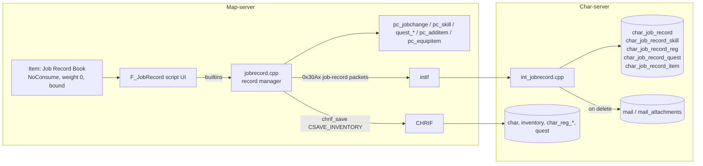

# Job Record System: design v2 (after decisions of 2026-11-08)

> Status: **Design proposal, not implemented.** ✅ = verified in source (with `file:line`) · ⚠️ = inferred · ❓ = unknown.
> Source-level analysis: [character-progression-and-job-records.md](character-progression-and-job-records.md) (the "deep dive"; § numbers below prefixed **DD**). This document replaces the deep dive's §7 (v1 design) and §9 (questions).
> Line numbers are for this checkout and are quoted with the function name.

---

## 1. Decisions

| # | Topic | Decision |
|---|---|---|
| 1 | Base level | **Per record**: base level and base exp are saved for each record. This removes the level-cap conflict in DD §3.1 |
| 2 | Rebirth / baby | A new record is always a **plain Novice**: a reborn or baby character starts again from scratch and has to rebirth again. Rebirth stays allowed. Baby records are allowed |
| 3 | Stats | Each record has its own stats. Switching saves the current record's stats and applies the target's |
| 4 | Job exp | Per record |
| 5 | Equipment | **Each record owns its equipped gear, including costumes ("cash equips").** A new record starts with nothing equipped. Warn when the switch would push weight past the threshold |
| 6 | Free job gear | Once per character, tracked by a variable for each item given. That gear becomes storable |
| 7 | Count / delete / restrictions | 20 by default, unlimited if possible. Records can be deleted, and the deleted record's equipment and costumes are **mailed** back. Switching is blocked only **in combat** and on GvG/WoE maps |
| 8 | Races / jobs | Every job and race. A new record picks **Human (Novice)** or **Doram (Summoner)** |
| 9 | Job quests | Both the Job Master and the official job quests can be used. **Each record keeps its own job-quest progress**, so a new record can do the official quests again |
| 10 | New record base level | **Base level 1**, base exp 0 (decided 2026-11-08) |
| 11 | Blocked maps | In combat, on GvG/WoE maps, **and inside instances** (any time, not only during WoE) |
| 12 | Free-gear guard | **Job Master only.** Official job-quest rewards stay as they are |
| 13 | Weight warning | Follow Renewal: **70%** (`natural_heal_weight_rate`) |
| 14 | Deletion mail | **Never expires** |
| 15 | Hotkeys | **Saved per record** |
| 16 | Cooldown | **30 s** between create / switch / delete, so no action starts while a previous one is still being written or read |

What follows from these decisions:

- Equipment has to be **moved out of the inventory** into a per-record stash. Mailing on delete and the weight warning only make sense that way.
- Quest progress per record covers both **character variables** and **quest-log entries**.
- That puts the work well past a script with one helper (v1). The system becomes a **C++ feature owned by the char-server with its own SQL tables**, plus a script UI.

---

## 2. What the new decisions need from the engine (verified)

### 2.1 Equipment stash: where can items live?

| Option | Verdict | Why |
|---|---|---|
| Character variables (encode each item as ~25 integers) | ❌ | 20 records × ~30 slots × ~25 ints ≈ 15,000 registry rows, all sent at login. Fragile with random options and enchant grade |
| Existing extra storages (`conf/inter_server.yml`) | ❌ | They're **per account** (`storage_fromsql(uint32 account_id, …)`, `src/char/int_storage.cpp:83`) and configured statically, so you can't have one per record |
| Map-server direct SQL (`query_sql` / map SQL handle) | ❌ | Blocks the single-threaded map loop, and it's a second writer next to the char-server, so items could be duplicated or lost |
| **New table owned by the char-server, using the generic item helper** | ✅ recommended | `char_memitemdata_to_sql(items[], max, id, tableswitch, stor_id)` (`src/char/char.cpp:533`) already diff-saves item arrays for inventory, cart, storage and guild storage by `storage_type` (`mmo.hpp:436`). Add a `TABLE_JOB_RECORD` case keyed on `(char_id, record_id)` |

✅ **Save ordering.** `chrif_save` (`src/map/chrif.cpp:277`) puts the inventory (`intif_storage_save`, when `CSAVE_INVENTORY`), the registry (`intif_saveregistry`) and then `mmo_charstatus` (`0x2b01`) into **one send buffer in one call**. If the stash save packet goes into the same buffer right before `chrif_save(sd, CSAVE_INVENTORY)`, the map-server either sends all of them or none of them ⚠️. The char-server still applies them as separate SQL statements, so a **char-server** crash in between could duplicate items. **Mitigation:** on restore, skip any item whose `unique_id` is already in the inventory, and log it. Every inventory item has a `unique_id` (`pc_additem`, `pc.cpp:6062`).

### 2.2 Weight warning

✅ Max weight is rebuilt in `status_calc_weight` (`src/map/status.cpp:3655`):

```
max_weight = job_db.get_maxWeight(job) + STR*300
           + bAddMaxWeight (items) + MC_INCCARRY*2000 + riding 10000 / dragon 5000+2000*lv
           + SC_KNOWLEDGE% + ALL_INCCARRY*2000 + mado 15000
```

Every input except item `bAddMaxWeight` is known from the target record's data: class, STR, and its `MC_INCCARRY`/`ALL_INCCARRY` levels. Mounts are dropped on job change anyway. So a **pre-switch preview** can work out:

`predicted_weight = sd->weight − Σ weight(current equipped) + Σ weight(target stash)` against `predicted_max` (no item bonuses, so the estimate errs on the cautious side).

✅ **Threshold (decision 13):** use `battle_config.natural_heal_weight_rate` directly. It's 70 under `RENEWAL` (`battle.cpp:8391`), and the server uses it for the overweight state (`pc.cpp:3030`). If someone later changes the regen rule, the warning follows automatically. There's no separate setting.

### 2.3 "In combat"

✅ The engine already tracks this: `sd->canlog_tick` is set when the player attacks, casts or gets hit, according to `prevent_logout_trigger: 14` (`conf/battle/player.conf:152`; set in `unit.cpp:2571/2771/3341`, `pc.cpp:9707`). It's checked against `prevent_logout: 10000` ms (`player.conf:143`), as the logout check does (`clif.cpp:2139`). Reuse it: "in combat" means `DIFF_TICK(gettick(), sd->canlog_tick) < job_record_combat_delay` (default = `prevent_logout`).

Map blocks (decision 11): refuse when `map_flag_gvg2(m)` is true (gvg, gvg_castle, gvg_te maps; `map.hpp:1062`), when the `battleground` mapflag is set, or when the map is an instance (`map_getmapdata(m)->instance_id > 0`, field at `map.hpp:849`). This is a static map check, with no WoE-schedule logic, which keeps it simple.

### 2.4 Mail on delete

✅ A rodex message holds `struct item item[MAIL_MAX_ITEM]` with **5 items** on this client (`MAIL_MAX_ITEM 5` for `PACKETVER >= 20150513`, `mmo.hpp:199`; field at `:670`). These are full `struct item`s, so cards, options, refine and grade survive when the mail is built in C++. The script `mail` command doesn't carry enchant grade, expiry or `unique_id` (`buildin_mail`, `script.cpp:26196`), so **delete must run in C++**, ideally on the char-server inside the same transaction that removes the stash rows.

✅ **Mail expiry (decision 14): already handled for system mail.** The return and delete timers (`mail_return_timer` / `mail_delete_timer`, every minute, `char.cpp:3243-3248`) both go through `mail_timer_sub` (`src/char/int_mail.cpp`). Its query does `INNER JOIN char c2 ON c2.char_id = m.send_id`. A mail sent with **`send_id = 0`** has no matching character row, so it's **never selected for return or deletion**, whatever `mail_return_days` / `mail_delete_days` say (`conf/char_athena.conf:287,293`).

So: send deletion mails with `send_id = 0` (sender name "Job Record") and type `MAIL_INBOX_NORMAL`.

⚠️ Cosmetic: the loader `mail_loadmessage` (`int_mail.cpp:163`) still computes `scheduled_deletion = timestamp + mail_return_days` for normal mails (`int_mail.cpp:187-188`), so the client may show an expiry countdown that never happens. One-line fix: also require `send_id != 0` there.

✅ The inbox shows at most `MAIL_MAX_INBOX 30` mails (`mmo.hpp:192`). Further mails stay in the table (`status < 3`) and show up as older ones are cleared, so nothing is lost.

### 2.5 Quest log per record

✅ The runtime quest log is `sd->quest_log` / `num_quests` / `avail_quests` / `save_quest` (`pc.hpp:804-807`). Each entry is `struct quest { quest_id, time, count[MAX_QUEST_OBJECTIVES], state }` (`mmo.hpp:286`). The API is `quest_add` / `quest_delete` / `quest_update_status` / `quest_check` (`src/map/quest.cpp:590/685/849/898`), saved by `intif_quest_save` (`intif.cpp:2123`). Copying whole `struct quest` entries keeps timers and kill counts, which the script commands (`setquest`/`completequest`) can't do.

### 2.6 Which variables count as "job-quest progress"

✅ The 81 job script files loaded from `npc/scripts_jobs.conf` + `npc/re/scripts_jobs.conf` write about 70 permanent character variables and use **433 distinct quest IDs** (`setquest`/`completequest`/`erasequest`/`changequest`). The variables include `KNIGHT_Q`, `KNGT_SK`, `CRUS_Q`, `job_rune_edq`(+`2`,`3`,`_book`), `job_wl`, `job_gen`, `job__mechanic`, `job_kagero`, `nov_3_*`, `ADVJOB`, `SUPNOV_Q`, `EXSUPNOV_Q`, `GUNS_Q`, `NINJ_Q`, `TK_Q`, `STGL_Q`, `SOUL_Q`… (extracted by grep; the list needs curating).

⚠️ **Not all of them are job-only**: `MISC_QUEST` (a bitmask shared with non-job quests), `new_cook`, `xmas_npc`, `sail`, `cart_remodel` and `RESRVPTS` must **not** be swapped. The whitelist has to be curated by hand. Store it as data (§4.4), not code.

Variables the engine itself manages, which must also go per record (DD §4.3): `jobchange_level`, `jobchange_level_3rd`, `jobchange_level_4th` (plus the `sd->change_level_*` cache), the SG feel/hate variables, the Taekwon mission variables and `lastJob` (Job Master rebirth).

### 2.7 Doram (Summoner)

✅ Race comes from the class: `base_status->race = (class_ & MAPID_FIRSTMASK) == MAPID_SUMMONER ? summoner_race : RC_PLAYER_HUMAN` (`status.cpp:3840`), and size likewise (`:3829`). Choosing Doram for a new record is just `pc_jobchange(sd, JOB_SUMMONER, 0)` at job level 1. `pc_jobchange` re-sends `LOOK_HAIR` for the Doram head (`#if PACKETVER >= 20151001`).

❓ Human and Doram hairstyle IDs map to different sprite sets on the client, and the server doesn't check them when the race changes. **Test this.** The safe default is to reset the hairstyle to 1 when the race changes and point the player to the fork's Dress Changer NPC.

### 2.8 Free gear once per character, and storable

✅ Several gifts are `NoStorage` and/or `NoMail`: Hourglass Necklace 490087 and Green Apple Ring 2795 have both. Rune Circlet 5746 is `NoMail` but storable. Plain weapons (Claymore 1163, N_Falchion 13415) have no restrictions. Making them storable means overriding `Trade` in `db/import/item_db.yml`.

⚠️ Side effect: account storage is shared, so other characters on the same account can use the gear. That's acceptable given "once per character", but worth knowing.

Where gifts are handed out: Job Master `Get_Job_Equip` (`npc/custom/jobmaster.txt`, `.GetJobEquip = true` at `:519`) and the official job quests' own `getitem` calls (e.g. `rune_knight.txt:541-542`). Only the Job Master gets the guard (decision 12).

---

## 3. Architecture



### 3.1 SQL (new `sql-files/upgrades/upgrade_YYYYMMDD.sql` + `main.sql`)

| Table | Key | Columns |
|---|---|---|
| `char_job_record` | `(char_id, record_id)` | `name`, `class`, `upper_flag`, `base_level`, `base_exp`, `job_level`, `job_exp`, `status_point`, `skill_point`, `trait_point`, `str`…`luk`, `pow`…`crt`, `chg_2nd`, `chg_3rd`, `chg_4th`, `hair` (for race switches), `created`, `last_used`, `equip_weight`, `equip_count` (cached for the preview) |
| `char_job_record_skill` | `(char_id, record_id, id)` | `lv`, `flag` (0 permanent / 3 granted) |
| `char_job_record_reg` | `(char_id, record_id, key, index)` | `value_num`, `value_str` (whitelisted job-quest variables) |
| `char_job_record_quest` | `(char_id, record_id, quest_id)` | `state`, `time`, `count1..3` (`MAX_QUEST_OBJECTIVES`) |
| `char_job_record_hotkey` | `(char_id, record_id, hotkey)` | `type`, `itemskill_id`, `skill_lvl`. Same shape as the core `hotkey` table (`char.cpp:501`), so it maps 1:1 to `mmo_charstatus.hotkeys[MAX_HOTKEYS_DB]` (`mmo.hpp:611`) (decision 15). On switch, copy the array into the outgoing record, load the incoming one, then send `clif_hotkeys_send(sd, tab)` for each tab (`clif.hpp:952`). A new record starts with an empty bar |
| `char_job_record_item` | `id` (auto), index `(char_id, record_id)` | **Same columns as `inventory`** (nameid, amount, equip, identify, refine, attribute, card0-3, option_id/val/parm 0-4, expire_time, bound, unique_id, enchantgrade…). `equip` keeps the slot so gear can be put back on |

`record_id` is `INT UNSIGNED`, so the **count is unlimited in storage**. The real limits are the summary packet at login and the menu size (§5). Cap it with `max_job_records: 20` (`0` = unlimited).

> Don't add fields to `mmo_charstatus`. All servers must agree on its size (`chrif_authok` refuses a mismatch). Keeping everything in separate tables keeps the core layout untouched (DD §10).

### 3.2 Map-side state

```cpp
// src/map/jobrecord.hpp (new)
struct s_job_record_summary {      // all records, loaded at login (small)
    uint32 record_id; char name[NAME_LENGTH];
    uint16 class_; uint8 upper; uint32 base_level, job_level;
    uint16 str; uint8 inccarry_lv, all_inccarry_lv;
    uint32 equip_weight; uint16 equip_count;
};
struct s_job_record_full;          // one record, loaded on demand: skills, regs, quests, items
// map_session_data gets: std::vector<s_job_record_summary> job_records; uint32 job_record_active;
//                       std::unique_ptr<s_job_record_full> job_record_pending; uint8 job_record_state;
```

> **C++ note.** `std::unique_ptr` owns the pending record, so it's freed automatically when the session ends (`pc_close`/`map_quit`). That avoids a leak if the player logs out while the char-server reply is still on its way.

### 3.3 Inter-server packets (new, in `src/map/intif.cpp` / `src/char/int_jobrecord.cpp`)

| Packet | Direction | Purpose |
|---|---|---|
| `JR_LIST_REQ` / `JR_LIST_ACK` | map→char / char→map | Summaries, sent after `pc_reg_received` |
| `JR_LOAD_REQ` / `JR_LOAD_ACK` | map→char / char→map | Full record k (skills, regs, quests, items) |
| `JR_SAVE` | map→char | Write the outgoing record in full (replace its rows), sent **in the same buffer as** `chrif_save(CSAVE_INVENTORY)` |
| `JR_CLAIM` | map→char | Delete the incoming record's item rows after they've been added to the inventory |
| `JR_DELETE` / `JR_DELETE_ACK` | map→char / char→map | Delete record k. The char-server creates the mails (5 items each) and deletes the rows in **one transaction** |

Other inter-server features (achievements, clans) use the same pattern ([../../architecture/inter-server.md](../../architecture/inter-server.md)). Packet IDs must not collide with the existing `0x30xx` range. Check `doc/packet_interserv.txt`.

---

## 4. Flows

### 4.1 Switch to record K

```mermaid
sequenceDiagram
  participant P as Player
  participant S as F_JobRecord
  participant M as jobrecord.cpp
  participant C as char-server
  P->>S: use item, pick record K
  S->>M: jobrecord_preview(K)
  M->>M: guards: alive, not vending/trading/chat/storage, not casting,<br/>not in combat (canlog_tick), not GvG/BG map
  M->>M: predicted weight % and free inventory slots >= equip_count(K)
  M-->>S: ok / weight% / reason
  S->>P: "Weight will be 63% (warn at 50%). Continue?"
  P->>S: yes
  S->>M: jobrecord_switch(K)
  M->>C: JR_LOAD_REQ(K)
  Note over S: script ends ("Preparing record...")
  C-->>M: JR_LOAD_ACK(K data)
  M->>M: re-check guards (time passed)
  M->>M: snapshot active A: levels, exp, stats, points, skills, change levels, whitelisted vars, job quests, hotkeys
  M->>M: unequip all; move equipped items A → stash(A); delete them from inventory
  M->>C: JR_SAVE(A) + chrif_save(CSAVE_INVENTORY)
  M->>M: clear whitelisted vars and job quests; set base_level = K.base_level (before jobchange: no cap truncation)
  M->>M: pc_jobchange(K.class, K.upper); pc_resetskill; set stats/points/levels/exp; change_level_* (sd + reg)
  M->>M: pc_skill(..., PERMANENT) for each K skill; restore vars + quest_log entries
  M->>M: pc_additem stash(K) (skip duplicate unique_id; drop expired rentals); pc_equipitem to saved slots
  M->>M: pc_calc_skilltree, clif_skillinfoblock, status_calc_pc(SCO_FORCE), pc_inventory_rentals, party/guild refresh
  M->>C: JR_CLAIM(K) + chrif_save(CSAVE_INVENTORY)
  M->>P: "Now playing <name>"
```

Why each ordering choice matters:
- **Set `base_level` before `pc_jobchange`.** `pc_jobchange` truncates the base level to the new job's cap and calls `pc_resetstate` (DD §3.1, `pc.cpp:10923`). Setting the target level first means a 175 → 99 switch never goes through the truncation branch. Set the field directly, not through `pc_setparam(SP_BASELEVEL)`, which hands out status points for levels gained (`pc.cpp:10418`).
- **Run `pc_resetskill` after the job change**, then overwrite `skill_point` (DD §2.3 points 5–6).
- **Write the `change_level_*` cache and its variables before the final `pc_calc_skilltree`** (DD §2.5).
- **Re-equip with `pc_equipitem(sd, idx, saved_pos)`.** It runs `pc_isequip`, so anything the restored job can't wear stays in the inventory (it was wearable when saved, so this should only happen after DB edits).
- **Rentals:** stashed rental items keep their absolute `expire_time`. If it has passed, delete the item on restore. Call `pc_inventory_rentals` to restart the timers.
- **Same class (e.g. Novice record → Novice record):** `pc_jobchange` returns false and does nothing (DD §3.2). The manager must still go through every other step.

### 4.2 Create a new record

1. Guards plus the record cap. Choose **Human** or **Doram**. Ask for the name (`input`, 1–23 characters, no `|`/`:`, unique per character).
2. Snapshot and stash the active record (same as 4.1).
3. Clear the whitelisted job-quest variables and quest-log entries, and set the change levels to 0.
4. `base_level = 1`, `base_exp = 0` (decision 10). Then `pc_jobchange(JOB_NOVICE or JOB_SUMMONER, upper = 0)`. Upper 0 turns transcendent and baby characters into a **plain** Novice (decision 2): `pc_jobchange` removes the +52 transcendent points or resets.
5. `pc_resetskill`, `skill_point = 0`, `pc_resetstate` (recomputes status points for base 1 and sets stats to 1).
6. If the race changed, reset the hairstyle to 1 ❓ (§2.7).
7. Nothing equipped. The new record is saved with `JR_SAVE`, then `chrif_save`.

### 4.3 Delete record K

- You can't delete the active record (switch away first). Ask twice for confirmation.
- `JR_DELETE(K)`. The char-server, in one transaction: builds rodex mails from `char_job_record_item` rows (5 per mail, sender "Job Record", title "Record <name> deleted"), then deletes the record's rows from all 5 tables.
- The map removes it from `sd->job_records` when the ACK arrives.

### 4.4 Job-quest variable whitelist (data, not code)

`db/import/job_record_vars.yml` (new loader, `TypesafeYamlDatabase`):

```yaml
Body:
  - Variable: KNIGHT_Q
  - Variable: KNGT_SK
  - Prefix: job_rune_edq      # matches job_rune_edq, job_rune_edq2, job_rune_edq3, job_rune_edq_book
  - Prefix: nov_3_
  - Variable: ADVJOB
  - Variable: lastJob
  - QuestRange: { From: 3200, To: 3229 }   # Rune Knight
  # … curated from npc/re/jobs/** and npc/jobs/**; NOT MISC_QUEST, new_cook, xmas_npc, sail, cart_remodel, RESRVPTS
```

The engine-managed variables in §2.6 are always included.

### 4.5 Free gear once per character

- A global function `F_JobGearOnce(<item id>{,<amount>})`: `if (getd("JG_" + itemid)) return; getitem …; setd "JG_" + itemid, 1;`. It's a character variable that is **not** whitelisted, so it's shared across records.
- Replace `getitem` in Job Master `Get_Job_Equip` **only** (decision 12). That covers the ~40 `getitem` lines in `npc/custom/jobmaster.txt`. The official job quests are left untouched, so replaying them with a new record gives their rewards again, which is accepted.
- `db/import/item_db.yml`: clear `NoStorage` (and `NoMail` if you like) on those items.

---

## 5. Record limit and "unlimited"

| Limit | Value | Notes |
|---|---|---|
| Storage | unlimited (`INT UNSIGNED` record_id) | |
| Login summary | ~60 bytes/record | A few hundred records fit easily in one packet (`0xFFFF`-byte limit → split above ~1,000) ⚠️ |
| Script menu | `select` builds one string | Paginate at 20 per page; works with any count |
| Stash rows | ~30 items/record | Only loaded for the record being switched to |

Recommendation: `max_job_records: 20` in a new `conf/battle/job_record.conf` (or as a battle config key). `0` means unlimited. That keeps your default and allows unlimited.

---

## 6. Effort estimate

| Part | Files | Size ⚠️ |
|---|---|---|
| SQL tables + upgrade | `sql-files/main.sql`, `sql-files/upgrades/` | ~80 lines |
| Char-server handler | new `src/char/int_jobrecord.{cpp,hpp}`, register in `inter.cpp` parse table, CMake/VS project files | ~500 lines |
| Map-server manager | new `src/map/jobrecord.{cpp,hpp}`, `intif.cpp` packets, `map_session_data` fields, hooks in `pc_reg_received`/`map_quit` | ~900 lines |
| Script builtins | `src/custom/script.inc` / `script_def.inc`: `jobrecord_list`, `jobrecord_preview`, `jobrecord_switch`, `jobrecord_create`, `jobrecord_rename`, `jobrecord_delete` | ~250 lines |
| Whitelist DB loader | `jobrecord.cpp` + `db/job_record_vars.yml` | ~150 lines + curation |
| Script UI + item | `npc/custom/job_record.txt`, `db/import/item_db.yml`, `OnPCLoginEvent` for the bound item (DD §6.1) | ~400 lines |
| Free-gear guard | `npc/other/Global_Functions.txt` (or custom), Job Master, official job quests | ~50 edits |
| **Total** | | **~2,300 lines + data curation.** High effort; nothing in it is impossible |

**Rebuild:** char + map servers. **Merge hazard:** low, since it's mostly new files. The hooks in `pc.cpp`, `intif.cpp`, `inter.cpp` and `pc.hpp` are small ([../../architecture/fork-notes.md](../../architecture/fork-notes.md)).

---

## 7. Risks

| Risk | Severity | Mitigation |
|---|---|---|
| Duplicated/lost items if the char-server crashes between the inventory save and the stash save | High | `unique_id` de-duplication on restore. Log every move to `picklog` (`log_pick_pc` with a new `LOG_TYPE_*`) |
| Skills lost because of stale `change_level_*` | High | Restore in C++ before `pc_calc_skilltree` (DD §2.5) |
| Mail expiry deletes the gear of a deleted record | Resolved | `send_id = 0` mails are never expired (§2.4) |
| A second action starts while the first is still being written or read | High | 30 s cooldown **plus** an in-flight state flag (§8) |
| Whitelist misses a job variable (an official quest gets stuck) or includes a shared one (non-job quest progress breaks) | Medium | Curate it, and test each job line once. The YAML can be fixed without a rebuild (`@reloadjobrecord` builtin) |
| Not enough inventory slots for the incoming gear | Medium | Preview refuses (`pc_inventoryblank(sd) < equip_count`) |
| Player logs out while a `JR_LOAD` is pending | Low | The state machine drops the pending record on `map_quit`. Nothing has changed yet at that point |
| Doram ↔ human hairstyle sprite crash | Low ❓ | Reset hair on race change; test with the 2022-04-06 client |
| Costume or shadow gear in odd slots | Low | `equip` keeps the exact `EQP_*` mask; restore with `pc_equipitem(…, pos)` |
| Equip-switch feature (`equipSwitch` slots) | Low | Clear the equip-switch set on switch ⚠️ (not traced) |

---

## 8. Cooldown and in-flight protection (decision 16)

All questions have been answered (decisions 10–16, 2026-11-08). The only remaining item is the cooldown mechanism. **Chosen: a server-side cooldown in `jobrecord.cpp`, not the item's `Delay`.**

| Option | Why not / why |
|---|---|
| Item `Delay: 30000` in item_db | ❌ Starts on **every** use, even when the player only opens the menu to look at their records or cancels. It doesn't know whether a write is still in flight |
| Script `gettimetick(2)` check | ❌ Can be bypassed by any other script path calling the builtins, and it doesn't see the async char-server round trip |
| **C++ state + timestamp in the record manager** | ✅ Covers every caller (item, NPC, future `@command`). It knows exactly when the char-server ACKs |

Rules:
1. `sd->job_record_state` is `IDLE`, `LOADING` (waiting for `JR_LOAD_ACK`), `APPLYING` or `DELETING`. Every builtin except `jobrecord_list` / `jobrecord_preview` refuses unless the state is `IDLE`. This is the real guard against overlapping reads and writes.
2. The 30 s cooldown starts **when an action completes** (after the final `chrif_save` / `JR_DELETE_ACK`), not when it's requested. A slow char-server reply therefore can't shorten the gap.
3. Store the end time as a permanent character variable (`JR_COOLDOWN`, Unix seconds). Relogging doesn't reset it, and it's never part of the per-record whitelist.
4. Viewing records and renaming them are **not** subject to the cooldown, since they don't move items or switch the job. Rename is a single `JR_RENAME` write.
5. Setting: `job_record_cooldown: 30000` (ms) next to `max_job_records`.
6. If the char-server connection drops while the state is `LOADING`, nothing has been changed yet: reset to `IDLE` when `chrif_on_disconnect` runs. In `APPLYING`, all changes are local to `sd` until the closing `chrif_save`, so the normal save-on-reconnect path (`chrif_check`) applies ⚠️ (to verify during implementation).
